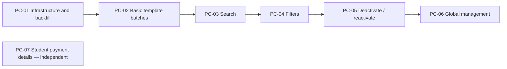

# Payment Codes — Epic Plan

Status: Proposed story definitions · Updated: 2026-11-10

Technical source of truth: `docs/exec-plans/current/epics/payment-codes/edd.md`. UX source: `docs/exec-plans/current/epics/payment-codes/handoff.md`. PC identifiers are local placeholders for Jira stories; this plan does not create issues.

Candidate descriptions are indexed in `docs/exec-plans/current/epics/payment-codes/overview.md` under “Candidate story descriptions.” Each includes the detailed UX requirements and design resources for that production increment.

## Deployment order and dependency graph

Each story is a cohesive production release with its own backend, UI where applicable, authorization, tests, and recovery notes. A story depends only on already deployed predecessors; none requires a future story to make its production state usable. No separate final integration or hardening ticket is assumed.

Arrows are required delivery predecessors for this plan. Search, filters, and actions could technically be developed in parallel after PC-02, but the chosen release order keeps the increments small and makes each story's baseline explicit. PC-07 has no dependency on the batch sequence; schedule it before PC-06 if global management should be the final epic release.

| Story | Depends on | Usable production outcome |
| --- | --- | --- |
| PC-01 | None | Existing interfaces create actual batches; historical codes are all assigned |
| PC-02 | PC-01 | Admins create named batches and browse/download them within a template |
| PC-03 | PC-02 | Admins find template batches and individual codes by text |
| PC-04 | PC-03 | Admins narrow and export template results using combined criteria |
| PC-05 | PC-04 | Admins safely disable and re-enable unused template codes |
| PC-06 | PC-05 | Admins manage all templates from one shared global interface |
| PC-07 | None | Admins see how a student paid for a selected course section |

## PC-01 — Persist batches and backfill historical codes through existing interfaces

**Story:** As an administrator or existing API consumer, I can continue generating codes while the system records each generation request as a durable batch.

**Scope:** Deliver the EDD schema and same-migration backfill, transactional creation service and compatibility adapters, availability enforcement, safe redemption, batch-aware template transfers, and exact-batch support for the existing download workflow. Update all production creation paths. Keep the current visible UI, 500-code limit, API shape, and code encoding.

**Acceptance criteria:**

- The table-creation migration creates one historical batch per resolved template and assigns every existing code-bearing payment, including used and invalidated codes. Codes for inactive templates remain represented; non-code payments are unchanged.
- Historical creator/date are honestly unavailable. Ambiguous ownership is reported and resolved before deployment; no record is silently omitted.
- Every new generation request creates one batch first, followed by all requested child payments in the same transaction. A failed request leaves neither partial codes nor an empty batch. Existing callers still receive their documented results.
- Browser creation records the current admin; API creation records its source. Existing unnamed calls receive a generated batch name. Availability defaults to enabled, and redemption rejects a disabled code even though no availability UI exists yet.
- Concurrent generation/download does not substitute another admin's latest codes. “Download last created” retains its current appearance and text format but uses the exact batch generated by that interaction.
- Explicit template transfers preserve whole batches and metadata; enrollment transfers preserve batch association. Redemption remains value-based and is safe against concurrent use.
- The migration contains explicit `up/0` and `down/0`, and the coordinated writer pause/deployment/reopen procedure is executable and rehearsed.

**Verification/release:** Run migration up/down/up fixtures, Paywall and creation/API/controller regressions, rollback-on-failure and collision tests, transfer tests, and independent-connection redemption races. Rehearse against production-like volume, including the conditional constraint rejecting an old unbatched insert. Verify zero unassigned codes and unchanged payment data before reopening writers. Application recovery retains the schema and pauses incompatible old writers, as described in the EDD. No UI work is needed for this story to ship.

## PC-02 — Deliver basic template batch management with reusable components

**Story:** As an admin, I can create a named code batch, find it in a template's batch table, open its codes, and download it again later.

**Scope:** Deliver the two-level template UI, shared component contracts, batch-aware query/export services, and named creation modal. Search and filter additions are reserved for PC-03/04; existing non-code payment auditing remains accessible.

**Acceptance criteria:**

- The template page shows only its batches with name, current template cost, total/redeemed/unused counts, creation date, creator, and download. Historical batches appear immediately with unavailable metadata labeled correctly.
- Opening a batch shows code, status, redeemed student/date, and redeemed course section; links target the relevant student-in-section profile and course Manage page. Missing associations do not produce broken links.
- The creation modal accepts a nonblank free-form name and integer quantity 1–2,500, allows duplicate names, and records the real admin/time. Validation messages and modal dismissal follow the handoff; invalid inputs and failures preserve entered values.
- Creation is atomic and retry-safe, with pending state, repeated-submit prevention, and success only after the full quantity commits. The resulting batch appears immediately. The legacy API keeps its 500-code contract.
- Tables paginate and navigate back correctly. Batch-row export includes the entire selected batch; detail export includes all current results across pages (all batch codes at this stage).
- Shared batch/code tables, modal, status, and export components accept scope and navigation callbacks. They contain no embedded template-only routing or database access. Template UI is the first consumer of the eventual global implementation.
- Admin authorization applies to reads, creation, and downloads. Empty/loading/error/retry states and baseline accessibility ship with the feature.

**Verification/release:** Test template isolation, forged batch IDs, historical/invalidated states, creation boundaries including 2,500, repeat requests, download completeness, and shared-component navigation. Measure creation latency and historical export memory. Run the repo UI workflow against the template/creation designs. Recovery can restore the earlier template UI while keeping all batches and codes.

## PC-03 — Search template batches and codes

**Story:** As an admin, I can locate a batch by name or payment code without manually opening each batch.

**Acceptance criteria:**

- Batch search matches names and formatted payment codes only within the current template, without duplicate batch rows. Code matching consistently handles case and separators.
- Opening a code-matched result carries the query to detail, shows matching codes, and highlights the matching text safely. A batch-name-only match opens the batch without an irrelevant code restriction.
- Detail search works across the batch, independent of the displayed page. Clearing search restores results; returning restores parent query/page/sort and focus.
- Detail downloads include all search matches across pages, while batch-row downloads always include the whole batch.
- Shared search controls and query services handle pending, no-results, error/retry, and accessible result announcements.

**Verification/release:** Test name/code matches, separator/case behavior, literal wildcard input, duplicate avoidance, cross-template isolation, return state, and export/search equivalence. Measure representative batch/code queries. Ship usable template search; no global route is required. UI rollback leaves stored data untouched.

## PC-04 — Filter template batches and codes

**Story:** As an admin, I can combine search with creation-date, creator, and code-status filters to narrow template results and downloads.

**Acceptance criteria:**

- Batch filters provide creation date range and creator; detail provides status. Include the EDD's compatibility handling for invalidated codes and missing historical metadata.
- Filters combine with search, show active criteria, support Clear all filters, and survive drill-down/back navigation. Changing criteria resets pagination; invalid dates explain the correction without losing input.
- Detail exports use the same combined criteria across all pages. Batch counts retain their full-batch meaning; a code query does not silently redefine total/redeemed/unused.
- Controls are shared components; global template selection can be added without rewriting date/creator/status filtering.
- Empty, invalid, loading, and failed results remain distinguishable and accessible.

**Verification/release:** Test combined criteria, inclusive date boundaries/timezones, unknown historical dates/creators, pagination reset, preserved parent state, and export parity. Ship a complete template filtering increment. UI rollback does not affect payment data.

## PC-05 — Deactivate and reactivate unused template codes

**Story:** As an admin, I can stop an unused code from being redeemed and later make that same code available again.

**Acceptance criteria:**

- Unused codes offer Deactivate with the handoff's confirmation; deactivated codes offer Reactivate. Redeemed codes have a disabled action and visible explanation. Invalidated payments cannot be reactivated through this workflow.
- Only confirmed deactivation changes state; cancel, Escape, and modal close leave the code unchanged. Repeated submits are prevented, failures preserve state and permit retry, and successful actions announce the result.
- Server-side mutations reauthorize the actor/scope and recheck current payment state under lock. Concurrent redemption and deactivation have one valid winner; a stale modal cannot disable a redeemed code.
- Disabled codes fail redemption through every learner entry point. Reactivation preserves code, batch, value, and generation metadata. Neither action revokes already-paid access.
- Counts, status, actions, and filtered results refresh after mutation. If the row disappears under the active filter, focus moves logically. Other sessions obtain current state on reload/navigation; no cross-session real-time synchronization is required.
- Action and confirmation components are reusable in global detail without duplicating state rules.

**Verification/release:** Test role/scope enforcement, stale confirmations, both race orderings, duplicate actions, active-filter disappearance, and student access regressions. Exercise keyboard/focus behavior against the handoff. Deploy only after PC-01-compatible redemption code is on all nodes. Recovery may hide management actions but must retain disabled-code enforcement and stored states.

## PC-06 — Deliver complete global payment-code management

**Story:** As an admin, I can find and manage a payment code across templates from one central interface.

**Scope:** Deliver the complete global surface in one story by composing PC-02–05 services and components. Add global routing/auth, the admin-panel “Manage all Payment Codes” entry, template column/links, and searchable template filter. No new payment model or second set of code-management components.

**Acceptance criteria:**

- The global list shows batches across templates, including historical batches, with all handoff columns. Template links open the appropriate Manage Payments page.
- Batch-name/code search, query-carrying drill-down/highlighting, creation-date and creator filters, the new template selector, and combined criteria work together.
- Global detail uses the existing code table, search/status filters, student/section links, deactivate/reactivate controls, and error/empty states. Returning preserves global criteria and focus.
- Batch-row and detail downloads retain their respective whole-batch and all-matching-results semantics, including unavailable historical metadata.
- Only admins can access global reads/actions/downloads. Supplying global query parameters to a template route cannot broaden its scope.
- Named generation remains template-specific via its Manage Payments page. “Global” changes where admins manage batches, not where codes are valid.

**Verification/release:** Test multi-template fixtures, global/template route transitions, template filter combinations, unauthorized access, mutations, and exports. Demonstrate that both wrappers invoke the same query/export/action services and render the same components. Run global Figma/accessibility verification and representative cross-template query/export measurements. Ship the whole global workflow; recovery removes its entry/routes while template management remains usable.

## PC-07 — Show payment details on the student's course-section profile

**Story:** As an admin supporting a student, I can see the selected section's fee, how the student paid, and the available payment reference.

**Scope:** Independent companion from the UX handoff; uses existing payments/enrollment/provider data and does not require batches.

**Acceptance criteria:**

- Display the section fee as currency, payment method, and payment-code or CASHNet transaction reference when available; identify manually bypassed payment explicitly.
- Distinguish unpaid enrollment, no-fee course, and bypass. Use the existing active-payment rules so invalidated payments are not presented as current payment. Support other existing provider records without mislabeling them as CASHNet.
- Missing references display “Unavailable” while retaining the known method. A query failure displays an error, not “Not paid.” Expose only the reference, never sensitive provider payload/card information.
- Data is scoped to the selected student and section and visible only to authorized admins. Implement the handoff's typography/layout and accessible labels/reading order through the repo UI workflow.

**Verification/release:** Test code, card, bypass, unpaid, no-fee, invalidated, missing-reference, load-error, and unauthorized cases. The profile can ship with the current payment schema. Recovery removes the new presentation without changing payments.

## Completion and handoff coverage

| Handoff feature | Delivery |
| --- | --- |
| Historical codes grouped by template | PC-01 data, PC-02 presentation |
| Batch creation and template two-level management | PC-01 infrastructure, PC-02 UI |
| Search / filtering | PC-03 / PC-04 |
| Deactivate / reactivate | PC-01 enforcement foundation, PC-05 complete workflow |
| Global management | PC-06, reusing PC-02–05 |
| Student profile payment details | PC-07 |
| Enrollment reporting | Excluded; separately scoped follow-up |

Each story must pass relevant automated regressions and its own production smoke checks before its successor ships. UI stories include the applicable handoff accessibility and failure behavior when each control is introduced. Development and QA approvals and required repository checks apply per delivery PR. No changes outside this epic directory are part of this planning task.
