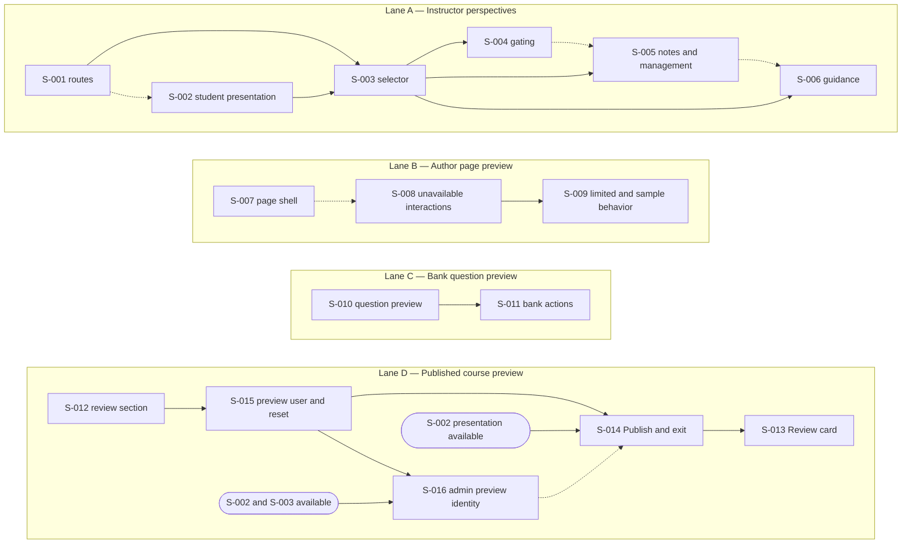

# User Preview November 2026 — Technical product overview

Epic/source: [MER-6158](https://eliterate.atlassian.net/browse/MER-6158) and the existing local overview
Review: Steps 1 and 2 approved; operator ticket review complete; all 16 tickets approved
Filing: verified; 16 Stories, 13 sub-tasks, and 19 dependencies filed; MER-6183 owns the delivery assign rename, and MER-6182 is route-only

## Outcomes and scope

Instructors need to distinguish instructor tools from the student experience, discover the view switcher, switch views without losing their location, and inspect gated content without changing student access. Authors need a current single-page preview, direct bank-question preview, clear preview limitations, and a way to inspect the latest published course without manually building a test section.

The scope covers instructor perspectives and guidance, contextual notes and gated-content inspection, working authoring page and bank-question previews, limitation messages, and a student-only published-course preview from Review and Publish. Existing permissions, authoring preview contracts, and student delivery remain in force. The eleven requirements below describe product outcomes.

Excluded: Publish-table redesign, support for unavailable page-preview activities, display of drafts in full-course preview, changes to student gating through preview bypass, and broader bank editor/filter redesign. Prototype-only behavior is excluded under Q1; the Make prototype remains inaccessible. The handoff’s written guidance criteria support R-009, while its detailed Figma placement still needs visual review during child UI analysis.

### Source evidence

| Source | Evidence and limits |
| --- | --- |
| [MER-6158](https://eliterate.atlassian.net/browse/MER-6158) | Links the handoff, design file, and Make prototype. The epic contains the verified 16 Stories and their 13 sub-tasks. Read-back confirms the intended hierarchy and the preserved original content. |
| [User Preview Overhaul — Design Handoff](https://docs.google.com/document/d/1XrwiN86AETdRxxyoGanQE2pAvl484RHPM6w0prWKk6c/edit) | Defines the eight feature areas, including Instructor Guidance on Switching Views, their acceptance criteria, accessibility requirements, and exclusions. Scope decisions in this overview govern implementation. Embedded Figma chips are not available as usable URLs through the connector. Switcher guidance behavior is supported by the written criteria; its frames require visual review during child UI analysis. |
| [Figma Handoff 2026](https://www.figma.com/design/S8qAFhjjlnRyTHCg2Dyb8p/User-Preview-Overhaul?node-id=484-13117) | The reviewed frames below establish layouts, preview banners, notes, gating states, and Review card states. Static frames do not establish interactive behavior beyond what they depict. |
| [Figma Make prototype](https://www.figma.com/make/gUx8oHNz23gIenz8htAL7C/Check-Prompt-Progress) | Inaccessible and excluded from the evidence base under Q1. Prototype-only interactions are unverified and outside the committed requirements. |
| `AGENTS.md`, `harness.yml`, [docs/ISSUE_TRACKING.md](docs/ISSUE_TRACKING.md) | Repository contracts, small-scope implementation, Jira approval/read-back requirements, and capability defaults. Feature flags, new telemetry, and additional performance requirements default to exclusion. |
| [docs/exec-plans/current/epics/instructor_customizations/instructor_view_shell/prd.md](docs/exec-plans/current/epics/instructor_customizations/instructor_view_shell/prd.md) | Existing MER-5617 scope: basic-page instructor shell, return context, authorization, no learner-progress side effects, and preservation of adaptive preview. Defines the implementation contracts this epic must preserve. |

### Design evidence

All frame links refer to the same User Preview Overhaul file.

| Area | Frames | What they establish |
| --- | --- | --- |
| Instructor/student views | [Instructor Interface](https://www.figma.com/design/S8qAFhjjlnRyTHCg2Dyb8p/User-Preview-Overhaul?node-id=484-14126), [student page](https://www.figma.com/design/S8qAFhjjlnRyTHCg2Dyb8p/User-Preview-Overhaul?node-id=484-14996) | Perspective selector, return action, and student-facing page layout. |
| Gating and notes | [Restricted](https://www.figma.com/design/S8qAFhjjlnRyTHCg2Dyb8p/User-Preview-Overhaul?node-id=484-15826), [bypassed](https://www.figma.com/design/S8qAFhjjlnRyTHCg2Dyb8p/User-Preview-Overhaul?node-id=529-11932), [instructor](https://www.figma.com/design/S8qAFhjjlnRyTHCg2Dyb8p/User-Preview-Overhaul?node-id=484-15942) | Restriction message, reversible bypass, retained explanation, example bank-selection note, and settings links. |
| Author page preview | [Page preview](https://www.figma.com/design/S8qAFhjjlnRyTHCg2Dyb8p/User-Preview-Overhaul?node-id=484-13987) | Student page styling without course navigation and a persistent exit banner. The banner label is Page Preview (Q7). |
| Author bank preview | [Bank controls](https://www.figma.com/design/S8qAFhjjlnRyTHCg2Dyb8p/User-Preview-Overhaul?node-id=534-12632), [standalone question](https://www.figma.com/design/S8qAFhjjlnRyTHCg2Dyb8p/User-Preview-Overhaul?node-id=484-13190) | Per-question Preview action, surrounding action styling, and isolated question with exit banner. Q5 excludes broader editor/filter redesign; Q7 names the banner Question Preview. |
| Preview limitations | [Information tooltip](https://www.figma.com/design/S8qAFhjjlnRyTHCg2Dyb8p/User-Preview-Overhaul?node-id=484-13208) | Indicator near affected content with explanatory text. The handoff supplies more specific messages. |
| Published course preview | [Never published](https://www.figma.com/design/S8qAFhjjlnRyTHCg2Dyb8p/User-Preview-Overhaul?node-id=546-53431), [published](https://www.figma.com/design/S8qAFhjjlnRyTHCg2Dyb8p/User-Preview-Overhaul?node-id=545-51964), [draft changes](https://www.figma.com/design/S8qAFhjjlnRyTHCg2Dyb8p/User-Preview-Overhaul?node-id=546-54200), [existing template](https://www.figma.com/design/S8qAFhjjlnRyTHCg2Dyb8p/User-Preview-Overhaul?node-id=553-14997), [Learn](https://www.figma.com/design/S8qAFhjjlnRyTHCg2Dyb8p/User-Preview-Overhaul?node-id=563-30474) | Review card states, version/draft notices, course navigation, and primary exit action. Perspective switching is not shown in these course-preview frames; see Q2. |

### Agreed terminology

| Context | Visible label |
| --- | --- |
| Working authoring page | Page Preview |
| Individual bank question | Question Preview |
| Published course | Full Course Preview |
| Instructor perspective selector | Instructor View / Student Preview |

Follow the designs and use ordinary sentence casing for buttons changed by this epic: Page preview, Preview page, Show restricted view, Open full course preview, Preview published course, Go to Publish, View revision, and Edit title. Retain Publish as the name of the destination page. Preserve ordinary sentence casing in explanatory messages. The table names the preview contexts; button labels use sentence casing (Q7). Unrelated UI is outside scope.

### Requirement sources

These source citations support the requirement IDs and are included in the Technical Product Overview appended to the epic ticket. Preserve non-ticket citations as plain text or inline code; use Jira issue URLs for ticket hyperlinks.

- **R-001: Switch instructor perspectives without losing context:** [MER-6158](https://eliterate.atlassian.net/browse/MER-6158), [Design Handoff](https://docs.google.com/document/d/1XrwiN86AETdRxxyoGanQE2pAvl484RHPM6w0prWKk6c/edit), [instructor frame](https://www.figma.com/design/S8qAFhjjlnRyTHCg2Dyb8p/User-Preview-Overhaul?node-id=484-14126), [student frame](https://www.figma.com/design/S8qAFhjjlnRyTHCg2Dyb8p/User-Preview-Overhaul?node-id=484-14996); Q4, Q7, Q8 below.
- **R-002: Explain instructor preview content:** [Design Handoff](https://docs.google.com/document/d/1XrwiN86AETdRxxyoGanQE2pAvl484RHPM6w0prWKk6c/edit), [bank-selection note](https://www.figma.com/design/S8qAFhjjlnRyTHCg2Dyb8p/User-Preview-Overhaul?node-id=529-11932); Q7 below.
- **R-003: Inspect restricted content without changing access:** [Design Handoff](https://docs.google.com/document/d/1XrwiN86AETdRxxyoGanQE2pAvl484RHPM6w0prWKk6c/edit), [restricted](https://www.figma.com/design/S8qAFhjjlnRyTHCg2Dyb8p/User-Preview-Overhaul?node-id=484-15826), [bypassed](https://www.figma.com/design/S8qAFhjjlnRyTHCg2Dyb8p/User-Preview-Overhaul?node-id=529-11932), and [instructor](https://www.figma.com/design/S8qAFhjjlnRyTHCg2Dyb8p/User-Preview-Overhaul?node-id=484-15942) frames; Q8 below.
- **R-004: Preview a working authoring page:** [Design Handoff](https://docs.google.com/document/d/1XrwiN86AETdRxxyoGanQE2pAvl484RHPM6w0prWKk6c/edit), [page-preview frame](https://www.figma.com/design/S8qAFhjjlnRyTHCg2Dyb8p/User-Preview-Overhaul?node-id=484-13987); Q7 below.
- **R-005: Preview a bank question in isolation:** [Design Handoff](https://docs.google.com/document/d/1XrwiN86AETdRxxyoGanQE2pAvl484RHPM6w0prWKk6c/edit), [bank controls](https://www.figma.com/design/S8qAFhjjlnRyTHCg2Dyb8p/User-Preview-Overhaul?node-id=534-12632) and [standalone question](https://www.figma.com/design/S8qAFhjjlnRyTHCg2Dyb8p/User-Preview-Overhaul?node-id=484-13190) frames; Q5, Q7 below.
- **R-006: Explain verified page-preview limitations:** [Design Handoff](https://docs.google.com/document/d/1XrwiN86AETdRxxyoGanQE2pAvl484RHPM6w0prWKk6c/edit), [information-tooltip frame](https://www.figma.com/design/S8qAFhjjlnRyTHCg2Dyb8p/User-Preview-Overhaul?node-id=484-13208); Q6 below.
- **R-007: Preview the latest published course:** [Design Handoff](https://docs.google.com/document/d/1XrwiN86AETdRxxyoGanQE2pAvl484RHPM6w0prWKk6c/edit), [Review states](https://www.figma.com/design/S8qAFhjjlnRyTHCg2Dyb8p/User-Preview-Overhaul?node-id=546-53431), [template preview](https://www.figma.com/design/S8qAFhjjlnRyTHCg2Dyb8p/User-Preview-Overhaul?node-id=553-14997), and [Learn](https://www.figma.com/design/S8qAFhjjlnRyTHCg2Dyb8p/User-Preview-Overhaul?node-id=563-30474) frames; Q2, Q3, Q7, Q10 below.
- **R-008: Keep preview controls accessible and authorized:** [Design Handoff](https://docs.google.com/document/d/1XrwiN86AETdRxxyoGanQE2pAvl484RHPM6w0prWKk6c/edit), [MER-6158](https://eliterate.atlassian.net/browse/MER-6158), [AGENTS.md](AGENTS.md); Q4, Q7, Q8 below.
- **R-009: Guide first-time instructors to the view switcher:** [Design Handoff](https://docs.google.com/document/d/1XrwiN86AETdRxxyoGanQE2pAvl484RHPM6w0prWKk6c/edit), Instructor Guidance on Switching Views criteria; Q4, Q8 below. Guidance-frame visual placement awaits child UI analysis.
- **R-010: Manage and reset the author-linked preview user:** Operator requirement for Reset Preview User in author account settings and queryable preview records.
- **R-011: Identify preview users and sections:** Operator requirement for preview-user reset and later cleanup identification.

## Product requirements

### R-001: Switch instructor perspectives without losing context

- Preview entry from course content, Customize Content, or Manage exposes a selector labeled with the active perspective. Confirm concrete entry-point mappings against existing routes during child analysis; the handoff's names do not exactly match the current return-context labels.
- Switching perspective preserves the current course page. Navigating or switching does not replace the original Return to [origin] destination.
- Student delivery and instructor Student Preview share the existing non-prefixed course routes, including `/sections/:section_slug/lesson/:revision_slug`; both render a student view of the materials. Instructor View uses `/sections/:section_slug/instructor/...`, replacing the existing `/preview/...` prefix across lesson, Learn, container, and adaptive-page routes. Switching perspectives preserves the resource and original return context. Course links in Student Preview stay on ordinary delivery URLs; Instructor View links retain `/instructor/...` (Q8).
- Instructor View and Student Preview are available to instructors in the requested section and authors with an admin role. Admin authorization does not require a preexisting instructor enrollment; provision the dedicated preview user’s section instructor enrollment after authorization. An instructor role in another section alone does not grant access. Keep actual user/author identity and roles for authorization while explicitly applying student presentation in Student Preview; ordinary students receive no instructor selector or controls. Preserve separate author Page Preview, Question Preview, and Full Course Preview routes and behavior, including existing template-preview sessions. Student Preview uses existing persistent attempt/progress storage. Regular instructors use their own user; admin section previews use the same dedicated author-linked preview user as project Full Course Preview. After checking actual-admin authorization, ensure an instructor enrollment for that preview user in the requested section. Switching perspective changes route-derived presentation, not user or enrollment roles. Generated enrollment alone cannot authorize an admin preview without its current owning admin author. There is no automatic reset (Q9/Q13).
- Return takes the user to that original location. Existing safe-return validation and fallback behavior remain intact.
- Hide the instructor preview header and perspective selector while managing an activity-bank selection because there is no equivalent student view. Retain a local back control to the containing course page. Returning restores the header and selector, with focus on the opener or a logical fallback (Q4).
- The selector exposes its accessible name, current choice, and expanded state; supports keyboard operation and Escape; and restores focus to its trigger when dismissed. View changes are announced. Switching retains selector focus when available.

### R-002: Explain instructor preview content

- In authorized instructor/admin Student Preview, show a nearby note labeled Instructor preview note for activity-bank selections. Explain that the displayed question is an example of what students may receive and identify any instructor-only action in its applicable perspective. The note label names its audience, not the active perspective. Keep unrelated content free of the note; do not copy Instructor View management controls into Student Preview.
- Notes follow reading order, are programmatically labeled, and do not take focus or announce as alerts. Interactive actions have descriptive names and visible focus. Actual learners receive neither the notes nor instructor-only controls in visible markup or the accessibility tree. Authorized instructor/admin Student Preview uses ordinary delivery URLs and must still show the note; separate author-preview contexts remain excluded.

### R-003: Inspect restricted content without changing access

- Restricted Student Preview shows the student restriction message and an Instructor preview note with Preview page. Activating it reveals content and changes the action to Show restricted view; activating that restores the restriction message. Keep focus on the toggle, prevent hidden content from retaining focus, and announce the state change.
- Instructor View shows an informational banner linking to Assessment settings and Advanced gating tool. The bypass applies only to the instructor preview: it grants no student access, changes no gating settings, and completes no prerequisites. Students never receive the bypass or notes.

### R-004: Preview a working authoring page

- The page editor’s secondary Page preview button opens the working page in current student styling, with a sticky Page Preview banner and exit action. Exit returns to the originating authoring page and restores focus to its preview action.
- Authoring page preview must reuse the page-delivery layouts, views, and shared presentation components so delivery design and UX changes are reflected in preview through the same implementation. Accept explicit preview context and assigns instead of requiring a database-backed learner user to render those surfaces. Keep authenticated-author/project authorization separate from presentation. Preview-specific wrappers may supply the banner, activity bridge, and capability restrictions, but must not duplicate the delivery page UI. This applies to basic and advanced page previews.
- Exclude previous/next navigation, course back navigation, the course outline, DOT, and instructor notes. Keep the banner usable on long pages, narrow screens, and at increased zoom.

### R-005: Preview a bank question in isolation

- Each bank question has a secondary Preview button that opens only that question in student styling, under a sticky Question Preview banner with exit. No course-page placement is required.
- Exit preserves bank search, filters, list position, and focus on the selected question’s Preview button. Preview does not modify the question.
- Edit, Copy, View revision, and Edit title adopt consistent design-system controls without changing behavior or permissions. Repeated controls identify their question; decorative icons are hidden from assistive technology. Broader editor and filter redesign remains outside this epic (Q5).

### R-006: Explain verified page-preview limitations

All nine content types below are in scope (Q6). Embedded-activity failure messaging is conditional, and alternatives retain their strategy-specific explanations. Static code findings support these distinctions; targeted author-page runtime verification is required before implementation acceptance.

| Content | Required message/behavior |
| --- | --- |
| LTI external tool | You cannot interact with this tool in page preview. |
| File upload | File uploads are not available in page preview. |
| Directed discussion | Posting to discussions is not available in page preview. |
| Logic Lab | You can open this lab in page preview, but scores are not recorded. |
| Activity reports | This is sample data. Actual activity reports are not available in page preview. |
| OLI embedded activities | If a preview session cannot be created: Preview is not available for this activity. |
| Surveys | After submitting this survey in page preview, you cannot reset it here. |
| Alternatives | Preserve the existing strategy-specific explanation of the tabs or preference selector and how the configured policy selects content for students. Do not replace it with the handoff's generic all-alternatives message. |
| Page collaborative spaces | Labeled placeholder: Collaborative spaces are not available in page preview. |

- Put an information trigger beside affected content or its placeholder. Distinguish unavailable content, limited interaction, and sample data. Do not mark ordinary working scored activities unsupported or block review of the rest of the page.
- The trigger is a keyboard-focusable button with a descriptive name and `aria-describedby`. The tooltip opens on focus or hover, remains visible while focused/hovered unless dismissed, and closes with Escape without moving focus. Tooltips contain no interactive controls.
- Placeholders stay in normal reading order. Preserve supported evaluation, reset, hint, and embedded-preview behavior rather than disabling it to match a generic warning.
- Verify all nine types in authoring page preview before implementation acceptance, including supported interactions and embedded-session failure. This scope communicates limitations; it does not add support for unavailable functionality. Any runtime finding that requires a product-scope change returns for a decision.

### R-007: Preview the latest published course

| Project state | Review card | Actions |
| --- | --- | --- |
| Never published | Explain that publication is required. | Go to Publish |
| Published without draft changes | Identify the version and explain that published content is used. | Open full course preview |
| Published with draft changes | Identify the version and count excluded draft changes. | Primary Open full course preview; secondary Go to Publish |

- Preserve automated review, existing review behavior, and the chart while updating the Review layout.
- Both Review and the new Preview published course action beside the latest Publish version use the same launch operation. Publish-triggered updates maintain the review section; launch opens Learn only when the latest update is complete and the section is current. Pending or failed updates show their state instead of opening stale/partial content; launch itself performs no refresh. This promise applies to the section publication; existing in-progress graded attempts may continue to display their retained older revisions under the normal attempt lifecycle (Q10). Draft content is excluded. Preserve the existing Publish table.
- Base course navigation on the existing template-preview experience, with a Full Course Preview banner and a primary Exit preview button. Open project Full Course Preview in a new tab and leave the authoring tab open. Exit preview closes the preview tab; assume closure succeeds. Do not track an origin-specific return destination or add a fallback redirect. Author full-course preview is student-only and has no perspective selector. Full Course Preview has no dependency on the R-001 perspective selector (Q2).
- Publication details and draft counts are readable text, not color-only signals. Associate the card heading programmatically. Keep navigation and the tab-closing Exit preview action keyboard accessible. Announce dynamic card updates without stealing focus and communicate that launch opens a new tab.
- Reuse one dedicated review section per project. Create it from the latest publication on first launch if absent. Every subsequent successful Publish automatically schedules its update, independently of optional pushes to other sections. Check readiness before launch; do not refresh an existing section during launch. Use the author’s project-preview identity under R-010, preserving normal-use progress. The review section remains shared and a section update/reset may affect other open previews. Q11/Q13 require one dedicated author-linked preview user created on first supported use; legacy product/template identity behavior stays separate. No automatic reset or per-author section allocation is included (Q3); author preview-user reset is defined separately in R-010.
- For project Full Course Preview sections only, a failed update response includes a Reset Preview button for authorized regular project authors and admins. Reset creates a new section from the latest publication and replaces the project association. Fresh attempts/progress follow naturally from creating the new section; no explicit progress-clearing operation is required. Explain that the shared preview restarts with fresh progress and other open previews may be affected. Enforce failed state and project ownership server-side; ordinary delivery and product/template preview sections are excluded. Concurrent resets, publishing, and obsolete update jobs must not corrupt the replacement. Failed recreation must not expose a partial section.

### R-008: Keep preview controls accessible and authorized

All changed controls, notes, navigation, and tooltips must support keyboard operation, visible focus, descriptive accessible names, screen-reader state, and reflow at narrow widths and increased zoom. Instructors in the requested section and authors with an admin role may access instructor perspectives; ordinary students and users without those permissions must not receive instructor controls or notes. Keep existing project authorization for author previews and preserve safe return destinations. Each preview-specific requirement above adds its relevant focus, announcement, and failure behavior.

### R-009: Guide first-time instructors to the view switcher

- On the first entry to Instructor View after this feature releases, show a dismissible callout anchored to the instructor view dropdown and highlight the dropdown. Show the exact message: “Switch between instructor view and student preview.” The guidance belongs to Instructor View where the selector is present; do not show it in bank-selection management, which hides the selector under Q4, or in author previews.
- Provide a clearly labeled, keyboard-accessible dismiss control with an accessible name such as “Dismiss preview guidance.” Dismissal removes both the callout message and the dropdown highlight. The dropdown remains usable while the guidance is visible.
- Save dismissal only on the instructor/user preference record, including the admin’s author-linked preview user when active. It follows the same user record across courses, sessions, and devices; a replacement preview user naturally starts with its own preferences. Add no author-account preference or separate per-admin dismissal mapping. Merely displaying the callout is not dismissal.
- Escape dismisses when focus is within the callout. Make the message available to screen readers without automatically moving focus. Keep focus visible and unobscured; if dismissal removes the focused control, move focus to the instructor view dropdown.
- The written criteria define guidance behavior. Detailed placement and styling require review of the guidance Figma frame during child UI analysis. The handoff specifies no additional technical constraints for this feature.

### R-010: Manage and reset the author-linked preview user

- Author account details/settings provide Reset Preview User. An authenticated author can create and link a fresh preview user to their own author account, independently of any project preview section’s update status.
- Future project Full Course Preview launches and authorized admin section previews use the author’s same currently linked preview user. Replacing the user naturally provides fresh progress in those sections; do not clear or delete attempts/progress explicitly and do not recreate shared sections for this action.
- Keep this preview association distinct from normal learner/SSO account links. Preserve actual author and learner accounts, ordinary course progress, project authorization, and separate author Page Preview/Question Preview behavior. Another author’s preview-user association must not be changed.
- Mark newly generated and superseded preview users so they remain identifiable by database query (R-011). Do not delete old preview users as part of reset; cleanup is outside scope.
- Always use a dedicated author-linked preview user for project Full Course Preview and admin section preview. Whichever supported preview entry is used first creates it if absent; reuse it across projects/authorized admin sections and replace it only on explicit Reset Preview User. Failed provisioning does not fall back to a real learner or shared section-hidden identity (Q11/Q13).

### R-011: Identify preview users and sections

- Persist explicit database markers distinguishing generated preview users and dedicated project preview sections from real user accounts, ordinary delivery sections, and reusable product/templates. Names, current associations, or the generic hidden flag alone are insufficient identifiers.
- Set markers when creating preview records and retain them on superseded users and reset-retired sections. If existing preview-only records are adopted, classify them only from verified purpose/ownership. Querying does not depend on the record still being the current author/project association.
- Keep identification simple: direct database queries must return preview users and preview sections, including superseded records. Concrete fields and query examples belong in the implementation; a durable users.preview_purpose value and sections.is_preview flag are proposed approaches. User classification must distinguish current and superseded author-owned preview users from legacy shared identities, so remaining shared fallback queries cannot select them.
- Cleanup jobs, deletion, retention policies, and cleanup UI are outside scope.

### Requirement interpretations

These approved interpretations define the preview boundaries referenced by requirement and ticket criteria.

| ID | Interpretation |
| --- | --- |
| Q1 | Use the written handoff, static designs, and repository evidence. The inaccessible Make prototype supplies no committed requirements; do not infer prototype-only interactions. |
| Q2 | Author Full Course Preview is student-only, with no instructor perspective or selector. Instructor perspective switching is scoped to R-001; R-007 does not depend on it. |
| Q3 | Reuse one dedicated review section per project, create it from the latest publication when first needed, and automatically update it on Publish. Launch checks current/complete state, reporting pending/failed updates without refreshing. Preserve normal-use progress for the selected author-linked preview user. No automatic reset. R-010 adds a dedicated author-linked preview user created on first use and replaced by explicit Reset Preview User. Explicit Reset Preview is available for a failed project preview to authorized regular authors and admins; it creates a fresh section without retained attempts/progress. Normal use preserves the current author-linked preview user’s progress and retained attempt revisions; updates or reset may affect open previews. |
| Q4 | Hide the instructor preview header and selector in activity-bank selection management. Keep local back navigation that restores the containing page’s header, selector, and focus on the opener or a logical fallback. |
| Q5 | Limit bank UI work to Preview and design-system controls for Edit, Copy, View revision, and Edit title. Broader question-editor and filter redesign is outside this epic. |
| Q6 | Cover all nine R-006 content types. Show embedded-activity unavailability only on preview-session failure; retain strategy-specific alternatives explanations and supported interactions. Verify all nine types in author-page context before implementation acceptance. |
| Q7 | Use Page Preview, Question Preview, and Full Course Preview for the respective preview contexts, and Instructor View / Student Preview for the selector. Follow the designs and use ordinary sentence casing on buttons. Unrelated UI is outside scope. |
| Q8 | Student delivery and instructor Student Preview share ordinary course URLs and render student materials. Instructor View uses `/sections/:section_slug/instructor/...`; legacy `/preview/...` links redirect there. Both views allow section instructors and admin authors; actual-admin authorization needs no preexisting enrollment, and the generated preview user receives section instructor enrollment after authorization. Preserve actual identities/roles and separate author preview behavior. The related delivery must cover navigation, authorization, and regression checks. |
| Q9 | Student Preview keeps persistent attempts/progress. Regular instructors use their own user. Admin section previews use S-015’s author-linked preview user under actual-admin authorization and section instructor enrollment, replacing the shared hidden-user fallback. The route toggle does not switch users/roles; no automatic reset. Reset Preview User naturally supplies fresh progress on subsequent project/admin previews. |
| Q10 | Latest published means the review section uses the latest publication. Existing in-progress graded attempts may display their retained older revisions under the normal lifecycle. Preserve attempts and progress during normal updates with no automatic reset; explicit failed-state Reset Preview creates a fresh section. |
| Q11 | Always use one dedicated author-linked preview user for project Full Course Preview and authorized admin section previews. Create/link it lazily on the first supported use, reuse it across those contexts, and replace it through explicit Reset Preview User. Preserve ordinary learner/SSO links; provisioning failure does not fall back to real learner or shared section-hidden identities. |
| Q12 | Project Full Course Preview opens in a new tab. The primary Exit preview action closes that tab and assumes success. Keep the authoring tab open; omit origin-specific return destinations, return redirects, and close-failure fallbacks. Preserve authentication and reusable preview records. |
| Q13 | Reuse S-015’s author-linked preview user for admin section previews, replacing affected shared-admin fallback paths. Ensure section instructor enrollment after owning-admin authorization; toggling changes presentation, not identity/roles. Preserve regular instructors and project Full Course Preview’s student-only shell. Reset Preview User also starts fresh admin-preview progress; exclude all current/superseded author-owned users from legacy shared fallback. |

## Technical approach

Use the route family to derive section-delivery presentation and navigation mode. S-002 owns renaming the existing delivery presentation assign from `preview_mode` to `instructor_view` and updating its producers/consumers alongside student presentation. S-001 remains responsible for the route-prefix migration and redirects. This naming change is presentation-only and preserves separate author/template/activity preview contracts and actual-role authorization. The assign rename and its criteria are filed under MER-6183; MER-6182 retains route-only scope. Instructor View uses instructor routes; Student Preview uses ordinary delivery routes. Keep actual authorization roles separate and preserve explicit author-template contexts. Original-return information still propagates independently; no additional perspective preference is proposed.

### Observed repository behavior

| Area | Current implementation and consequence |
| --- | --- |
| Instructor shell | [lib/oli_web/components/delivery/layouts.ex](lib/oli_web/components/delivery/layouts.ex) renders a static Instructor view label and return action. [lib/oli_web/live/delivery/instructor/preview_lesson_live.ex](lib/oli_web/live/delivery/instructor/preview_lesson_live.ex) owns the basic-page shell. Add perspective selection to this existing surface rather than introduce a second independent instructor shell. |
| Ordinary instructor delivery | Ordinary lesson routes currently mount `Delivery.Student.LessonLive` for enrolled instructors as well as students. [lib/oli_web/live_session_plugs/init_page.ex](lib/oli_web/live_session_plugs/init_page.ex) initializes learner page context, and [lib/oli/delivery/page/page_context.ex](lib/oli/delivery/page/page_context.ex) tracks access and invokes the attempt lifecycle. Content audience and notes still recognize the instructor role. Q8 keeps these URLs for student presentation and requires instructor Student Preview to suppress instructor-only material without changing the user’s actual enrollment role. |
| Student Preview gaps | Ordinary delivery already renders page content in delivery mode and persists attempts for the current user. [lib/oli_web/live/delivery/student/lesson_live.ex](lib/oli_web/live/delivery/student/lesson_live.ex) derives `is_instructor` from the actual section role; the annotation panel then hides My Notes and selects Class Notes. Class Notes itself is also available to learners and must remain in Student Preview. [lib/oli_web/live_session_plugs/set_preview_mode.ex](lib/oli_web/live_session_plugs/set_preview_mode.ex) derives preview mode from a `:preview` live action, which ordinary lesson routes do not use. An admin author with a user account already passes the delivery enrollment checks; an admin without a user account needs a user identity for `PageContext.create_for_visit/4`. [lib/oli_web/controllers/products_controller.ex](lib/oli_web/controllers/products_controller.ex) already logs in a hidden instructor for template preview on ordinary delivery URLs. S-002 supplies student presentation and owns the delivery assign rename; S-016 integrates the author-linked admin preview identity using these existing mechanisms. |
| Instructor routes | [lib/oli_web/router.ex](lib/oli_web/router.ex) and [lib/oli_web/delivery/instructor/preview_routes.ex](lib/oli_web/delivery/instructor/preview_routes.ex) currently use `/sections/:section_slug/preview/...` for Instructor View. Q8 renames that prefix to `/instructor/...`; Student Preview uses ordinary delivery URLs. Update helpers, generated links, and authorization redirects together. Legacy `/preview/...` links redirect to the corresponding Instructor View route under the same authorization checks for section instructors and admin authors; they do not define a separate Student Preview route family. |
| Return navigation | [lib/oli_web/delivery/instructor/preview_return.ex](lib/oli_web/delivery/instructor/preview_return.ex) resolves Customize Content, Assessment Settings, and Overview, sanitizes destinations, and falls back to section remix. `lib/oli_web/delivery/instructor/preview_routes.ex` and existing preview pages propagate navigation state. Preserve these contracts across perspective switches; derive presentation and navigation mode from the route family. |
| Bank management | [lib/oli_web/live/delivery/instructor/bank_selection_manager_live.ex](lib/oli_web/live/delivery/instructor/bank_selection_manager_live.ex) currently renders the instructor header and a local back path. Hide the instructor preview header and perspective selector here; retain local back navigation and restore the containing page’s header and focus on return (Q4). |
| Preview side effects | [lib/oli_web/delivery/instructor/preview_page_context.ex](lib/oli_web/delivery/instructor/preview_page_context.ex) builds basic-page instructor content without learner visits, attempts, submissions, scoring records, or progress events. Preserve that existing basic-page contract. It is distinct from a template launch into student delivery. |
| Authorization | [lib/oli_web/plugs/authorize_section_preview.ex](lib/oli_web/plugs/authorize_section_preview.ex) currently permits section instructors or admins, redirects enrolled students to delivery, and rejects other unauthorized access. Q8 preserves access for instructors in the requested section and authors with an admin role, and requires both Instructor View and Student Preview to support those actors. Other existing permissions, including author full-course project authorization, remain unchanged. |
| Author page rendering | [lib/oli_web/controllers/resource_controller.ex](lib/oli_web/controllers/resource_controller.ex) resolves the working publication and supplies activity-bank selections. [lib/oli_web/templates/resource/page_preview.html.heex](lib/oli_web/templates/resource/page_preview.html.heex) still has a Preview Mode message, window-close exit, and previous/next navigation. Reuse shared delivery layouts/views with explicit preview context and assigns, retaining working-draft semantics and selection-error feedback without requiring a learner account. Adapt both basic and advanced preview paths; thin preview adapters must not duplicate delivery presentation. |
| Activity preview evaluation | [assets/src/phoenix/activity_bridge.ts](assets/src/phoenix/activity_bridge.ts) handles author-preview evaluation, reset, hints, and client evaluations. [assets/src/data/persistence/activity.ts](assets/src/data/persistence/activity.ts) sends evaluation to `/project/test/evaluate`. Do not assume the instructor's read-only activity presentation and the author's interactive page preview are interchangeable. |
| Full-course launch | [lib/oli/delivery/template_preview.ex](lib/oli/delivery/template_preview.ex) currently accepts an active blueprint and authorizes its author/admin. It uses an existing user with student enrollment or a hidden instructor identity. [lib/oli_web/controllers/products_controller.ex](lib/oli_web/controllers/products_controller.ex) sets preview session/return state and launches the section root. This is reusable groundwork, but does not by itself establish a dedicated latest-publication review section for an arbitrary project. |
| Publication and Review UI | [lib/oli_web/live/projects/publish_view.ex](lib/oli_web/live/projects/publish_view.ex) already loads the latest/working publications and computes their diff. [lib/oli_web/live/qa/qa_live.ex](lib/oli_web/live/qa/qa_live.ex) owns automated review and its display. Reuse those publication semantics and preserve review functions when adding the card and launch actions. |
| Saved dismissal | [lib/oli/accounts.ex](lib/oli/accounts.ex) provides persisted `get_user_preference` and `set_user_preference` operations. [lib/oli/accounts/schemas/user_preferences.ex](lib/oli/accounts/schemas/user_preferences.ex) defines the embedded preference fields, including a dismissed instructor warning; [lib/oli_web/live/sections/assessment_settings/settings_live.ex](lib/oli_web/live/sections/assessment_settings/settings_live.ex) uses that preference. R-009 can reuse this account-level pattern with a dedicated guidance preference. |

Q8 keeps ordinary delivery URLs for students and instructor Student Preview, with Instructor View isolated under its own prefix. Student Preview needs explicit student presentation across audience filtering, notes, activity rendering, and gating; hiding instructor controls alone is insufficient. Real students must not receive instructor preview controls, notes, or gating bypasses. Existing author template-preview behavior remains separate. These findings come from code inspection, not runtime verification. Q9 retains ordinary persistent attempt and progress behavior for Student Preview. An admin author without a user account uses the existing hidden instructor identity, subject to validating its route and enrollment wiring during child analysis.

### Preliminary verification of limitation claims

- LTI has an explicit `author_preview` noninteractive branch in [assets/src/components/activities/lti_external_tool/LTIExternalToolDelivery.tsx](assets/src/components/activities/lti_external_tool/LTIExternalToolDelivery.tsx) with an existing warning. Activity reports use sample data in [lib/oli/rendering/report/html.ex](lib/oli/rendering/report/html.ex).
- OLI embedded activities attempt to create preview sessions in [assets/src/components/activities/oli_embedded/OliEmbeddedDelivery.tsx](assets/src/components/activities/oli_embedded/OliEmbeddedDelivery.tsx); unavailable messaging must be conditional, not a blanket unsupported label.
- Alternatives already have tabs or a preference selector plus strategy-specific explanations in [lib/oli/rendering/alternatives.ex](lib/oli/rendering/alternatives.ex) and [lib/oli/rendering/alternatives/html.ex](lib/oli/rendering/alternatives/html.ex). The generic all-alternatives message should not erase those distinctions.
- Surveys: [lib/oli/authoring/editing/page_editor.ex](lib/oli/authoring/editing/page_editor.ex) builds the author-preview context without overriding the empty `resettable_surveys` default in [lib/oli/rendering/context.ex](lib/oli/rendering/context.ex). [lib/oli/rendering/survey/html.ex](lib/oli/rendering/survey/html.ex) passes that value to [assets/src/components/delivery/SurveyControls.tsx](assets/src/components/delivery/SurveyControls.tsx), which only renders Reset when `canReset` is true. This supports the no-reset message for the current page-preview context.
- Logic Lab: [assets/src/components/activities/logic_lab/LogicLabDelivery.tsx](assets/src/components/activities/logic_lab/LogicLabDelivery.tsx) handles score and save messages only in delivery mode, supporting the distinction between opening a lab and recording scores in author preview.
- File upload: the author page constructs preview activity state rather than persisted attempts. [assets/src/components/activities/file_upload/FileUploadDelivery.tsx](assets/src/components/activities/file_upload/FileUploadDelivery.tsx) calls a section/attempt-based upload endpoint through [assets/src/data/persistence/state/intrinsic.ts](assets/src/data/persistence/state/intrinsic.ts); it has no author-preview upload path. This supports the unavailable-upload message, but the rendered control/error behavior still needs runtime verification.
- Directed discussion: its delivery component uses section-backed APIs through [assets/src/components/activities/directed-discussion/discussion/discussion-service.ts](assets/src/components/activities/directed-discussion/discussion/discussion-service.ts), while the author page supplies project context. The read-only instructor-preview component is a different rendering path and does not prove author-page behavior. Verify the author-page presentation and failed posting behavior during implementation; do not add discussion-posting support under this epic.
- Page collaborative spaces: the basic author-page preview template does not render a page collaboration surface. The labeled placeholder must use the page's collaboration configuration to appear only where relevant.
- These are static code findings, not end-to-end test results. Runtime behavior is unverified. Targeted verification must cover all nine content types in the author-page context before their implementation is accepted, including supported behavior and embedded-session failures.

### Review-section behavior

Use one reusable, dedicated review section per project, created from the latest publication on first launch if needed and maintained by Publish-triggered updates (Q3). Launch verifies current/complete state and reports pending/failed updates without performing a refresh. Reuse compatible template-preview enrollment/progress/session mechanisms. R-010/S-015 supplies a distinct author-linked project preview identity; Q11 requires lazy first-use creation and reuse of the author’s dedicated preview user. Preserve legacy product/template identity behavior and ordinary learner/SSO links. This avoids requiring a new section for every launch or author. Project preview opens in a new tab; Exit preview closes it, with no origin tracking or fallback redirect. Preserve actual author/learner authentication and the reusable preview records. The project-to-review-section association, publish scheduling, ordered update execution, and launch readiness contract must support this behavior; schema and transaction details belong to child analysis and architecture. Full structural publication changes need explicit handling because blueprint updates can preserve an older hierarchy. The latest-publication promise applies to the section publication. Existing in-progress graded attempts retain their older revisions where the ordinary attempt lifecycle does so (Q10). Reuse existing queued section-update infrastructure for Publish-triggered updates, tied to the publication transaction. Explicit failed-state Reset Preview replaces only the project’s managed preview section. The replacement starts fresh through normal section creation, without a separate attempt/progress-clearing operation. Reuse existing section lifecycle mechanisms and coordinate replacement with Publish and queued updates. Reset Preview User in author settings separately creates/relinks a fresh preview user for that author across project Full Course Preview sections (R-010). It does not recreate the project section or clear stored progress. Dedicated user and section records retain database preview-purpose markers after replacement (R-011). Automatic progress reset, cleanup/retention mechanisms, and periodic synchronization are outside scope.

### Proposed implementation approach

Reuse existing preview shells, route helpers, authorization, renderers, and publication queries. Keep perspective, original return context, and local gating-bypass state distinct so changing one cannot silently change the others. Build notes and limitation indicators with existing design-system patterns. These are implementation proposals for later child analysis, not requirements for a new preview framework.

For R-009, use a dedicated persisted user preference, defaulting to not dismissed. Store it on the current instructor/user record, including the admin’s author-linked preview user when active. Dismissal stays on that user record; replacing it naturally gives the new record its default preference state. Add no author-account preference, per-admin mapping, separate table, generic onboarding framework, or browser-only dismissal store. Verify persistence failure and stale account reads during child analysis; do not treat an unsuccessful write as a saved dismissal.

For R-001, retain regular instructors’ existing user accounts and persistent visits/attempts. S-015 supplies a single author-linked preview user; S-016 uses it for admin section previews, ensures section instructor enrollment, and integrates adaptive/controller/LiveView/activity entry. Preserve actual owning-admin authorization and normal learner sessions; do not let the generated enrollment grant independent access after author logout or role loss. Exclude current and superseded author-owned users from remaining legacy shared fallback selection using durable purpose/ownership information. Existing generated users remain for later cleanup. The route toggle selects presentation without changing identity or roles; no temporary attempt store or automatic reset is added.

No additional telemetry, feature-flag rollout, or numerical performance target is proposed. Required accessibility, security, and publication contracts come from the handoff and repository evidence above, with the Q8 access rule for section instructors and admin authors explicitly recorded. The existing basic-page Instructor View's no-learner-side-effect contract remains distinct from full-course preview's retained template-preview progress behavior.

## Open decisions

No product decision remains open. The scope, Q10 interpretation, account reset, preview-record identification, and Q11’s dedicated first-use preview-user policy are approved. All 16 Stories are qualified and individually approved. S-001 through S-016 are Created and verified; all reviewed sub-tasks and approved Jira relationships are verified. The Make prototype is excluded from the evidence base (Q1), and broader bank UI redesign is outside this epic (Q5). Runtime verification under Q6 remains an implementation requirement.

### Decision log

- 2026-11-09 — Q1: Proceed from the written handoff and static Figma designs without inferring behavior from the inaccessible Make prototype.
- 2026-11-09 — Q2–Q6: Keep Full Course Preview student-only; reuse one review section per project and existing template-preview identity/progress behavior; hide the switcher in bank management; defer broader bank editor/filter redesign; cover all nine page-preview limitation types with targeted runtime verification.
- 2026-11-11 — Q7: Use context-specific preview names and sentence casing for changed buttons.
- 2026-11-11 — Q8: Use ordinary delivery routes for Student Preview and an `/instructor/...` prefix for Instructor View; permit section instructors and admin authors.
- 2026-11-11 — R-009: Include first-entry switcher guidance with durable per-instructor dismissal.
- 2026-11-12 — Q9: Keep persistent Student Preview attempts/progress under the current user or the hidden instructor fallback for an admin author without a user account; do not reset automatically.
- 2026-11-12 — Step 1: The operator approved this technical product overview as the source of truth for Story and lane decomposition. Jira writes remain subject to separate approval.
- 2026-11-12 — Step 2 qualification: Every proposed Story received subagent code/test analysis and coordinator review. Eleven are qualified for decomposition review; three course-preview drafts are blocked by Q10. Existing behavior is separated from remaining changes; no runtime verification is claimed. The following material corrections apply to the proposed ticket set.

| Candidate | Qualification disposition and material correction |
| --- | --- |
| S-001 | Retain. Route migration remains needed; reuse return/rendering infrastructure and scope the no-learner-side-effect preservation to basic Instructor View. |
| S-002 | Revise. Reuse ordinary routes and persistence; preserve learner Class Notes, restore student tab/default presentation, and reuse admin identity setup. Own shared presentation changes consumed by S-014. |
| S-003 | Retain. Add the missing selector and cross-perspective return propagation using existing safe-return helpers. |
| S-004 | Revise; M → L. Cover admin bypass in LiveView, prologue, and controller gating. Remove the candidate's extra no-progress/no-grade guarantee; R-003 protects gates and prerequisite state while Q9 retains ordinary persistence. |
| S-005 | Narrow. Reuse existing bank sample rendering, management action, and back path; add explanation and focus behavior. S-004 is scheduling only. |
| S-006 | Revise. Reuse both user and author preferences and store dismissal on the actual actor, not a shared hidden user. |
| S-007 | Revise; M → L. Include basic and advanced preview shells plus the cross-window return/focus contract. Working-publication rendering is existing behavior. |
| S-008 | Narrow. Reuse LTI suppression and embedded-session failure detection; add required messages, accessible presentation, and runtime verification. S-007 is scheduling only. |
| S-009 | Narrow; L → M. Alternatives strategy behavior and other limitation semantics already exist; change information presentation and verify preservation. Depends on S-008's indicator integration. |
| S-010 | Correct approach. The assumed standalone bank preview does not exist; implement an authorized one-question surface using existing author-preview rendering mechanisms. |
| S-011 | Revise; S → M. Scope changes to bank use of shared controls and preserve locks/admin history permissions while improving names and focus. |
| S-012 | Revise; blocked on Q10. Reuse identity/session machinery; add project association and full structural refresh, since blueprint major updates can follow minor-update behavior. |
| S-013 | Reorder after S-014 so Review exposes a complete launch/exit flow; blocked by Q10. Reuse existing publication/diff data and preserve automated review. |
| S-014 | Reorder before S-013; blocked by Q10. Reuse banner/session/exit machinery, depend on S-002's shared presentation behavior, and remain independent of S-003's selector. |

- 2026-11-12 — Q10: The operator accepted latest publication as the section publication while existing in-progress graded attempts retain older revisions under the normal lifecycle. This preserves Q3’s no-reset policy and removes the qualification blockers on S-012, S-014, and S-013. All 14 Stories are qualified; decomposition approval remains separate.

- 2026-11-12 — Operator ticket review: S-001 approved. Retain its local Qualification record and set Status to Approved and pending creation. Jira write approval remains separate.

- 2026-11-12 — S-002 review: Revise the proposed approach to reuse route-derived mode for presentation and link construction. A separate perspective query parameter or browser preference is unnecessary. Preserve actual authorization roles and existing author-template context. S-002 remains Pending operator approval.

- 2026-11-12 — Operator ticket review: S-002 approved, including S-002a and S-002b. Retain its local Qualification record and set Status to Approved and pending creation. Jira write approval remains separate.

- 2026-11-12 — Operator ticket review: S-003 approved. Retain its local Qualification record and set Status to Approved and pending creation. Jira write approval remains separate.

- 2026-11-12 — Operator ticket review: S-004 approved. Retain its local Qualification record and set Status to Approved and pending creation. Jira write approval remains separate.

- 2026-11-12 — S-005 review: Figma frame 529:11932 and the written handoff confirm bank-selection notes in Student Preview for instructors/admins. Correct the draft to use existing delivery selection provenance, exclude actual learners and separate author previews, and retain management controls in Instructor View. Targeted subagent requalification retains size M and adds S-002 eligibility as an explicit prerequisite alongside S-003. S-005 remains Pending operator approval.

- 2026-11-12 — Operator ticket review: S-005 approved with bank-selection notes in authorized Student Preview, reuse of delivery selection provenance, and S-002/S-003 prerequisites. Retain its local Qualification record and set Status to Approved and pending creation. Jira write approval remains separate.

- 2026-11-12 — S-006 review: The operator chose user-only guidance dismissal for simplicity, including the active hidden user. Admins using the same hidden record share dismissal; different records can show guidance again. Update R-009 and S-006 to exclude author-account preferences and per-admin isolation. S-006 remains Pending operator approval.

- 2026-11-12 — Operator ticket review: S-006 approved with user-only dismissal, including shared hidden-user state; no author-account preference or per-admin mapping. Retain its local Qualification record and set Status to Approved and pending creation. Jira write approval remains separate.

- 2026-11-12 — S-007 review: The operator requires author page preview to reuse page-delivery layouts/views through explicit preview context and assigns, without a database-backed learner account. Extend R-004 and requalify S-007: L → XL, with S-007a shared presentation and S-007b basic/advanced integration. Preserve author authorization, working content, preview activity semantics, and normal delivery. S-008/S-009 remain independent rendering work; no new prerequisite is imposed. S-007 remains Pending operator approval.

- 2026-11-12 — Operator ticket review: S-007 approved, including S-007a and S-007b, with shared delivery presentation, learner-free preview context, basic/advanced integration, and size XL. Retain its local Qualification record and set Status to Approved and pending creation. Jira write approval remains separate.

- 2026-11-12 — Operator ticket review: S-008 approved, including S-008a and S-008b, for accessible limitation messages and conditional embedded-session failure presentation. Retain its local Qualification record and set Status to Approved and pending creation. Jira write approval remains separate.

- 2026-11-12 — Operator ticket review: S-009 approved for accessible Logic Lab, sample-report, survey, and strategy-specific alternatives notices with targeted runtime verification. Retain its local Qualification record and set Status to Approved and pending creation. Jira write approval remains separate.

- 2026-11-12 — Operator ticket review: S-010 approved, including S-010a and S-010b, for authorized isolated question preview and bank state/focus return. Retain its local Qualification record and set Status to Approved and pending creation. Jira write approval remains separate.

- 2026-11-12 — Operator ticket review: S-011 approved for bank-scoped action styling and accessibility while preserving operations, locks, and permissions. Retain its local Qualification record and set Status to Approved and pending creation. Jira write approval remains separate.

- 2026-11-12 — S-012 review: Move refresh from launch to mandatory Publish-triggered update jobs for an existing review section; create from the latest publication on first launch if absent. Retain launch readiness checks because updates are queued: pending/failed updates are reported instead of opening stale content, and launch does not refresh. Reuse existing job infrastructure with structural-update and ordering safeguards. Align R-007, Q3, S-013, and S-014. S-012 remains Pending operator approval at XL with two sub-tasks.

- 2026-11-12 — S-012 recovery: The operator requires Reset Preview only for failed project Full Course Preview sections, available to regular authorized project authors and admins. Recreate from the latest publication, replace the managed association, and start with fresh preview attempts/progress; keep normal-update retention and no automatic reset. Add S-012c, AC9/AC10, and shared failed-state entry handling in S-013/S-014. S-012 remains Pending operator approval at XL.

- 2026-11-12 — Author preview-user reset: Add R-010/R-011 and candidate S-015 for own-account Reset Preview User, a distinct current author→preview-user association, full-course identity/session integration, and durable generated-user markers. Extend S-012 with persistent section markers, including retired sections. Add S-015 after S-012 and before S-014 in Lane D. Superseded preview records remain identifiable; cleanup/deletion/retention are excluded. Existing S-001–S-011 approvals remain intact. Q11’s initial provisioning policy is pending; S-015 remains blocked and Pending operator approval.

- 2026-11-12 — Q11: The operator accepted always using a dedicated author-linked preview user for project Full Course Preview, created lazily on first use and reused across projects until explicit Reset Preview User. Preserve normal learner/SSO accounts; do not fall back to real/shared identities if provisioning fails. S-015 is qualified and remains Pending operator approval; continue ticket review at S-012.

- 2026-11-12 — Q12: The operator chose new-tab project Full Course Preview with Exit preview closing the tab and closure assumed to succeed. Remove Review/Publish origin tracking, dynamic return URLs, and fallback redirects from S-012/S-015/S-014/S-013. Preserve actual account authentication and reusable preview records; other preview flows retain their existing return requirements. S-012 remains Pending operator approval.

- 2026-11-12 — Operator ticket review: S-012 approved, including S-012a, S-012b, and S-012c, for marked project review sections, Publish-driven updates, launch readiness, failed-state Reset Preview recovery, and new-tab launch without return tracking. Retain its local Qualification record and set Status to Approved and pending creation. Jira write approval remains separate.

- 2026-11-12 — Q13 and ticket review: The operator approved unified author-linked preview users for admin section previews and the adjusted S-015, including S-015a/b. Mark S-015 Approved and pending creation. Add qualified S-016 (L, two sub-tasks) after S-015, dependent on S-002/S-003, for admin enrollment/entry/API integration and legacy fallback safety. Narrow S-002 to presentation (L → M); transfer S-002a admin setup to S-016 and fold S-002b into its parent Story. Retain S-002 approval under the explicitly approved scope change and preserve all other approvals. Admin guidance remains user-preference-only. S-016 remains Pending operator approval; cleanup stays excluded.

- 2026-11-12 — Operator ticket review: S-016 approved, including S-016a and S-016b, for unified admin preview identity, section instructor enrollment, owning-admin authorization, and legacy fallback safeguards. Retain its local Qualification record and set Status to Approved and pending creation. Jira write approval remains separate.

- 2026-11-12 — Operator ticket review: S-014 approved for the latest-publication Publish entry, readiness/recovery responses, student-only Full Course Preview shell, and new-tab launch with a tab-closing exit. Retain its local Qualification record and set Status to Approved and pending creation. Jira write approval remains separate.

- 2026-11-12 — Operator ticket review: S-013 approved for the publication-aware Review card, published-version and excluded-draft information, shared preview launch/readiness/recovery, accessibility, and preservation of automated review and its chart. Retain its local Qualification record and set Status to Approved and pending creation. All 16 Stories have completed operator review; Jira write approval remains separate.

- 2026-11-12 — Step 3 preparation: Read MER-6158 and check its children through the Jira CLI; no existing children were found. Prepare exact payloads for 16 Stories, 13 reviewed sub-tasks, parent relationships, and 19 technical Blocks links. Correct stale S-001/S-006 admin-identity references and S-012 lane prose to match the approved S-016 scope; no behavior or approval changes. Preserve the existing Jira epic content. Bulk Jira write approval is pending.

- 2026-11-12 — Ticket handoff process: The operator requires one maintained ticket set in tickets/. Store the final review Description before operator review, present it verbatim, and create Jira descriptions directly from it after title/status bulk approval. Keep local analysis in the same document and remove the generated Jira folder/manifest. Preserve all 16 Story approvals and reviewed sub-task scope. Publish the full canonical requirements to MER-6158; Story descriptions reference the epic and requirement IDs, with only Jira-issue hyperlinks in exported content. Bulk creation, requirements publication, parents, and dependency links remain subject to explicit write approval.

- 2026-11-13 — Step 3 preflight: Read MER-6158 through the Jira CLI and confirm no existing child work items. Verify 16 approved Story Descriptions, 13 approved nested sub-task descriptions, 19 technical prerequisite links, and the self-contained R-001–R-011 requirements with Q1–Q13 interpretations. Present the title/status batch for explicit execution approval; no description rewrite or additional content-review pass, and no Jira writes performed.

- 2026-11-13 — Epic handoff scope: The operator requires appending the epic document’s product and technical content under Technical Product Overview, rather than requirements alone. Exclude Jira filing and local review/filing workflow material while retaining scope, sources, requirements, technical approach, product decisions, child work items, RTA, and lanes. Preserve existing Jira content and the single-source local documents. The 29-item creation batch and 19 dependency links are unchanged; bulk write approval remains pending.

- 2026-11-13 — Bulk Jira execution approved: The operator authorized appending Technical Product Overview to MER-6158, creating all 16 Stories and 13 reviewed sub-tasks, and establishing their parent relationships and 19 technical Blocks links. The installed Jira CLI cannot preserve embedded media in description edits; use the permitted rich-text API fallback only for the epic append, preserving its original rich text and screen recording. All other Jira operations use the CLI.

- 2026-11-13 — Jira description size recovery: Jira rejected the approximately 67,000-character filtered overview with CONTENT_LIMIT_EXCEEDED and made no change. The operator directed committing the complete epic document to the repository and placing a summary, full requirements, and a link to the committed document in the epic under Technical Product Overview. No continuation comments or attachment will be created. Keep the existing Jira content and screen recording intact. The approved 29-ticket batch and 19 dependency links remain unchanged.

- 2026-11-13 — Jira filing complete: Created and read back all 16 Stories and 13 sub-tasks (MER-6182–MER-6210), verified their parents and 19 technical Blocks links, and substituted verified issue keys without changing approved scope. MER-6158 contains Technical Product Overview with a summary, full requirements, and the committed complete document link. The existing rich text and screen recording are preserved. Record keys in the sole ticket set and RTA; no development flows were started.

- 2026-11-13 — MER-6182 amendment draft: The operator requests renaming the internal delivery-view preview_mode assign to instructor_view as part of the route migration. Targeted code inspection confirms its LiveView/controller producers and layout/component/navigation consumers, plus distinct author/activity preview contracts that must retain their behavior. Draft AC7/AC8 and a matching MER-6183 approach-reference correction. Keep existing Jira keys, Story sizes, technical prerequisites, and the 19-link graph; Jira edits await approval of the exact proposed changes. No feature code or Jira content changed.

- 2026-11-13 — Assign-rename amendment approved and filed: The operator approved MER-6182’s delivery preview_mode → instructor_view rename, its producers/consumers and AC7/AC8, plus MER-6183’s matching technical-approach reference. Updated both descriptions through the Jira CLI and verified exact text, nested lists, code/link formatting, and unchanged issue metadata/relationships. Retain separate author/template/activity preview contracts; no feature code changed. Synchronize the canonical documents and committed overview link.

- 2026-11-13 — Assign-rename ownership proposal: Following the operator’s question, recommend MER-6183 as the owner because it already controls route-derived presentation and its consumers. Draft moving the assign rename and boundary criteria from MER-6182 to MER-6183, restoring MER-6182 AC1–AC6 and adding MER-6183 AC9/AC10. The behavior, sizes, parents, and technical prerequisites are unchanged. Jira relocation awaits explicit approval; the previously filed amendment remains the live state.

- 2026-11-13 — Assign-rename ownership approved and filed: The operator approved moving the delivery presentation assign rename from MER-6182 to MER-6183. Updated both Jira descriptions through the CLI, restoring MER-6182 AC1–AC6 and adding MER-6183 AC9/AC10 with the same rename behavior and preview-contract boundaries. Verified text, nested lists, code/link formatting, and unchanged sizes, prerequisites, parents, and dependency relationships. Synchronize and commit the epic, both canonical ticket documents, and the complete-document link. No implementation code changed.

## Child work items

The authoritative ticket documents live in `docs/exec-plans/current/epics/user-preview/tickets/`. Each stores its final Jira Description before review, alongside local qualification evidence, source/design links, and detailed technical analysis. The entire Description section is presented verbatim during operator review and copied to Jira after bulk execution approval; nested sub-task bullets supply their final descriptions. Local analysis and metadata are not exported. This is the only maintained set of ticket documents. Every candidate has received a qualification disposition. Qualification establishes a justified change from static code and test inspection; implementation and runtime verification remain future work. All 16 Stories are Created and verified, including their reviewed sub-tasks, and retain their local Qualification fields. Qualification, Status, Lane, Ticket bookkeeping, and Local analysis are excluded from Jira descriptions. Technical approaches are provisional; approved behavior, acceptance criteria, binding constraints, and prerequisite handoffs govern implementation. Operator ticket approval and bulk Jira write approval are separate.

| Story and ticket draft | Delivery outcome / requirements | Status | Size | Technical prerequisites | Lane | Ticket |
| --- | --- | --- | --- | --- | --- | --- |
| [S-001 — Move Instructor View to its dedicated routes](docs/exec-plans/current/epics/user-preview/tickets/S-001.md) | New prefix and legacy redirects; R-001/R-008 | Created and verified | L | None | A1 | [MER-6182](https://eliterate.atlassian.net/browse/MER-6182) |
| [S-002 — Apply route-derived student presentation to delivery](docs/exec-plans/current/epics/user-preview/tickets/S-002.md) | Student UI, route-derived presentation assign rename, and role-independent presentation; R-001/R-008, enables R-007 | Created and verified | M | None; scheduled after S-001 | A2 | [MER-6183](https://eliterate.atlassian.net/browse/MER-6183) |
| [S-003 — Add the instructor perspective selector and return flow](docs/exec-plans/current/epics/user-preview/tickets/S-003.md) | Same-resource switching and original return; R-001/R-008 | Created and verified | L | S-001, S-002 | A3 | [MER-6184](https://eliterate.atlassian.net/browse/MER-6184) |
| [S-004 — Inspect restricted content without changing student access](docs/exec-plans/current/epics/user-preview/tickets/S-004.md) | Reversible presentation bypass and settings links; R-003/R-008 | Created and verified | L | S-002, S-003 | A4 | [MER-6185](https://eliterate.atlassian.net/browse/MER-6185) |
| [S-005 — Explain bank examples and simplify selection management](docs/exec-plans/current/epics/user-preview/tickets/S-005.md) | Student Preview bank notes, local back and focus; R-001/R-002/R-008 | Created and verified | M | S-002 eligibility; S-003 selector-return | A5 | [MER-6186](https://eliterate.atlassian.net/browse/MER-6186) |
| [S-006 — Guide instructors to the perspective selector once](docs/exec-plans/current/epics/user-preview/tickets/S-006.md) | Durable user-record dismissal; R-009/R-008 | Created and verified | M | S-002, S-003 | A6 | [MER-6187](https://eliterate.atlassian.net/browse/MER-6187) |
| [S-007 — Reuse delivery layouts and views for authoring page preview](docs/exec-plans/current/epics/user-preview/tickets/S-007.md) | Shared delivery layouts/views, learner-free preview context, basic/advanced integration and return; R-004/R-008 | Created and verified | XL | None | B1 | [MER-6188](https://eliterate.atlassian.net/browse/MER-6188) |
| [S-008 — Explain unavailable interactions in page preview](docs/exec-plans/current/epics/user-preview/tickets/S-008.md) | Five conditional/unavailable types; R-006/R-008 | Created and verified | L | None; scheduled after S-007 | B2 | [MER-6191](https://eliterate.atlassian.net/browse/MER-6191) |
| [S-009 — Explain limited and sample behavior in page preview](docs/exec-plans/current/epics/user-preview/tickets/S-009.md) | Four types, retaining existing semantics; R-006/R-008 | Created and verified | M | S-008 indicator integration | B3 | [MER-6194](https://eliterate.atlassian.net/browse/MER-6194) |
| [S-010 — Preview one bank question without changing it](docs/exec-plans/current/epics/user-preview/tickets/S-010.md) | One working question and preserved bank state; R-005/R-008 | Created and verified | L | None | C1 | [MER-6195](https://eliterate.atlassian.net/browse/MER-6195) |
| [S-011 — Align bank question action controls](docs/exec-plans/current/epics/user-preview/tickets/S-011.md) | Accessible consistent actions; R-005/R-008 | Created and verified | M | S-010 for complete five-action acceptance | C2 | [MER-6198](https://eliterate.atlassian.net/browse/MER-6198) |
| [S-012 — Prepare a project review section and published-course launch](docs/exec-plans/current/epics/user-preview/tickets/S-012.md) | Dedicated section, Publish-driven updates, readiness and failed-state reset; R-007/R-008 | Created and verified | XL | None | D1 | [MER-6199](https://eliterate.atlassian.net/browse/MER-6199) |
| [S-015 — Manage and reset the author-linked preview user](docs/exec-plans/current/epics/user-preview/tickets/S-015.md) | Shared owned-user resolver/reset, project preview integration, durable user purpose; R-010/R-011/R-007/R-008 | Created and verified | XL | S-012 launch/readiness/session handoff | D2 | [MER-6203](https://eliterate.atlassian.net/browse/MER-6203) |
| [S-016 — Reuse author-linked preview users for admin section previews](docs/exec-plans/current/epics/user-preview/tickets/S-016.md) | Owned admin preview user, instructor enrollment, toggle/entry integration and legacy fallback safety; R-001/R-008/R-010/R-011 | Created and verified | L | S-015, S-002, S-003 | D3 | [MER-6206](https://eliterate.atlassian.net/browse/MER-6206) |
| [S-014 — Launch Full Course Preview from Publish with a complete preview shell](docs/exec-plans/current/epics/user-preview/tickets/S-014.md) | Complete first launch and exit; R-007/R-008 | Created and verified | M | S-012, S-015 identity, S-002 presentation; no S-003 dependency | D4 | [MER-6209](https://eliterate.atlassian.net/browse/MER-6209) |
| [S-013 — Add a publication-aware Full Course Preview card to Review](docs/exec-plans/current/epics/user-preview/tickets/S-013.md) | Publication-aware card and launch; R-007/R-008 | Created and verified | M | S-012, S-014 | D5 | [MER-6210](https://eliterate.atlassian.net/browse/MER-6210) |

### Requirements Traceability Analysis (RTA)

Requirement links below lead to their source evidence. Ticket acceptance IDs refer to the detailed criteria in the linked drafts. Existing coverage is distinguished from planned changes; neither code inspection nor planned criteria prove runtime completion.

| Requirement | Behavior or constraint | Existing coverage and remaining delivery | Ticket acceptance / finding |
| --- | --- | --- | --- |
| [R-001](#r-001-switch-instructor-perspectives-without-losing-context) | Route families, authorized old links, safe return | Ordinary routes and safe-return sanitizer exist. Migrate instructor prefix and preserve access. | [S-001](docs/exec-plans/current/epics/user-preview/tickets/S-001.md) ([MER-6182](https://eliterate.atlassian.net/browse/MER-6182)) AC1–6; route-only scope verified. |
| R-001 | Route-derived presentation, actual actor permissions, persistent instructor/admin identity | Delivery/persistence and route helpers exist. S-002 owns the assign rename and applies presentation; S-015/S-016 replace shared-admin entry with the owned preview identity. | [S-002](docs/exec-plans/current/epics/user-preview/tickets/S-002.md) ([MER-6183](https://eliterate.atlassian.net/browse/MER-6183)) AC1–3/5–10 (including assign-rename AC9/AC10) and [S-016](docs/exec-plans/current/epics/user-preview/tickets/S-016.md) ([MER-6206](https://eliterate.atlassian.net/browse/MER-6206)) AC1–9; learner Class Notes retained, admin adaptive entry covered by S-016. |
| R-001 | Entry mapping, same page, original return, selector accessibility | Header is static; return sanitizer exists. Add selector and context propagation. | [S-003](docs/exec-plans/current/epics/user-preview/tickets/S-003.md) ([MER-6184](https://eliterate.atlassian.net/browse/MER-6184)) AC1–7; qualified. |
| R-001 / [R-002](#r-002-explain-instructor-preview-content) | Bank-management header exception; authorized Student Preview note, local back/focus, actual learner exclusion | Selection provenance, Instructor View sample/management, and local back exist. Add the note through authorized Student Preview delivery rendering and preserve management separation; remove the management header and restore focus. | [S-005](docs/exec-plans/current/epics/user-preview/tickets/S-005.md) ([MER-6186](https://eliterate.atlassian.net/browse/MER-6186)) AC1–6; qualified. |
| [R-003](#r-003-inspect-restricted-content-without-changing-access) | Restricted/revealed states, settings banner, no gate/prerequisite mutations | Gate evaluator exists; automatic admin bypass must retain restriction information in selected preview. | [S-004](docs/exec-plans/current/epics/user-preview/tickets/S-004.md) ([MER-6185](https://eliterate.atlassian.net/browse/MER-6185)) AC1–7; qualified. Q9 normal persistence remains. |
| [R-004](#r-004-preview-a-working-authoring-page) | Working page, shared delivery presentation, learner-free context, sticky banner, exit/focus, excluded navigation | Working resolution and launch exist. Separate shared delivery presentation from learner lifecycle and reuse it in basic/advanced author preview. | [S-007](docs/exec-plans/current/epics/user-preview/tickets/S-007.md) ([MER-6188](https://eliterate.atlassian.net/browse/MER-6188)) P1–6/N1–5 and S-007a/b; requalified. |
| [R-005](#r-005-preview-a-bank-question-in-isolation) | Isolated question, student presentation, state/focus return, question safety | Author-preview rendering/bridge can be reused; the isolated bank flow is missing. | [S-010](docs/exec-plans/current/epics/user-preview/tickets/S-010.md) ([MER-6195](https://eliterate.atlassian.net/browse/MER-6195)) P1–4/N1–4 and S-010a/b; qualified. |
| R-005 | Edit/Copy/history/title controls, names, permissions | Operations and guards exist; presentation and naming need changes scoped to bank usage. | [S-011](docs/exec-plans/current/epics/user-preview/tickets/S-011.md) ([MER-6198](https://eliterate.atlassian.net/browse/MER-6198)) P1–3/N1–4; qualified. |
| [R-006](#r-006-explain-verified-page-preview-limitations) | LTI, upload, discussion, conditional embedded failure, collaborative placeholder | LTI suppression and embedded success/failure exist. Add exact copy, mode-scoped indicators, and configured placeholder. | [S-008](docs/exec-plans/current/epics/user-preview/tickets/S-008.md) ([MER-6191](https://eliterate.atlassian.net/browse/MER-6191)) P1–4/N1–4 and S-008a/b; qualified. Runtime verification required. |
| R-006 | Logic Lab, sample reports, surveys, strategy-specific alternatives | Limitation semantics and alternatives explanations exist. Add accessible indicators and verify supported interactions. | [S-009](docs/exec-plans/current/epics/user-preview/tickets/S-009.md) ([MER-6194](https://eliterate.atlassian.net/browse/MER-6194)) P1–4/N1–3; qualified. Together S-008/S-009 cover all nine types. |
| [R-007](#r-007-preview-the-latest-published-course) | One review section, Publish-driven publication/hierarchy updates, launch readiness, failed-state reset, normal identity/progress retention | Template identity/session plumbing exists; project association, mandatory publish scheduling, coherent refresh, and durable readiness handling are missing. Retained active attempts may display older content. | [S-012](docs/exec-plans/current/epics/user-preview/tickets/S-012.md) ([MER-6199](https://eliterate.atlassian.net/browse/MER-6199)) AC1–11/S-012a/b/c; qualified under Q10’s section-publication boundary. |
| R-007 | New-tab Publish launch, Learn, banner/tab-close exit, student-only course | Existing template shell/exit is reused; project context consumes S-002 presentation. | [S-014](docs/exec-plans/current/epics/user-preview/tickets/S-014.md) ([MER-6209](https://eliterate.atlassian.net/browse/MER-6209)) AC1–8 plus [S-002](docs/exec-plans/current/epics/user-preview/tickets/S-002.md) ([MER-6183](https://eliterate.atlassian.net/browse/MER-6183)) AC8; qualified. Selector-independent; retained attempts follow Q10. |
| R-007 | Three Review states, draft count, preserved review/chart | Publish diff/version and QA machinery exist; Review card and published launch are missing. | [S-013](docs/exec-plans/current/epics/user-preview/tickets/S-013.md) ([MER-6210](https://eliterate.atlassian.net/browse/MER-6210)) AC1–8; qualified. Version information describes the section publication under Q10. |
| [R-008](#r-008-keep-preview-controls-accessible-and-authorized) | Keyboard/focus/reflow, actor/project access, safe returns | Existing guards and return helpers are reused; each changed surface retains its own positive/negative acceptance. | S-001 AC4–6; S-002 AC5–10; S-016 AC1/2/5–9; S-003 AC3–7; S-004 AC3/5/6; S-005 AC2–6; S-006 AC2–6; S-007 P2/P3/N2; S-008 P3/N4; S-009 P3/N3; S-010 P1–3/N2; S-011 P2/N1–3; S-012 AC3/5–10; S-013 AC5–8; S-014 AC2/3/5–8. |
| [R-009](#r-009-guide-first-time-instructors-to-the-view-switcher) | First entry, exact text, usable highlight, durable dismissal, focus | User preferences and warning-dismissal patterns exist. Add a user-only preference/callout, including the dedicated admin preview user’s state; no author preference or separate dismissal mapping. | [S-006](docs/exec-plans/current/epics/user-preview/tickets/S-006.md) ([MER-6187](https://eliterate.atlassian.net/browse/MER-6187)) AC1–6; qualified. Guidance frame remains a child visual-analysis task. |

| [R-010](#r-010-manage-and-reset-the-author-linked-preview-user) | Reset Preview User, own-account association, fresh cross-project progress, unified admin identity and preserved normal sessions | Account settings and synthetic-user creation exist; distinct preview association/reset and full-course identity integration are missing. | [S-015](docs/exec-plans/current/epics/user-preview/tickets/S-015.md) ([MER-6203](https://eliterate.atlassian.net/browse/MER-6203)) AC1–3/5–8 and S-015a/b; qualified under Q11’s first-use dedicated-user policy. S-012 supplies launch/session foundations; [S-016](docs/exec-plans/current/epics/user-preview/tickets/S-016.md) ([MER-6206](https://eliterate.atlassian.net/browse/MER-6206)) AC1–9 covers admin adoption and reset reuse. |
| [R-011](#r-011-identify-preview-users-and-sections) | Queryable generated users and dedicated sections, including superseded records; no cleanup | Generic hidden/type/current-link values are insufficient. Add persistent preview-purpose markers at creation/replacement. | [S-015](docs/exec-plans/current/epics/user-preview/tickets/S-015.md) ([MER-6203](https://eliterate.atlassian.net/browse/MER-6203)) AC4/9, [S-016](docs/exec-plans/current/epics/user-preview/tickets/S-016.md) ([MER-6206](https://eliterate.atlassian.net/browse/MER-6206)) AC6/7/9, and [S-012](docs/exec-plans/current/epics/user-preview/tickets/S-012.md) ([MER-6199](https://eliterate.atlassian.net/browse/MER-6199)) AC11/S-012a/c; identification planned, cleanup excluded. |

Every candidate has a disposition. All 16 retained Stories are qualified and cover the resulting scope. Q11 defines first-use dedicated preview-user provisioning; individual ticket approvals and Jira write approval remain separate. Q10 defines the latest-publication boundary while preserving ordinary attempt behavior. Individual operator ticket review and the approved bulk Jira filing are complete; content and relationships are verified. Deferred/excluded scope remains Make-prototype-only behavior, broader bank editor/filter redesign, unsupported activity capabilities, draft display in full-course preview, automatic progress reset, cleanup jobs, and retention policy.

## Lanes

Lanes are serial ownership boundaries, with Stories merging and deploying progressively. Solid chart arrows are technical prerequisites; dashed arrows are scheduling order only. The S-002 milestone in Lane D is an explicit cross-lane handoff. Invisible links arrange the blocks vertically and carry no dependency meaning.

| Lane | Serial order | Entry / exit handoffs | Sizes and bottleneck |
| --- | --- | --- | --- |
| A — Instructor perspectives | S-001 → S-002 → S-003 → S-004 → S-005 → S-006 | S-001/S-002 can be analyzed independently; S-003 consumes both. S-002 also supplies student presentation to S-014. Exit: switching, restrictions, notes and durable guidance. | L, M, L, L, M, M; actor/presentation and gating boundaries. |
| B — Author page preview | S-007 → S-008 → S-009 | S-007 and S-008 have no hard dependency. S-009 consumes S-008 indicator integration. Exit: shared delivery page presentation and all nine limitation types verified. | XL, L, M; shared presentation boundary, basic/advanced integration, focus and mixed rendering contexts. |
| C — Bank question preview | S-010 → S-011 | S-010 supplies the isolated flow and Preview control; S-011 completes action alignment. | L, M; missing standalone surface and shared-control boundaries. |
| D — Published course preview | S-012 → S-015 → S-016 → S-014 → S-013 | S-012 preparation has no Story prerequisite; S-015 consumes its new-tab launch/session handoff and supplies Q11’s dedicated preview identity. S-016 requires S-002/S-003; S-014 also requires S-002 presentation. S-016 precedes S-014 by scheduling only. Exit: complete Publish and Review entry/exit. | XL, XL, L, M, M; project section/updates/recovery plus author-specific preview identity/session integration. |

The technical Story graph is acyclic. The cross-lane implementation handoffs are S-002 → S-014 and S-002/S-003 → S-016; the grouped lane graph is A → D and is also acyclic. S-014 does not depend on S-003's selector. No feature flag is proposed: S-003 introduces instructor switching after its dependencies, and S-014 introduces project preview with its complete shell/exit after S-015’s identity integration.

## Jira filing and next work

The Jira filing and approved ownership amendment are verified. MER-6183 owns the delivery assign rename and its boundary criteria AC9/AC10; MER-6182 has route-only scope and AC1–AC6. Both descriptions were read back with correct text and formatting. Story sizes, prerequisites, parents, and the 19-link dependency graph remain unchanged. All 16 Stories and 13 reviewed sub-tasks were created from their approved Description sections and nested sub-task text. The Story index and ticket metadata record every returned Jira key. All Stories are Child work items of MER-6158; every sub-task has its intended Story parent. All 19 technical Blocks links are verified in the intended direction, with no scheduling-only dependencies or duplicate tickets.

MER-6158 contains Technical Product Overview with an overview summary, the full R-001–R-011 requirements and Q1–Q13 interpretations, and a repository link to the complete committed epic document. The link displays the repository-relative document path and resolves to its GitHub commit URL. The full filtered overview exceeded Jira’s description limit; the repository overview is the operator-approved complete artifact. Existing Jira content and its embedded screen recording are preserved exactly. The Jira CLI performed ticket creation, editing, linking, and read-back; its media-preservation limitation required the permitted rich-text API fallback only for the epic description.

The single maintained ticket set remains in tickets/. Local analysis and workflow metadata are excluded from Story descriptions. The full epic and ticket documents are committed on MER-6158-user-preview-november-2026. No duplicate Jira/payload directory, continuation comments, or overview attachment was created. Documentation and Jira read-back checks passed; no implementation or runtime feature verification is claimed.

| Sub-task | Final title | Status | Parent | Ticket |
| --- | --- | --- | --- | --- |
| S-007a | Shared delivery presentation boundary | Created and verified | S-007 / MER-6188 | [MER-6189](https://eliterate.atlassian.net/browse/MER-6189) |
| S-007b | Integrate basic and advanced author preview | Created and verified | S-007 / MER-6188 | [MER-6190](https://eliterate.atlassian.net/browse/MER-6190) |
| S-008a | Accessible limitation presentation and static cases | Created and verified | S-008 / MER-6191 | [MER-6192](https://eliterate.atlassian.net/browse/MER-6192) |
| S-008b | Conditional embedded preview message | Created and verified | S-008 / MER-6191 | [MER-6193](https://eliterate.atlassian.net/browse/MER-6193) |
| S-010a | Authorized single-question rendering | Created and verified | S-010 / MER-6195 | [MER-6196](https://eliterate.atlassian.net/browse/MER-6196) |
| S-010b | Bank launch, banner, and return | Created and verified | S-010 / MER-6195 | [MER-6197](https://eliterate.atlassian.net/browse/MER-6197) |
| S-012a | Review-section association and Publish-driven updates | Created and verified | S-012 / MER-6199 | [MER-6200](https://eliterate.atlassian.net/browse/MER-6200) |
| S-012b | Authorized launch, readiness, and session contract | Created and verified | S-012 / MER-6199 | [MER-6201](https://eliterate.atlassian.net/browse/MER-6201) |
| S-012c | Failed-state Reset Preview recovery | Created and verified | S-012 / MER-6199 | [MER-6202](https://eliterate.atlassian.net/browse/MER-6202) |
| S-015a | Preview-user ownership, markers, and reset | Created and verified | S-015 / MER-6203 | [MER-6204](https://eliterate.atlassian.net/browse/MER-6204) |
| S-015b | Full Course Preview identity integration | Created and verified | S-015 / MER-6203 | [MER-6205](https://eliterate.atlassian.net/browse/MER-6205) |
| S-016a | Admin preview identity and instructor enrollment | Created and verified | S-016 / MER-6206 | [MER-6207](https://eliterate.atlassian.net/browse/MER-6207) |
| S-016b | Section and legacy admin preview integration | Created and verified | S-016 / MER-6206 | [MER-6208](https://eliterate.atlassian.net/browse/MER-6208) |

The handoff is [MER-6158](https://eliterate.atlassian.net/browse/MER-6158) with its verified child work items, plus this epic and its linked ticket documents. Further development flows begin separately when requested.
