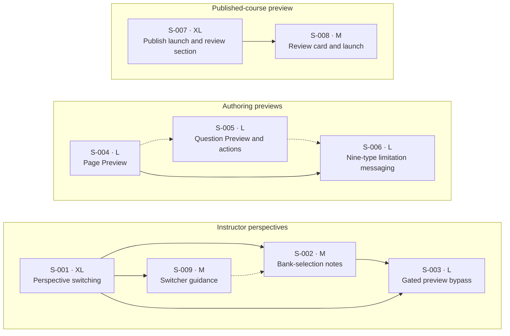

- # User Preview November 2026 — Technical product overview

- Updated: 2026-11-11
- Epic: [MER-6158](https://eliterate.atlassian.net/browse/MER-6158)
- Overview review: UP-01–UP-08 and Q1–Q8 accepted; UP-09 pending review; Q9 unresolved
- Decomposition review: nine draft Stories across three lanes; final review pending UP-09 review and resolution of Q9
- Jira filing: pending; no writes authorized or performed

## Sources

| Source | Evidence and limits |
| --- | --- |
| [MER-6158](https://eliterate.atlassian.net/browse/MER-6158) | Links the handoff, design file, and Make prototype. No comments or child tickets are recorded in the intake evidence. |
| [User Preview Overhaul — Design Handoff](https://docs.google.com/document/d/1XrwiN86AETdRxxyoGanQE2pAvl484RHPM6w0prWKk6c/edit) | Defines the eight feature areas, including Instructor Guidance on Switching Views, their acceptance criteria, accessibility requirements, and exclusions. Scope decisions in this overview govern implementation. Embedded Figma chips are not available as usable URLs through the connector. Switcher guidance behavior is supported by the written criteria; its frames require visual review during child UI analysis. |
| [Figma Handoff 2026](https://www.figma.com/design/S8qAFhjjlnRyTHCg2Dyb8p/User-Preview-Overhaul?node-id=484-13117) | The reviewed frames below establish layouts, preview banners, notes, gating states, and Review card states. Static frames do not establish interactive behavior beyond what they depict. |
| [Figma Make prototype](https://www.figma.com/make/gUx8oHNz23gIenz8htAL7C/Check-Prompt-Progress) | Inaccessible and excluded from the evidence base under Q1. Prototype-only interactions are unverified and outside the committed requirements. |
| `AGENTS.md`, `harness.yml`, `docs/ISSUE_TRACKING.md` | Repository contracts, small-scope implementation, Jira approval/read-back requirements, and capability defaults. Feature flags, new telemetry, and additional performance requirements default to exclusion. |
| `docs/exec-plans/current/epics/instructor_customizations/instructor_view_shell/prd.md` | Existing MER-5617 scope: basic-page instructor shell, return context, authorization, no learner-progress side effects, and preservation of adaptive preview. Defines the implementation contracts this epic must preserve. |

### Design evidence

All frame links refer to the same User Preview Overhaul file.

| Area | Frames | What they establish |
| --- | --- | --- |
| Instructor/student views | [Instructor Interface](https://www.figma.com/design/S8qAFhjjlnRyTHCg2Dyb8p/User-Preview-Overhaul?node-id=484-14126), [student page](https://www.figma.com/design/S8qAFhjjlnRyTHCg2Dyb8p/User-Preview-Overhaul?node-id=484-14996) | Perspective selector, return action, and student-facing page layout. |
| Gating and notes | [Restricted](https://www.figma.com/design/S8qAFhjjlnRyTHCg2Dyb8p/User-Preview-Overhaul?node-id=484-15826), [bypassed](https://www.figma.com/design/S8qAFhjjlnRyTHCg2Dyb8p/User-Preview-Overhaul?node-id=529-11932), [instructor](https://www.figma.com/design/S8qAFhjjlnRyTHCg2Dyb8p/User-Preview-Overhaul?node-id=484-15942) | Restriction message, reversible bypass, retained explanation, example bank-selection note, and settings links. |
| Author page preview | [Page preview](https://www.figma.com/design/S8qAFhjjlnRyTHCg2Dyb8p/User-Preview-Overhaul?node-id=484-13987) | Student page styling without course navigation and a persistent exit banner. The banner label is Page Preview (Q7). |
| Author bank preview | [Bank controls](https://www.figma.com/design/S8qAFhjjlnRyTHCg2Dyb8p/User-Preview-Overhaul?node-id=534-12632), [standalone question](https://www.figma.com/design/S8qAFhjjlnRyTHCg2Dyb8p/User-Preview-Overhaul?node-id=484-13190) | Per-question Preview action, surrounding action styling, and isolated question with exit banner. Q5 excludes broader editor/filter redesign; Q7 names the banner Question Preview. |
| Preview limitations | [Information tooltip](https://www.figma.com/design/S8qAFhjjlnRyTHCg2Dyb8p/User-Preview-Overhaul?node-id=484-13208) | Indicator near affected content with explanatory text. The handoff supplies more specific messages. |
| Published course preview | [Never published](https://www.figma.com/design/S8qAFhjjlnRyTHCg2Dyb8p/User-Preview-Overhaul?node-id=546-53431), [published](https://www.figma.com/design/S8qAFhjjlnRyTHCg2Dyb8p/User-Preview-Overhaul?node-id=545-51964), [draft changes](https://www.figma.com/design/S8qAFhjjlnRyTHCg2Dyb8p/User-Preview-Overhaul?node-id=546-54200), [existing template](https://www.figma.com/design/S8qAFhjjlnRyTHCg2Dyb8p/User-Preview-Overhaul?node-id=553-14997), [Learn](https://www.figma.com/design/S8qAFhjjlnRyTHCg2Dyb8p/User-Preview-Overhaul?node-id=563-30474) | Review card states, version/draft notices, course navigation, and primary exit action. Perspective switching is not shown in these course-preview frames; see Q2. |

## Product outcomes and scope

Instructors need to distinguish instructor tools from the student experience, discover the view switcher, switch views without losing their location, and inspect gated content without changing student access. Authors need a current single-page preview, direct bank-question preview, explanations of preview limitations, and a way to inspect the latest published course without manually building a test section.

UP-01–UP-09 define the feature scope. Q1–Q8 specify its constraints and exclusions. Student Preview interaction-state behavior is unresolved under Q9.

| ID | Product outcome |
| --- | --- |
| UP-01 | Instructors switch between Instructor View and Student Preview while preserving the current course page and original return destination. |
| UP-02 | Contextual Instructor preview notes explain bank selections, gating, and relevant instructor-only controls; students never receive these notes or controls. |
| UP-03 | Instructors can switch between a student-facing gated state and preview content without changing access settings or completing prerequisites. Instructor View links to the relevant gating settings. |
| UP-04 | Authors preview the working page in current NG student styling with a persistent Page Preview banner and exit action, without course navigation, DOT, or notes. |
| UP-05 | Authors preview a selected bank question in isolation under a Question Preview banner and return to the same list context; the specified existing question actions adopt design-system styling. |
| UP-06 | Authoring page preview explains verified content limitations through accessible information indicators and labeled placeholders, while preserving supported preview functionality. |
| UP-07 | Authors open a student-only preview of the latest published course from Review or Publish, beginning on Learn, with publication details and excluded-draft counts shown before launch. There is no instructor perspective or perspective selector. Reuse one dedicated review section per project, refreshed to the latest publication on launch, with existing template-preview identity and progress behavior (Q3). |
| UP-08 | All changed controls, notes, navigation, and tooltips meet the handoff's keyboard, focus, screen-reader, and reflow requirements. Existing permissions remain enforced. Q8 permits both views for instructors in the requested section and authors with an admin role. |
| UP-09 | On their first entry to Instructor View after the guidance feature releases, instructors see a dismissible callout anchored to and highlighting the view dropdown. Dismissal removes both and persists per instructor across courses, sessions, and devices; the dropdown remains usable. |

Out of scope: redesigning the Publish table, adding support for otherwise unavailable page-preview activities, displaying draft changes in full-course preview, and changing student gating through preview bypass. Broad bank question-editor and filter redesign is deferred to a separate effort under Q5. Prototype-only behavior is outside scope (Q1).

Author Full Course Preview is student-only (Q2). Instructor perspective switching belongs to UP-01.

## Workflows and acceptance outcomes

### Agreed terminology

| Context | Visible label |
| --- | --- |
| Working authoring page | Page Preview |
| Individual bank question | Question Preview |
| Published course | Full Course Preview |
| Instructor perspective selector | Instructor View / Student Preview |

Follow the designs and use ordinary sentence casing for buttons changed by this epic: Page preview, Preview page, Show restricted view, Open full course preview, Preview published course, Go to Publish, View revision, and Edit title. Retain Publish as the name of the destination page. Preserve ordinary sentence casing in explanatory messages. The table names the preview contexts; button labels use sentence casing (Q7). Unrelated UI is outside scope.

### UP-01: Instructor perspective and return context

- Preview entry from course content, Customize Content, or Manage exposes a selector labeled with the active perspective. Confirm concrete entry-point mappings against existing routes during child analysis; the handoff's names do not exactly match the current return-context labels.
- Switching perspective preserves the current course page. Navigating or switching does not replace the original Return to [origin] destination.
- Student delivery and instructor Student Preview share the existing non-prefixed course routes, including `/sections/:section_slug/lesson/:revision_slug`; both render a student view of the materials. Instructor View uses `/sections/:section_slug/instructor/...`, replacing the existing `/preview/...` prefix across lesson, Learn, container, and adaptive-page routes. Switching perspectives preserves the resource and original return context. Course links in Student Preview stay on ordinary delivery URLs; Instructor View links retain `/instructor/...` (Q8).
- Instructor View and Student Preview are available to instructors in the requested section and authors with an admin role. Admin access does not require an instructor enrollment in that section. An instructor role in another section alone does not grant access. Keep actual user/author identity and roles for authorization while explicitly applying student presentation in Student Preview; ordinary students receive no instructor selector or controls. Preserve separate author Page Preview, Question Preview, and Full Course Preview routes and behavior, including existing template-preview sessions. How instructor Student Preview stores attempts and progress remains unresolved (Q9).
- Return takes the user to that original location. Existing safe-return validation and fallback behavior remain intact.
- Hide the instructor preview header and perspective selector while managing an activity-bank selection because there is no equivalent student view. Retain a local back control to the containing course page. Returning restores the header and selector, with focus on the opener or a logical fallback (Q4).
- The selector exposes its accessible name, current choice, and expanded state; supports keyboard operation and Escape; and restores focus to its trigger when dismissed. View changes are announced. Switching retains selector focus when available.

### UP-09: Guidance on switching views

- On the first entry to Instructor View after this feature releases, show a dismissible callout anchored to the instructor view dropdown and highlight the dropdown. Show the exact message: “Switch between instructor view and student preview.” The guidance belongs to Instructor View where the selector is present; do not show it in bank-selection management, which hides the selector under Q4, or in author previews.
- Provide a clearly labeled, keyboard-accessible dismiss control with an accessible name such as “Dismiss preview guidance.” Dismissal removes both the callout message and the dropdown highlight. The dropdown remains usable while the guidance is visible.
- Save dismissal for the instructor’s account, not for a course, browser, or session. After dismissal, subsequent visits across courses, sessions, and devices do not show the callout again. Merely displaying the callout is not dismissal.
- Escape dismisses when focus is within the callout. Make the message available to screen readers without automatically moving focus. Keep focus visible and unobscured; if dismissal removes the focused control, move focus to the instructor view dropdown.
- The written criteria define guidance behavior. Detailed placement and styling require review of the guidance Figma frame during child UI analysis. The handoff specifies no additional technical constraints for this feature.

### UP-02–UP-03: Notes and gated content

- Notes carry the visible label Instructor preview note and sit next to the behavior they explain. Notes cover activity-bank selections and gating. A bank-selection note explains that the question is an example of what students may receive and identifies any instructor-only action.
- Restricted Student Preview shows the student restriction message plus a note with Preview page. Activating it replaces the restriction message with content and updates the note to explain the bypass, with Show restricted view as the inverse action.
- Restoring the restriction state restores the original message and action. Focus stays on the toggle; newly hidden content cannot retain focusable elements. State changes receive a concise announcement.
- Instructor View shows an informational banner with Assessment settings and Advanced gating tool links.
- Bypass is confined to the instructor's preview: it grants no student access, changes no gating settings, and completes no prerequisites. Notes and actions must be absent from both student-visible markup and the student accessibility tree.
- Static notes follow normal reading order and do not take focus or use alert announcements. Their label is programmatically associated with their content. Interactive note actions have visible focus and descriptive names.

### UP-04–UP-05: Authoring page and question previews

- The page editor's existing preview action becomes a secondary Page preview button. It opens the working page with current student styling and a sticky Page Preview banner; exit returns to the originating authoring page and restores focus to its preview action.
- Single-page preview excludes previous/next page navigation, course back navigation, the course outline, DOT, and notes. The banner remains readable and usable on long pages, narrow screens, and at increased zoom without obscuring focused content.
- Each bank question gains a secondary Preview button. It opens only that selected question in student styling under a sticky Question Preview banner with an exit control, without surrounding page/course content or needing to place the question on a course page.
- Exiting the question preview preserves search, filters, and position in the bank list, and restores focus to the selected question's Preview button. Previewing does not modify the question.
- Edit, Copy, View revision, and Edit title adopt consistent design-system controls without changing functionality or permissions. Together with the new Preview action, these are the activity-bank UI changes included in this epic. Broader question-editor and filter redesign is deferred to a separate effort (Q5).
- Entry focus identifies the preview context; exit controls describe their destination. Repeated action names identify the associated question. Decorative icons are hidden from assistive technology.

### UP-06: Explain page-preview limitations

All nine content types below are in scope (Q6). Embedded-activity failure messaging is conditional, and alternatives retain their strategy-specific explanations. Static code findings support these distinctions; targeted author-page runtime verification is required before implementation acceptance.

| Content | Required message/behavior |
| --- | --- |
| LTI external tool | You cannot interact with this tool in page preview. |
| File upload | File uploads are not available in page preview. |
| Directed discussion | Posting to discussions is not available in page preview. |
| Logic Lab | You can open this lab in page preview, but scores are not recorded. |
| Activity reports | This is sample data. Actual activity reports are not available in page preview. |
| OLI embedded activities | If a preview session cannot be created: Preview is not available for this activity. |
| Surveys | After submitting this survey in page preview, you cannot reset it here. |
| Alternatives | Preserve the existing strategy-specific explanation of the tabs or preference selector and how the configured policy selects content for students. Do not replace it with the handoff's generic all-alternatives message. |
| Page collaborative spaces | Labeled placeholder: Collaborative spaces are not available in page preview. |

- Put an information trigger beside affected content or its placeholder. Distinguish unavailable content, limited interaction, and sample data. Do not mark ordinary working scored activities unsupported or block review of the rest of the page.
- The trigger is a keyboard-focusable button with a descriptive name and `aria-describedby`. The tooltip opens on focus or hover, remains visible while focused/hovered unless dismissed, and closes with Escape without moving focus. Tooltips contain no interactive controls.
- Placeholders stay in normal reading order. Preserve supported evaluation, reset, hint, and embedded-preview behavior rather than disabling it to match a generic warning.
- Verify all nine types in authoring page preview before implementation acceptance, including supported interactions and embedded-session failure. This scope communicates limitations; it does not add support for unavailable functionality. Any runtime finding that requires a product-scope change returns for a decision.

### UP-07: Published full-course preview

| Project state | Review card | Actions |
| --- | --- | --- |
| Never published | Explain that publication is required. | Go to Publish |
| Published without draft changes | Identify the version and explain that published content is used. | Open full course preview |
| Published with draft changes | Identify the version and count excluded draft changes. | Primary Open full course preview; secondary Go to Publish |

- Preserve automated review, existing review behavior, and the chart while updating the Review layout.
- Both Review and the new Preview published course action beside the latest Publish version open the same latest published version on Learn. Draft content is excluded. Preserve the existing Publish table.
- Base course navigation and exit behavior on the existing template-preview experience, with a Full Course Preview banner and a primary exit button. Author full-course preview is student-only and has no perspective selector. UP-07 has no dependency on UP-01’s perspective selector (Q2).
- Publication details and draft counts are readable text, not color-only signals. Associate the card heading programmatically. Keep navigation keyboard accessible and provide an accessible return to authoring. Announce dynamic card updates without stealing focus; communicate a new-tab launch if that implementation is chosen.
- Reuse one dedicated review section per project. Before launch, refresh it to the latest published version. Retain existing template-preview identity and progress behavior: progress may persist, authors using the shared hidden identity may share state, and refreshing the section may affect other open previews. No automatic reset or new per-author isolation is included (Q3).

## Technical product description

### Observed repository behavior

| Area | Current implementation and consequence |
| --- | --- |
| Instructor shell | `lib/oli_web/components/delivery/layouts.ex` renders a static Instructor view label and return action. `lib/oli_web/live/delivery/instructor/preview_lesson_live.ex` owns the basic-page shell. Add perspective selection to this existing surface rather than introduce a second independent instructor shell. |
| Ordinary instructor delivery | Ordinary lesson routes currently mount `Delivery.Student.LessonLive` for enrolled instructors as well as students. `lib/oli_web/live_session_plugs/init_page.ex` initializes learner page context, and `lib/oli/delivery/page/page_context.ex` tracks access and invokes the attempt lifecycle. Content audience and notes still recognize the instructor role. Q8 keeps these URLs for student presentation and requires instructor Student Preview to suppress instructor-only material without changing the user’s actual enrollment role. |
| Instructor routes | `lib/oli_web/router.ex` and `lib/oli_web/delivery/instructor/preview_routes.ex` currently use `/sections/:section_slug/preview/...` for Instructor View. Q8 renames that prefix to `/instructor/...`; Student Preview uses ordinary delivery URLs. Update helpers, generated links, and authorization redirects together. Legacy `/preview/...` links redirect to the corresponding Instructor View route under the same authorization checks for section instructors and admin authors; they do not define a separate Student Preview route family. |
| Return navigation | `lib/oli_web/delivery/instructor/preview_return.ex` resolves Customize Content, Assessment Settings, and Overview, sanitizes destinations, and falls back to section remix. `preview_routes.ex` and existing preview pages propagate navigation state. Preserve these contracts while adding perspective state. |
| Bank management | `lib/oli_web/live/delivery/instructor/bank_selection_manager_live.ex` currently renders the instructor header and a local back path. Hide the instructor preview header and perspective selector here; retain local back navigation and restore the containing page’s header and focus on return (Q4). |
| Preview side effects | `lib/oli_web/delivery/instructor/preview_page_context.ex` builds basic-page instructor content without learner visits, attempts, submissions, scoring records, or progress events. Preserve that existing contract. It is distinct from a template launch into student delivery. |
| Authorization | `lib/oli_web/plugs/authorize_section_preview.ex` currently permits section instructors or admins, redirects enrolled students to delivery, and rejects other unauthorized access. Q8 preserves access for instructors in the requested section and authors with an admin role, and requires both Instructor View and Student Preview to support those actors. Other existing permissions, including author full-course project authorization, remain unchanged. |
| Author page rendering | `lib/oli_web/controllers/resource_controller.ex` resolves the working publication and supplies activity-bank selections. `lib/oli_web/templates/resource/page_preview.html.heex` still has a Preview Mode message, window-close exit, and previous/next navigation. Update this shell while retaining its working-draft semantics and selection-error feedback. Advanced delivery has a separate preview path that must remain compatible. |
| Activity preview evaluation | `assets/src/phoenix/activity_bridge.ts` handles author-preview evaluation, reset, hints, and client evaluations. `assets/src/data/persistence/activity.ts` sends evaluation to `/project/test/evaluate`. Do not assume the instructor's read-only activity presentation and the author's interactive page preview are interchangeable. |
| Full-course launch | `lib/oli/delivery/template_preview.ex` currently accepts an active blueprint and authorizes its author/admin. It uses an existing user with student enrollment or a hidden instructor identity. `lib/oli_web/controllers/products_controller.ex` sets preview session/return state and launches the section root. This is reusable groundwork, but does not by itself establish a dedicated latest-publication review section for an arbitrary project. |
| Publication and Review UI | `lib/oli_web/live/projects/publish_view.ex` already loads the latest/working publications and computes their diff. `lib/oli_web/live/qa/qa_live.ex` owns automated review and its display. Reuse those publication semantics and preserve review functions when adding the card and launch actions. |
| Saved dismissal | `lib/oli/accounts.ex` provides persisted `get_user_preference` and `set_user_preference` operations. `lib/oli/accounts/schemas/user_preferences.ex` defines the embedded preference fields, including a dismissed instructor warning; `lib/oli_web/live/sections/assessment_settings/settings_live.ex` uses that preference. UP-09 can reuse this account-level pattern with a dedicated guidance preference. |

Q8 keeps ordinary delivery URLs for students and instructor Student Preview, with Instructor View isolated under its own prefix. Student Preview needs explicit student presentation across audience filtering, notes, activity rendering, and gating; hiding instructor controls alone is insufficient. Real students must not receive instructor preview controls, notes, or gating bypasses. Existing author template-preview behavior remains separate. These findings come from code inspection, not runtime verification. Q9 determines the remaining interaction-state design and effort.

### Preliminary verification of limitation claims

- LTI has an explicit `author_preview` noninteractive branch in `assets/src/components/activities/lti_external_tool/LTIExternalToolDelivery.tsx` with an existing warning. Activity reports use sample data in `lib/oli/rendering/report/html.ex`.
- OLI embedded activities attempt to create preview sessions in `assets/src/components/activities/oli_embedded/OliEmbeddedDelivery.tsx`; unavailable messaging must be conditional, not a blanket unsupported label.
- Alternatives already have tabs or a preference selector plus strategy-specific explanations in `lib/oli/rendering/alternatives.ex` and `lib/oli/rendering/alternatives/html.ex`. The generic all-alternatives message should not erase those distinctions.
- Surveys: `lib/oli/authoring/editing/page_editor.ex` builds the author-preview context without overriding the empty `resettable_surveys` default in `lib/oli/rendering/context.ex`. `lib/oli/rendering/survey/html.ex` passes that value to `assets/src/components/delivery/SurveyControls.tsx`, which only renders Reset when `canReset` is true. This supports the no-reset message for the current page-preview context.
- Logic Lab: `assets/src/components/activities/logic_lab/LogicLabDelivery.tsx` handles score and save messages only in delivery mode, supporting the distinction between opening a lab and recording scores in author preview.
- File upload: the author page constructs preview activity state rather than persisted attempts. `assets/src/components/activities/file_upload/FileUploadDelivery.tsx` calls a section/attempt-based upload endpoint through `assets/src/data/persistence/state/intrinsic.ts`; it has no author-preview upload path. This supports the unavailable-upload message, but the rendered control/error behavior still needs runtime verification.
- Directed discussion: its delivery component uses section-backed APIs through `assets/src/components/activities/directed-discussion/discussion/discussion-service.ts`, while the author page supplies project context. The read-only instructor-preview component is a different rendering path and does not prove author-page behavior. Verify the author-page presentation and failed posting behavior during implementation; do not add discussion-posting support under this epic.
- Page collaborative spaces: the basic author-page preview template does not render a page collaboration surface. The labeled placeholder must use the page's collaboration configuration to appear only where relevant.
- These are static code findings, not end-to-end test results. Runtime behavior is unverified. Targeted verification must cover all nine content types in the author-page context before their implementation is accepted, including supported behavior and embedded-session failures.

### Review-section behavior

Use one reusable, dedicated review section per project, refreshed to the latest publication on launch (Q3). Reuse existing template-preview identity and progress behavior, including its shared hidden identity where applicable. This avoids requiring a new section for every launch or author. The project-to-review-section association and launch refresh must support this behavior; their schema and transaction details belong to child analysis and architecture. Automatic progress reset, new per-author isolation, retention mechanisms, and background synchronization jobs are outside scope.

### Proposed implementation approach

Reuse existing preview shells, route helpers, authorization, renderers, and publication queries. Keep perspective, original return context, and local gating-bypass state distinct so changing one cannot silently change the others. Build notes and limitation indicators with existing design-system patterns. These are implementation proposals for later child analysis, not requirements for a new preview framework.

For UP-09, propose a dedicated persisted user preference for dismissal, defaulting to not dismissed for existing and new instructors. No separate table, generic onboarding framework, or browser-only dismissal store is needed based on current evidence. Verify persistence failure and stale account reads during child analysis; do not treat an unsuccessful write as a saved dismissal.

No additional telemetry, feature-flag rollout, or numerical performance target is proposed. Required accessibility, security, and publication contracts come from the handoff and repository evidence above, with the Q8 access rule for section instructors and admin authors explicitly recorded. The existing instructor preview's no-learner-side-effect contract remains distinct from full-course preview's retained template-preview progress behavior.

## Scope decisions, open questions, and deferrals

Q1–Q8 define the current scope decisions. Q9 is the open product decision that blocks finalizing S-001 acceptance, effort, and decomposition. The Make prototype is excluded from the evidence base (Q1), and broader bank UI redesign is outside this epic (Q5). Runtime verification under Q6 is required implementation work.

| ID | Decision and consequence | State / owner / next point |
| --- | --- | --- |
| Q1 | Use the written handoff, static designs, and repository evidence. The inaccessible Make prototype supplies no committed requirements; do not infer prototype-only interactions. | Accepted evidence exclusion; does not block decomposition. Reassess scope if prototype evidence becomes available. |
| Q2 | Author Full Course Preview is student-only, with no instructor perspective or selector. Instructor perspective switching is scoped to UP-01; UP-07 does not depend on it. | Accepted. |
| Q3 | Reuse one dedicated review section per project, refresh it to the latest publication on launch, and retain template-preview identity/progress behavior. No automatic reset or new per-author isolation. Progress may persist, authors may share hidden-identity state, and refresh may affect open previews. | Accepted; schema and transaction details belong to child analysis. |
| Q4 | Hide the instructor preview header and selector in activity-bank selection management. Keep local back navigation that restores the containing page’s header, selector, and focus on the opener or a logical fallback. | Accepted. |
| Q5 | Limit bank UI work to Preview and design-system controls for Edit, Copy, View revision, and Edit title. Broader question-editor and filter redesign is outside this epic. | Deferred scope is non-blocking. Product/UX owns any separate bank UI effort; no delivery commitment is included here. |
| Q6 | Cover all nine UP-06 content types. Show embedded-activity unavailability only on preview-session failure; retain strategy-specific alternatives explanations and supported interactions. Verify all nine types in author-page context before implementation acceptance. | Accepted scope; runtime verification is pending implementation. Product-scope changes require review. |
| Q7 | Use Page Preview, Question Preview, and Full Course Preview for the respective preview contexts, and Instructor View / Student Preview for the selector. Follow the designs and use ordinary sentence casing on buttons. Unrelated UI is outside scope. | Accepted. |
| Q8 | Student delivery and instructor Student Preview share ordinary course URLs and render student materials. Instructor View uses `/sections/:section_slug/instructor/...`; legacy `/preview/...` links redirect there. Both views allow section instructors and admin authors; admins need no section instructor enrollment. Preserve actual identities/roles and separate author preview behavior. S-001 covers navigation, authorization, and regression checks. | Accepted; decomposition and Jira write approval are pending. |
| Q9 | Determine whether Student Preview for instructors and admin authors uses temporary or persistent attempts/progress, whose state is used, and how it resets. Author Full Course Preview uses the separate Q3 policy. | Open; operator decision required before finalizing S-001 acceptance, effort, and decomposition. No new persistence or isolation mechanism is approved. |

## Decisions and review

- 2026-11-09 — Q1 accepted: static Figma designs and the Google Docs handoff are sufficient to continue with prototype-only interactions unverified. The operator's acceptance is limited to this omission; it does not approve the overview, decomposition, or Jira writes.
- 2026-11-09 — Q2 resolved: author full-course preview is student-only. This supersedes the handoff overview's author perspective-switching statement. Full-course preview does not require the instructor perspective selector; instructor preview switching remains in scope under UP-01.
- 2026-11-09 — Q3 accepted: reuse one dedicated review section per project, refresh it on launch to the latest publication, and retain existing template-preview identity/progress behavior. Persistent/shared preview state and effects on open previews were stated with the accepted proposal. Implementation details remain for the child development workflow.
- 2026-11-09 — Q4 accepted: hide the instructor preview header and perspective selector in activity-bank selection management, which has no equivalent student view. Retain local back navigation and restore the containing page's header, selector, and focus on return.
- 2026-11-09 — Q5 accepted: limit authoring activity-bank UI changes to the new Preview action and design-system updates for Edit, Copy, View revision, and Edit title. Broader question-editor and filter redesign is explicitly deferred to a separate product/UX scoping decision and does not block this epic.
- 2026-11-09 — Q6 accepted: retain all nine limitation types, condition embedded-activity unavailability on session-creation failure, and preserve strategy-specific alternatives explanations and supported interactions. Targeted runtime verification is required during implementation; accepting the scope does not claim that verification has passed.
- 2026-11-09 — Q7 initially accepted: use the context-specific labels in Agreed terminology and Title Case for changed buttons. The button-casing decision was superseded by the operator correction on 2026-11-11; the agreed context names remain.
- 2026-11-09 — Overview approved: the operator replied “approved” to the complete overview review request. This authorizes Story and lane decomposition using UP-01–UP-08 and Q1–Q7, including the prototype omission and bank UI deferral. It does not authorize Jira writes.
- 2026-11-09 — Decomposition drafted: eight Stories in three lanes. Requirement coverage, Story fields, prerequisite references, lane membership/order, and diagram edges were checked. The functional and lane-order graphs are acyclic. This validates the document structure and sequencing, not application behavior.

- 2026-11-11 — Q7 corrected: follow the designs and use ordinary sentence casing for buttons. This replaces the earlier Title Case requirement; context names and feature scope remain unchanged. Button references in the workflows and Story acceptance criteria now follow this correction.

- 2026-11-11 — Q8 finalized: student delivery and instructor Student Preview share non-prefixed course routes and render student materials. Instructor View moves from `/preview/...` to `/instructor/...` and permits instructors in the requested section or authors with an admin role. This supersedes all earlier route arrangements and bookmark behavior. Q9 remains open for interaction state; separate author previews retain their behavior.
- 2026-11-11 — Guidance requirement added by the operator: confirmed the new Google Docs section against the supplied acceptance criteria. Added UP-09 and proposed S-009, with per-instructor dismissal across courses, sessions, and devices and the specified keyboard/focus behavior. The amended overview and decomposition remain for review; no Jira writes are authorized.
- 2026-11-11 — Q8 authorization corrected: authors with an admin role may access both Instructor View and Student Preview without a section instructor enrollment. Section-scoped authorization still applies to non-admin instructors. This replaces the earlier exclusion of admins; route placement and separate author previews are unchanged.
- Decomposition approval: pending operator review. Existing child plans and unrelated documents remain unchanged.

## Child work items

The nine Stories deliver UP-01–UP-09 across three lanes. Each includes its integration and verification. No separate infrastructure or final hardening Story is required. Sizes express relative effort, not calendar commitments. S-001 is provisionally XL pending Q9; no sub-tasks are proposed.

All Stories apply UP-08 to their changed surfaces: authorization including Q8’s access rule for section instructors and admin authors, keyboard operation, visible focus, descriptive accessible names, screen-reader state, and reflow. Preview context names and sentence casing follow Q7 and the designs. UI implementation and design verification must follow the repository's `ui_workflow`. Tests belong to each Story and cover its observable behavior and material failure cases; the checks below describe future implementation acceptance, not tests already run.

No new feature flags are planned. Each Story deploys with its completed user-facing behavior and required predecessors available. A discovery that requires a flag or changes product scope returns to overview review before changing this decomposition.

### S-001: Switch between Instructor View and Student Preview without losing context

- Delivery outcome: an instructor can inspect the same course page in Instructor View or Student Preview and return to the original entry location.
- Overview requirements: UP-01, UP-08; Q4, Q7, and Q8; instructor/student design frames and the existing shell/return contracts in Technical product description.
- Scope: perspective selector, student presentation on existing delivery routes, Instructor View under `/sections/:section_slug/instructor/...`, preserved page and return context, and the bank-management header exception. Reuse the existing instructor shell and its separate page-context initialization. Update helpers, generated navigation and content links, bank-management links, legacy redirects, and authorization for section instructors and admin authors together. Preserve current instructor customization behavior and actual student delivery. Separate author Page Preview, Question Preview, and Full Course Preview routes and behavior remain unchanged. Student Preview interaction-state behavior awaits Q9.
- Acceptance criteria:
  1. Preview entry from the existing course-content, Customize Content, and Manage surfaces exposes the correctly labeled active perspective. Switching in either direction preserves the current page and the original Return to [origin] destination.
  2. In-preview navigation retains the selected perspective and original return context. Return goes to the recorded origin; missing or invalid context follows existing safe fallback behavior.
  3. Activity-bank selection management hides the instructor preview header and selector, retains its local back action, and restores the containing page's header, selector, and focus on return.
  4. The selector exposes its purpose, selected option, and expanded state; keyboard operation and Escape work; closing restores trigger focus; switching retains selector focus when available and announces the new view.
  5. Instructors in the requested section and authors with an admin role can access both Instructor View and Student Preview and switch between them. Admins do not need an instructor enrollment in that section; coverage includes author-admin sessions, basic and adaptive pages, and both direct entry and switching. Users with neither authorization, including non-admin instructors from other sections, cannot obtain Instructor View or privileged preview controls by changing URLs or parameters. The basic-page Instructor View remains free of learner attempts/progress side effects.
  6. Students, along with instructors and admin authors in Student Preview, use the same ordinary course URLs and see student materials, without instructor-only content. Instructor View uses `/sections/:section_slug/instructor/...`. Direct entry, perspective switching, navigation, and embedded course links preserve the intended perspective, current resource, and return context across lesson, Learn, container, and adaptive pages. Legacy `/preview/...` links redirect to the corresponding `/instructor/...` route with the same authorization for section instructors and admin authors.
  7. Actual students retain existing delivery routes, behavior, and access enforcement, and never receive the instructor selector, notes, or gating bypass controls. Enrolled students without instructor or admin authorization who request Instructor View return to ordinary delivery. Regression coverage includes direct entry, LiveView navigation, reconnects, and cross-section authorization. Separate author Page Preview, Question Preview, and Full Course Preview routes and behavior remain unchanged, including template previews using a hidden instructor identity.
- Prerequisites: none within this epic. The existing instructor shell, preview routes, authorization, and return-context behavior described above must be present in the implementation base.
- Lane: Instructor perspectives.
- Effort and bottlenecks: provisional XL; uncertainty centers on student presentation despite the real instructor role, preview interactions and state (Q9), authorization for section instructors and admin authors, adaptive compatibility, and navigation. Keeping Instructor View separate avoids dispatching ordinary student routes into the instructor shell. Q9 may require smaller deliveries or focused sub-tasks before decomposition approval.
- Rollout/flags: deploy complete perspective switching, prefix migration, authorization, and bank return behavior together; no new flag. Legacy instructor-preview links redirect to Instructor View under the new prefix. Student-preview notes and reversible gating bypass follow as separate improvements.
- Jira: proposed Story; no key or write approval.

### S-002: Explain activity-bank selections in Student Preview

- Delivery outcome: instructors understand how a bank question shown in Student Preview relates to what students receive.
- Overview requirements: UP-02 for bank selections, UP-08; Q7; the bank-selection note in the bypassed-page design and the handoff's Instructor preview notes section.
- Scope: the contextual Instructor preview note presentation and its first usable placement beside bank-selection examples. Explain sample selection and any existing instructor-only controls. Gating placements belong to S-003.
- Acceptance criteria:
  1. Relevant bank-selection examples show a nearby note labeled Instructor preview note, explaining that the displayed question is an example of what students may receive.
  2. The note identifies instructor-only controls where present, without obscuring or replacing the question. Unrelated content receives no bank-selection note.
  3. Real student delivery excludes the note and associated instructor-only controls from both the visible UI and accessibility tree.
  4. Static notes are programmatically labeled, appear in logical reading order, take no keyboard focus, and do not announce as alerts. Any included actions have descriptive names, keyboard operation, and visible focus.
- Prerequisites: S-001 merged and deployable, providing an authorized Student Preview presentation that preserves current-page and return context. S-001 must be available before S-002 is enabled in a deployment.
- Lane: Instructor perspectives.
- Effort and bottlenecks: M; medium uncertainty around bank-selection rendering and keeping instructor context out of student output.
- Rollout/flags: deploy the note with its bank-selection placement; no new flag or unused component-only delivery.
- Jira: proposed Story; no key or write approval.

### S-003: Inspect gated content and restore the restricted preview

- Delivery outcome: instructors can inspect content behind student restrictions, restore the restricted view, and reach the access settings without changing student access.
- Overview requirements: UP-03, UP-02 for gating notes, UP-08; Q7; restricted, bypassed, and instructor gating frames.
- Scope: student-facing restriction presentation, preview-only reversible bypass, retained contextual notes, and Instructor View links to Assessment settings and the Advanced gating tool.
- Acceptance criteria:
  1. Restricted Student Preview initially shows the student restriction message and an Instructor preview note with Preview page.
  2. Preview page replaces the restriction message with the page content, retains a note explaining the bypass, and changes the action to Show restricted view. The inverse action restores the original restriction message and note.
  3. Instructor View identifies applied access conditions and links to the relevant Assessment settings and Advanced gating tool. Ordinary unrestricted pages do not receive a misleading restriction note.
  4. Both toggle states preserve the current page and original return context. Focus remains on the toggle as its label changes; hidden content is not focusable; a concise announcement identifies the new state.
  5. Bypass changes no gating settings, grants no student access, and completes no prerequisites. Students cannot invoke the bypass or receive its controls/notes. Existing preview authorization remains enforced server-side.
- Prerequisites: S-001's merged, deployable perspective switching and S-002's merged, deployable Instructor preview note presentation. Both predecessors must be available in the target deployment.
- Lane: Instructor perspectives.
- Effort and bottlenecks: L; high uncertainty around translating current gating results into preview states without entering learner completion paths.
- Rollout/flags: deploy both directions of the toggle and both perspective presentations together; no new flag.
- Jira: proposed Story; no key or write approval.

### S-004: Modernize the authoring Page Preview

- Delivery outcome: authors review the current working page in student styling and can always return to its editor.
- Overview requirements: UP-04, UP-08; Q7; author page-preview frame and current working-publication rendering contract.
- Scope: secondary Page preview action, current NG student page styling, persistent Page Preview banner/exit, and removal of course navigation, DOT, and notes from single-page preview. Preserve supported activity interactions, working-draft content, and existing selection-error feedback.
- Acceptance criteria:
  1. Page preview opens the current working page, including draft content and bank selections resolved from the working publication. It does not substitute the latest published version.
  2. The page uses current student styling and a sticky Page Preview banner with an exit action that returns to the originating authoring page. The banner and exit remain usable on long pages, narrow screens, and at increased zoom without obscuring content or focus.
  3. Course previous/next navigation, course back navigation, course outline, DOT, and notes are absent. Supported evaluation, hints, and reset behavior continue to work.
  4. Entry focus identifies the preview context; exit restores focus to Page preview in the editor. Actions have descriptive names and visible focus.
  5. Missing pages and unauthorized project access retain existing error/access behavior. Activity-bank selection errors remain understandable, and existing advanced/adaptive preview paths remain compatible.
- Prerequisites: none within this epic; reuse the existing author-page renderer and activity bridge.
- Lane: Authoring previews.
- Effort and bottlenecks: L; medium uncertainty around old/new layout integration, exit/focus handling, and preserving advanced-preview behavior.
- Rollout/flags: replace the existing page-preview experience as a complete delivery; no new flag.
- Jira: proposed Story; no key or write approval.

### S-005: Preview individual bank questions and update their actions

- Delivery outcome: authors can inspect a bank question in student styling and return to their exact bank-list context.
- Overview requirements: UP-05, UP-08; Q5 and Q7; bank-control and standalone-question frames.
- Scope: per-question secondary Preview action, standalone Question Preview with sticky banner/exit, retained search/filter/list position, and design-system controls for Edit, Copy, View revision, and Edit title. Broader editor and filter redesign remains excluded.
- Acceptance criteria:
  1. Preview opens the selected question without course/page content and without requiring placement on a course page. The question uses current student styling under a Question Preview banner.
  2. The banner and exit remain visible and operable while scrolling and at narrow widths/increased zoom. Entry focus identifies Question Preview.
  3. Exit restores search, filters, list position, and focus to that question's Preview button. Opening and exiting do not modify the question.
  4. The four named actions use consistent design-system controls while retaining their current behavior and permissions. Repeated and icon-only actions have meaningful accessible names; decorative icons are hidden from assistive technology.
  5. Unauthorized or missing-question requests retain appropriate existing access/not-found behavior. A preview failure must not modify the question or discard the originating bank context.
- Prerequisites: none within this epic. The lane schedules this after S-004 to keep author-preview presentation work with one owner; it does not require a new shared banner abstraction or an API from S-004.
- Lane: Authoring previews.
- Effort and bottlenecks: L; medium uncertainty around independent question rendering and restoring list position/focus.
- Rollout/flags: deploy the complete Preview round trip and named action updates; no new flag.
- Jira: proposed Story; no key or write approval.

### S-006: Explain verified limitations in Page Preview

- Delivery outcome: authors can distinguish preview limitations from content problems without losing supported preview interactions.
- Overview requirements: UP-06, UP-08; Q6 and Q7; nine-type requirements table and limitation-tooltip frame.
- Scope: relevant information indicators, accessible tooltips, and labeled unavailable-content placeholders for all nine specified content types. Preserve conditional embedded-session failure messaging and strategy-specific alternatives explanations. Do not add unavailable functionality.
- Acceptance criteria:
  1. Apply the UP-06 messages/behavior to LTI external tools, file upload, directed discussion, Logic Lab, activity reports, OLI embedded activities, surveys, alternatives, and page collaborative spaces. Indicators appear only for affected content; placeholders identify content that cannot be displayed.
  2. Successfully initialized embedded activities remain usable; the unavailable message appears only on preview-session failure. Alternatives retain explanations appropriate to their actual tabs, selector, and selection policy.
  3. Ordinary working scored activities are not marked unsupported. Evaluation, hints, reset, and other supported interactions remain intact; one unavailable item does not prevent review of the rest of the page.
  4. Information triggers have descriptive names and `aria-describedby`; tooltips open on focus/hover, remain visible while focused/hovered unless dismissed, close with Escape without moving focus, and contain no interactive controls. Placeholders and messages remain readable in normal screen-reader order and at increased zoom.
  5. Targeted author-page runtime verification covers all nine types, including supported interactions and embedded-session failure. Record actual behavior; a finding requiring different product scope returns to overview review rather than silently disabling functionality or dropping a type.
- Prerequisites: S-004 merged and deployable, providing the final Page Preview shell and preserved working-draft rendering/interaction behavior. S-005 is an ownership sequencing predecessor only, not a functional dependency.
- Lane: Authoring previews.
- Effort and bottlenecks: L; high uncertainty in activity-specific runtime behavior and external-tool/embedded-activity fixtures. Verification is part of this Story's delivery.
- Rollout/flags: deploy verified messaging and placements together; no new flag. No deferred verification or separate hardening Story.
- Jira: proposed Story; no key or write approval.

### S-007: Launch a published Full Course Preview from Publish

- Delivery outcome: authors can open the latest published course from Publish in a student-only review section and return to authoring.
- Overview requirements: UP-07 for launch, latest-publication semantics, review-section reuse, and Publish entry; UP-08; Q2, Q3, and Q7; template/Learn frames and existing template-preview launch contract.
- Scope: one dedicated review section per project, creation/reuse and latest-publication refresh on launch, existing template-preview identity/progress behavior, Preview published course beside the latest version, Learn landing, student course navigation, and Full Course Preview banner with primary exit. Preserve the existing Publish table.
- Acceptance criteria:
  1. A published project exposes Preview published course next to its latest publication. Launch begins on Learn in that publication's content; unpublished drafts are excluded. A never-published project cannot launch full-course preview.
  2. Repeated launches reuse the project's one dedicated review section rather than creating a section per author or launch. After a new publication, the next launch refreshes that section to the latest published version. Verify the single-section invariant for repeated and overlapping launch requests.
  3. The preview is student-only, with course navigation, a Full Course Preview banner, and primary exit action returning to the Publish authoring context. No instructor perspective selector is added. Announce a new-tab launch if that approach is used.
  4. Retain template-preview identity/progress behavior, including persistent/shared state where applicable. Do not introduce automatic reset or per-author isolation. Preserve project authorization and existing template-preview identity/session cleanup behavior on exit.
  5. Missing/unpublished projects, unauthorized access, and failed section preparation/refresh do not report a successful latest-publication launch. Use the existing launch error/return conventions so the author can recover from the originating context.
  6. Publish and preview actions/navigation are keyboard accessible, focus identifies the destination, and the exit remains accessible. The current Publish table and unrelated publishing behavior are preserved.
- Prerequisites: none within this epic. Reuse existing publication lookup/update semantics and template-preview launch/session behavior. No dependency on instructor switching or authoring Page Preview.
- Lane: Published-course preview.
- Effort and bottlenecks: XL; high uncertainty around review-section association, publication refresh, identity/session reuse, and overlapping launches. Existing machinery reduces scope, but this remains the principal backend delivery in the epic.
- Rollout/flags: expose the Publish action only with a working end-to-end launch and exit; no new flag. The Review entry follows separately in S-008.
- Jira: proposed Story; no key or write approval.

### S-008: Add the Full Course Preview card to Review

- Delivery outcome: authors see whether full-course preview is available, which publication it uses, and how many draft changes it excludes, then launch it from Review.
- Overview requirements: UP-07 for Review layout, three project states, publication/draft details, and matching entry points; UP-08; Q2, Q3, and Q7; never-published, published, and draft-change Review frames.
- Scope: updated Review layout and Full Course Preview card, using the same published-course launch behavior as Publish. Preserve automated review, its controls/results, and the chart.
- Acceptance criteria:
  1. Never-published projects explain the publication requirement and offer Go to Publish. Published projects without draft changes identify the version and offer Open full course preview. Published projects with drafts additionally show the excluded-draft count and secondary Go to Publish.
  2. Review and Publish launch the same latest published version through the same project review-section behavior. Review launch begins on Learn and its exit returns to Review. Go to Publish navigates to the project's Publish page.
  3. Publication details and draft counts use existing publication/diff semantics and appear as readable text. Associate the Full Course Preview heading with the card; announce dynamic state updates without moving focus.
  4. Actions have descriptive names, keyboard operation, visible focus, and appropriate destination focus. The card and actions remain usable at narrow widths/increased zoom.
  5. Existing automated review and chart behavior remain intact. Unauthorized access and launch failures follow the shared launch/access behavior without bypassing project permissions or presenting draft content as published content.
- Prerequisites: S-007 merged and deployable, with the Publish entry proving a working latest-publication launch, dedicated section reuse, student-only navigation, and authoring return behavior. S-007 must be available in the target deployment before the Review launch action is enabled.
- Lane: Published-course preview.
- Effort and bottlenecks: M; medium uncertainty around draft-count consistency and preserving the existing review/chart layout.
- Rollout/flags: deploy the complete three-state card and working Review launch/return path; no new flag.
- Jira: proposed Story; no key or write approval.

### S-009: Introduce the instructor view switcher with dismissible guidance

- Delivery outcome: an instructor discovers the view dropdown on first entering Instructor View after release and can permanently dismiss the guidance for their account.
- Overview requirements: UP-09, UP-08; UP-01’s selector and Q4’s bank-management exception; the Instructor Guidance on Switching Views criteria in the Google Docs handoff.
- Scope: anchored callout, dropdown highlight, exact guidance message, dismiss control, account-level persisted dismissal, and accessible keyboard/focus behavior. Reuse the existing preference storage pattern and design-system components; no general onboarding framework or new course-level state.
- Acceptance criteria:
  1. An instructor who has not dismissed this guidance sees the callout anchored to the dropdown and the dropdown highlighted on first entering Instructor View after release. Existing instructors qualify even if they used Instructor View before release. The message is exactly “Switch between instructor view and student preview.”
  2. The instructor can open and use the dropdown while the callout is visible. Merely displaying the callout does not mark it dismissed. Surfaces without the selector, actual student delivery, and separate author previews do not show this guidance.
  3. A clearly labeled dismiss control removes both the message and the highlight and saves dismissal for the authenticated instructor. Subsequent visits in another course, a new session, or another device using that same account do not show it again. Dismissing it for one instructor does not dismiss it for another.
  4. The dismiss control is keyboard accessible and has an accessible name such as “Dismiss preview guidance.” Escape dismisses when focus is within the callout. The guidance is available to screen readers without automatically moving focus; visible focus remains unobscured. If dismissal removes the focused control, focus moves to the instructor view dropdown.
  5. Persistence failure is handled without reporting that dismissal was saved, and the view switcher remains usable. Tests verify saved dismissal using a fresh account/session read, distinguish showing from dismissing, and cover keyboard dismissal and focus restoration. Child analysis defines the minimal failure feedback using existing application conventions.
- Prerequisites: S-001 merged and deployable, with the Instructor View dropdown, authorized section access, and working perspective switching. No functional dependency on bank notes or gated-preview bypass.
- Lane: Instructor perspectives.
- Effort and bottlenecks: M; low-medium uncertainty around callout positioning, focus restoration, and fresh preference reads across sessions. Existing user preferences cover durable storage; no new table is anticipated.
- Rollout/flags: deploy after S-001; no new flag. Instructors without a saved dismissal receive guidance on their first qualifying entry after this Story releases. No recurring reminder or reset policy is included.
- Jira: proposed Story; no key or write approval.

### Requirement coverage

| Overview requirement | Stories | Coverage boundary |
| --- | --- | --- |
| UP-01 | S-001 | Shared student delivery URLs, separate Instructor View prefix, authorization for section instructors and admin authors, legacy redirects, unchanged actual student delivery and author preview routes, retained page/origin, bank header exception, navigation and focus. |
| UP-02 | S-002, S-003 | Bank-selection notes first; gating notes with the bypass workflow. |
| UP-03 | S-003 | Restriction/bypass states, settings links, unchanged student access and prerequisites. |
| UP-04 | S-004 | Working-page shell, styling, exclusions, persistent exit and focus return. |
| UP-05 | S-005 | Isolated question preview, preserved bank context, and four named action updates. |
| UP-06 | S-006 | All nine types, accessible messages/placeholders, supported behavior and runtime verification. |
| UP-07 | S-007, S-008 | Publish launch and section lifecycle first; Review layout/card and second entry afterward. |
| UP-08 | S-001–S-009 | Relevant accessibility and authorization acceptance is included in each delivery. |
| UP-09 | S-009 | First-entry guidance, usable highlighted dropdown, durable per-instructor dismissal, and accessible dismissal/focus behavior. |

Q1 applies throughout: no prototype-only behavior is inferred. Q2–Q3 constrain S-007/S-008; Q4 and Q8 constrain S-001; Q9 must resolve its interaction-state acceptance and sizing; Q5 constrains S-005; Q6 constrains S-006; Q7 applies to all changed labels. Deferred bank redesign and unavailable preview functionality are not assigned to any Story.

## Lanes

Each lane is a contiguous serial sequence for one engineer. The three lanes can start in parallel because none requires another lane's delivery. They separate the instructor shell, working-draft authoring surfaces, and published-course lifecycle. Coordinate changes to shared layouts and activity rendering, but do not introduce a cross-lane prerequisite or framework merely for possible reuse.

| Lane | Serial Story order | Entry prerequisite | Exit delivery | Effort/bottlenecks |
| --- | --- | --- | --- | --- |
| Instructor perspectives | S-001 → S-009 → S-002 → S-003 | Existing instructor preview implementation | Perspective switching, first-entry guidance, contextual notes, and reversible gated preview | XL + M + M + L; route/presentation work first, then guidance and gating correctness. |
| Authoring previews | S-004 → S-005 → S-006 | Existing working-publication renderer and authoring bank | Modern Page Preview, isolated Question Preview, and verified limitations | L + L + L; shell integration, list restoration, and nine-type verification. |
| Published-course preview | S-007 → S-008 | Existing publishing and template-preview mechanisms | Both entry points to a reusable student-only latest-publication preview | XL + M; section refresh and identity/session behavior dominate. Likely less UI work than the other lanes, but backend uncertainty is higher. |

The chart shows dependency order only, with no calendar or duration estimates. Solid arrows are functional prerequisites. Dashed arrows are the chosen serial ownership order where no functional prerequisite exists. Every Story merges and deploys independently when its own acceptance and predecessor availability pass.

Concrete handoffs:

- S-001 → S-009: the authorized Instructor View dropdown and perspective switching are merged and deployable. S-009 precedes S-002 only for serial ownership; it adds no functional prerequisite to bank notes.
- S-001 → S-002/S-003: an authorized, working Student Preview presentation with perspective/current-page/original-origin continuity, merged and deployable.
- S-002 → S-003: the Instructor preview note presentation already integrated with bank-selection examples and excluded from actual student delivery, merged and deployable.
- S-004 → S-006: the final working-page preview shell with supported interactions preserved, merged and deployable.
- S-007 → S-008: a working latest-publication launch demonstrated from Publish, with one review section per project and an authoring return contract, merged and deployable.

Graph validation: all nine Stories belong to exactly one lane; every functional prerequisite names an existing Story and precedes its consumer; both the functional graph and the graph including lane order are acyclic. No cross-lane dependencies or lane-level cycles are present. UP-01–UP-09 are covered above. Every Story traces to a requirement in this overview. UP-09 and the Story decomposition require final review. Deferred scope is excluded.

## Jira filing drafts

Pending decomposition approval. No Jira writes are proposed yet. After approval, recheck existing epic children and prepare exact Story fields, descriptions, parent relationships, and functional dependency links for explicit write approval. Serial ownership order alone does not imply a Jira blocking link.

## Next work

Resolve Q9, then review UP-09, the nine Stories, acceptance criteria, sizes, prerequisite deliveries, and three-lane chart. After decomposition approval, prepare exact Jira payloads for separate write approval; do not file tickets before that approval.

S-001, S-004, and S-007 have no in-epic prerequisites and are the first actionable Stories in their respective lanes. Once filed, each begins with `harness-analyze`, using its Jira ticket and this approved overview, then proceeds separately through `harness-architect` → `harness-plan`. No child development workflow starts during epic decomposition.
