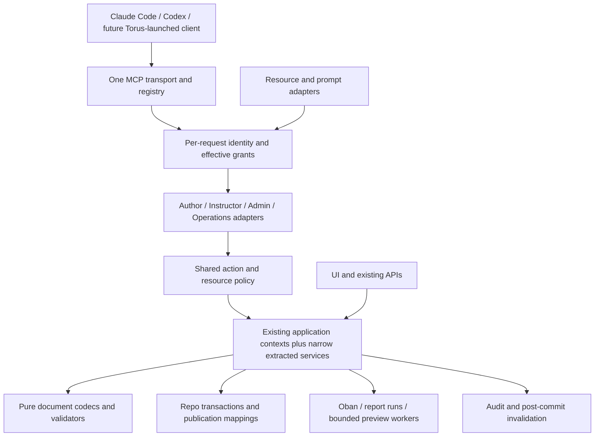

# Torus MCP expansion: discovery and architectural design

Investigation date: **2026-11-11**. Repository: **9541634b2035a138435a86cd7383df481ec33cdd**. This report describes that working tree, not a deployed environment. Pre-existing changes to `.tool-versions` and untracked `docs/exec-plans/current/epics/` were left untouched. No production implementation, dependency upgrade, authentication change, or live administrative mutation was performed.

Evidence labels used throughout: **Observed** means inspected source or an explicitly recorded probe; **Recommended** means proposed implementation; **Unverified** means a question not established by these inspections. All catalog names and new contracts are proposals unless explicitly identified as current. Repository references are root-relative; line numbers are navigation aids at the recorded revision. Existing tests cited below were inspected, not executed against a database. This is a design report, not certification of production security or client conformance.

## Contents

1. [Executive recommendation](#1-executive-recommendation)
2. [Current implementation](#2-current-implementation-and-codebase-map)
3. [Protocol and client compatibility](#3-versioned-protocol-library-and-client-findings)
4. [Capability taxonomy](#4-capability-taxonomy)
5. [Initial API catalog](#5-proposed-initial-api-catalog)
6. [Shared architecture](#6-shared-architecture-and-integration-points)
7. [Document contracts](#7-jsontorusdoc-contracts-and-adaptive-strategy)
8. [Authorization](#8-scoped-identity-authorization-and-audit)
9. [Reporting](#9-reporting-architecture)
10. [Composed workflows](#10-end-to-end-workflows)
11. [Verification](#11-verification-strategy)
12. [Delivery phases](#12-phased-delivery)
13. [Open decisions and risks](#13-ranked-open-decisions-risks-and-limitations)
14. [Sources](#14-source-register)

## 1. Executive recommendation

Build **one MCP server with four permission-separated domains**, backed by Torus application services. Make authoring the first complete workflow. Use typed tools for every essential operation, including reads; retain resources as optional addressable context and selectively add prompts as user conveniences. Resource templates parameterize URIs; prompt templates produce messages. Neither is a writable document API.

The important discoveries are:

- **Anubis is still the actual dependency**: `mix.exs:153` requests `~> 0.14.1`; `mix.lock:3` pins `anubis_mcp` **0.14.1**. The lock also contains `hermes_mcp` 0.14.1, but current server modules and the direct dependency use Anubis. Do not interpret the extra lock entry as the running implementation.
- There are only **three registered tools**, five resource components, seven project resource templates, and no registered prompts. Dynamic project reads deliberately work around exact-URI dispatch in Anubis 0.14.1.
- Authentication already revalidates the **current request's token**, because the old library shares a frame across sessions. Preserve those alternating-session regression tests during any upgrade. Token validation also rechecks project membership, but tokens lack expiry, action grants, delivery identities, and institution/section boundaries.
- **TorusDoc exists**, but it is an import pipeline, not a demonstrated lossless bidirectional format. Some activity converters are explicit stubs. Its top-level processor can clone a project: it must not become the generic parser for untrusted MCP documents.
- Authoring services already enforce revision, working-publication, editing-lock, attachment, and broadcast behavior. Direct database CRUD would lose those semantics. Page editing can update an existing working revision while a lock is held, so **revision ID alone is not necessarily a sufficient concurrency token**.
- Adaptive lessons are a graph spanning page sequence references, screen activity revisions, component layouts, variables, rules, and generated flowchart state. Frontend verification can mutate several of these. A server-side JSON validator is insufficient.
- Section creation has a particularly useful authorization boundary in `Oli.Delivery.create_section/1`. Experiments also have a substantial native context with scope and lifecycle validation; the legacy authoring query is not the whole experiment model.
- Enrollment reporting deserves a versioned report-definition/run/result model. Passback failures require both persisted grade-update evidence and Oban state; do not invent a permanent-failure field on the grade-update schema.
- Current official Claude Code documentation describes resource list/read tools, `@` references, and prompt commands. Codex release source exposes resource and resource-template handlers. The old “Claude only sees tools” observation should not determine today's architecture. Nevertheless, essential operations should have tool fallbacks.

Recommended first slice: a project-scoped token can discover a project, read/create a basic page and a multiple-choice activity, create an objective, attach it to an activity part, validate coverage, and reread both native JSON and a lossless supported TorusDoc subset. Include concurrency, denied access, real client tests, and UI coexistence before broadening activity types or adaptive writes. Publishing remains a separate explicit privilege.

## 2. Current implementation and codebase map

### 2.1 Protocol boundary and lifecycle

Observed request path:

```text
HTTP /mcp → Phoenix :mcp_api pipeline → Anubis StreamableHTTP.Plug
 → shared Oli.MCP.Server frame / protocol dispatch
 → current-request bearer validation for tools/call and torus://p/... reads
 → tool or project resource handler → authoring resolver/editor
 → Ecto transactions / resources + revisions + publication mappings
 → editor broadcasts, MCP response, token usage records
```

`lib/oli_web/router.ex:83,253` defines an empty MCP pipeline and forwards to `Anubis.Server.Transport.StreamableHTTP.Plug`. The comment saying authentication occurs at initialization is incomplete: `lib/oli/mcp/server.ex` explicitly reauthenticates protected calls. `lib/oli/application.ex:141–148` supervises the Anubis registry and server with `transport: :streamable_http`. The server advertises name `torus`, version `1.0.0`, capabilities tools/resources. This is server application metadata, not the MCP protocol version.

The installed dependency's `lib/anubis/protocol.ex:9` supports `2024-11-05`, `2025-03-26`, `2025-06-18`, latest `2025-06-18`, fallback `2025-03-26`. Initialization, JSON-RPC transport handling, sessions, protocol negotiation, and standard capability dispatch belong to Anubis. Torus overrides template listing, dynamic project reads, and tool invocation. Invalid initialization clears assigns without stopping the shared server. Torus itself does not configure a stdio or legacy SSE endpoint here. HTTP deployment/proxy behavior, Origin enforcement at the deployed edge, connection draining, and actual cluster session affinity were not exercised.

The installed resource handler (`deps/anubis_mcp/lib/anubis/server/handlers/resources.ex`) uses exact URI matching. Torus injects seven template descriptors into a temporary frame for template listing, then handles concrete `torus://p/` reads itself. Listing pagination is library cursor pagination; project hierarchy and objective graph bodies are currently whole-result reads. Catalog pagination does not bound document size.

### 2.2 Current catalog and contracts

| Current component | Inputs / output | Behavior and limitations |
|---|---|---|
| `ActivityValidationTool` | JSON encoded as string → textual validation result | Calls existing activity validation; a read/compute operation, still authenticated at tool dispatch. |
| `ActivityTestEvalTool` | activity JSON, activity type, part-input JSON strings → evaluation response | Useful evaluation foundation; must remain bounded and must not execute arbitrary code supplied as a tool argument. |
| `CreateActivityTool` | project slug, activity JSON string, activity type slug → JSON encoded in text, with resource/revision IDs | Validates, loads token author, calls `ActivityEditor.create/9`; always banked, empty objective map and tags. Its module comment claiming system-admin requirement is stale relative to its actual project-access check. |
| `ProjectResources` | `torus://p` plus seven templates below | Concrete project reads use `AuthoringResolver`; no searchable project listing tool. |
| `SchemasResource`, `SchemaResource` | `torus://schemas`, `torus://schemas/common/content` | Static schema index and common-content schema. Not a complete activity-schema catalog. |
| `ExamplesResource`, `ExampleResource` | `torus://examples`, `torus://examples/oli_multiple_choice` | Static example index and one MCQ example. |

Project URI templates: `torus://p/{project}`, `/hierarchy`, `/objectives`, `/pages/{id}`, `/activities/{id}`, `/containers/{id}`, `/objectives/{id}`. These are **resource templates**, not prompts. No Torus prompt listing/get implementation, resource subscription publisher, or argument-completion provider was found in the registered components. Static schema/example reads and discovery do not traverse the protected dynamic-project branch; keep static resources free of tenant data.

`ProjectResources` returns resource ID, slug, title, content, objectives, type, and timestamps, but does not expose a complete revision envelope or revision precondition. Its numeric type classification treats most IDs above 2 except 4 as activities; replace this assumption with registered resource types, especially for alternatives. `HierarchyBuilder` similarly uses broad fallback classification. Whole-hierarchy loading is useful for small courses but unsuitable as the only discovery operation. Broad rescues convert exceptions to resource errors, sometimes including inspected exception text; replace with safe public diagnostics and internal correlation IDs.

### 2.3 Identity, persistence, errors, and audit

`lib/oli/mcp/auth.ex` issues/regenerates project-author tokens after membership checks, looks up the hash and active status, validates author/project/membership existence, and updates `last_used_at`. Disabled tokens and removed memberships are rejected. `BearerToken` has author/project foreign keys, active/disabled status, hash, hint, and timestamps; no expiry or capability list. One token per author-project pair is enforced. `TokenGenerator` uses 32 random bytes, an `mcp_` prefix, and **MD5** storage hashes. High-entropy random tokens are not passwords, but a new token design should use SHA-256 or a versioned keyed digest; do not retain MD5 merely for consistency. No migration was made here.

Membership checks in MCP inspect the existence of `AuthorProject`; they do not visibly require `status == :accepted`, unlike experiment scope checks. That inconsistency deserves a regression test and a deliberate policy decision. Token issuance UI is in `lib/oli_web/live/projects/mcp_token_manager.ex`; administrative token browsing/status control is in `lib/oli_web/live/admin/mcp_tokens/mcp_tokens_view.ex`. These do not supply instructor or operational service identities.

`CreateActivityTool.execute/2` → `Authorization.validate_project_access/2` → JSON decode → `Oli.Validation.validate_activity/1` → `Accounts.get_author/1` → `ActivityEditor.create/9` → activity registration/model processing/objective construction → transaction creating resource/revision and working-publication association. The author is passed into the editor; the tool does not impersonate a global administrator. Existing editors are preferable to generic `Resources.create_*` wrappers.

`UsageTracker` writes token usage at entry, defaulting to success, and some error paths write a second event. It is **usage telemetry, not a reliable final-outcome audit**. It does not establish atomic mutation/audit persistence, complete request correlation, affected revisions, or client attribution. `Auth.validate_token` also writes on reads, which is relevant to throughput. No end-to-end MCP latency instrumentation or rate-limiting policy was identified in these handlers. Anubis telemetry capability is not evidence of a deployed Torus dashboard.

### 2.4 Reusable implementation map

All paths below exist at the recorded revision. The source register provides clickable root-relative repository links.

| Area | Principal implementation hooks | Implication |
|---|---|---|
| Authoring reads | `lib/oli/publishing/authoring_resolver.ex`; `lib/oli/authoring/course.ex` | Resolve the working publication and project ownership, not a globally guessed revision slug. |
| Page editing | `lib/oli/authoring/editing/page_editor.ex:64,256,295,910` | Transactions, editing locks, revision creation/reuse, learning-objective normalization, broadcasts. |
| Activities | `lib/oli/authoring/editing/activity_editor.ex:92,170,370,561,1658` | Bulk retrieval/edit, banked/embedded scope, part/objective synchronization, creation. |
| Curriculum | `lib/oli/authoring/editing/container_editor.ex:111,288,327,376` | Add, move, remove, reorder with working revisions and broadcasts. |
| Objectives | `lib/oli/authoring/editing/objective_editor.ex:22,163,193,283,398,559,706` | Hierarchy, detach preview, locking, reference-aware deletion and attachment queries. |
| Publication | `lib/oli/publishing.ex`; `lib/oli/resources/revision.ex` | Distinguish draft mappings from published content and historical revisions. |
| Media | `lib/oli/authoring/media_library.ex` | Reuse media ownership/catalog integration; do not accept arbitrary server filesystem paths. |
| Section creation | `lib/oli/delivery.ex:39`; `lib/oli/delivery/section_creation.ex`; `section_creation_request.ex` | Actor/source authorization, transaction, creation audit, direct versus LTI delivery. |
| Enrollments | `lib/oli/delivery/sections.ex:699,744,844`; `sections/enrollment.ex` | Roles are many-to-many LTI context roles, not a boolean instructor field. |
| Grades | `lib/oli/grading.ex:170,257,265`; `delivery/attempts/core/resource_access.ex` | Gradebook and authoritative persisted score/out-of data. |
| Passback | `delivery/attempts/core/lms_grade_update.ex`; `delivery/attempts/page_lifecycle/grade_update_worker.ex` under `lib/oli/` | Outcome history plus asynchronous retries; external side effects belong only to remediation. |
| Proficiency | `lib/oli/delivery/proficiency.ex:59,88`; provider modules | Model-aware estimates/aggregates, not simply grade percentages. |
| Analytics/export | `lib/oli/analytics/summary.ex`, `clickhouse_analytics.ex`, `datasets.ex`, `datasets/dataset_job.ex` | Operational SQL, derived summaries, historical events, and existing export jobs have different freshness and cost. |
| Experiments | `lib/oli/experiments.ex`; `experiments/scope_validator.ex`, `activation_validator.ex`, `lifecycle.ex` | Native typed request/context boundary; don't wrap legacy alternatives query as the complete API. |
| Operations | `lib/oli_web/telemetry.ex`; `lib/oli_web/presence.ex`; Oban config | Existing measurements and scoped presence are foundations, not a global session ledger. |
| Instructor customization | `lib/oli/delivery/remix.ex`, `remix/state.ex` | Delivery hierarchy/customization is a different authority boundary from source project editing. |

Tests include HTTP initialization and alternating authenticated sessions, revoked/missing tokens, static resources, creation, and template pagination in `test/oli/mcp/`. Authoring editors, objective rules, sections, experiments, proficiency, and TorusDoc have their own suites. Preserve those tests rather than replacing them with mocked MCP-only checks.

## 3. Versioned protocol, library, and client findings

### 3.1 Version evidence and release distinction

Primary sources accessed **2026-11-11**:

| Subject | Exact evidence | Interpretation |
|---|---|---|
| Installed Torus library | Anubis 0.14.1, dependency/lock and local source | Actual implementation; three older protocol revisions above. |
| Latest stable Anubis | Hex API `latest_stable_version: 2.2.0`; changelog date **2026-10-19** | Released, not a main-branch proposal. |
| Current MCP spec | Official `/specification/latest` redirects to **2026-07-28** | Current revision uses stateless self-contained requests and per-request capabilities. Older initialization/session assumptions are not universal. |
| Codex CLI | Local `codex --version`: **0.167.1**; GitHub latest release **rust-v0.167.1**, **2026-11-10T21:32:01Z** | Release-tagged source inspected, not SDK inference. |
| Claude Code | GitHub latest **v2.1.322**, **2026-11-10T02:29:43Z** | Current docs inspected. Local `claude` resolves to a cmux wrapper which reports `Error: claude not found in PATH`; no executable client session succeeded. |

Anubis 2.x documents support for 2025-03-26, 2025-06-18, 2025-11-25, 2026-07-28; 2.0 removed 2024-11-05 and legacy HTTP+SSE. 1.8 removed automatic application startup/bundled CLI; supervision must be checked explicitly. Recent releases add OAuth server integration, task handling, session isolation/storage work, and stateless support. 2.2 makes the stateless server mode default. These changes make a direct version bump inappropriate without migration tests. The package has recent releases and fixes, so abandonment is not established.

**Recommendation:** retain Anubis as the initial candidate, qualify 2.2.0 in a separate compatibility spike before expansion. Test Torus overrides, per-request identity, response conversion, supervision, protocol headers, and old client negotiation. Remove private-frame manipulation only after public APIs replace it. A disposable in-memory read of the released Hex tarball confirms `elixir: "~> 1.18"`, Finch `~> 0.24`, Peri `~> 0.11.2`, Telemetry `~> 1.4`, optional Plug `~> 1.20`, JOSE and Redix. These differ materially from the installed lock requirements. No explicit OTP floor was established from this package inspection; this investigation did not compile 2.2.0 or resolve its dependencies against Torus. No concrete blocker justifies a library migration yet, so an alternative-library survey would add little value.

### 3.2 Compatibility matrix

“Library” means implemented primitive, **not** a guarantee Torus registers it. “Client available” means documented or source-exposed to users/models, **not** a successful Torus HTTP end-to-end test. U = unverified at the CLI surface. Spec references are E1–E5 in §14.

| Capability | MCP current spec | Anubis 0.14.1 / Torus today | Anubis 2.2.0 | Claude Code current docs | Codex 0.167.1 evidence | Baseline decision |
|---|---|---|---|---|---|---|
| Tools list/call | Core; model-oriented | Yes / three tools | Yes | Model tools, deferred tool search configurable | MCP tool integration | Required, typed inputs and bounded outputs |
| Structured results / annotations | Output schemas, structured content, hints | Response.structured and component annotations exist; current tools mainly text | Supported | Exact rendering U; annotations influence behavior but are not authorization | Exact rendering U | Structured JSON plus useful text fallback; test both |
| Resources list/read | URI context; host decides UI | Static list; project dynamic routing workaround | Supported | `@server:uri` plus automatically provided list/read tools | Release handlers plus successful local list/read/pagination probe | Optional parallel read path sharing service/policy |
| Resource templates | Enumerate parameterized URIs, read expanded URI | Seven Torus templates, library pagination | Supported | Concrete resource support documented; template enumeration/completion UX U | Release handler plus successful local template-list probe | Useful URI documentation; do not require template expansion for essential work |
| Embedded resource / resource links | Tool content can include them | Response helpers exist | Supported | Automatic link dereference U | Automatic link dereference U | Include summary and tool-readable ID; links are not automatic fetch guarantees |
| Resource updates / list changes | Optional; current revision uses subscription stream | No Torus publishing integration identified | Released subscription/notifier work | Runtime/configuration-dependent streams documented; exact resource refresh U | Subscription model visibility U | Poll/read version fallback |
| Prompt templates | list/get reusable messages | Library prompt support; none registered | Supported | User commands `/server:prompt` or `/mcp__server__prompt` | CLI prompt UI/autonomous access U in this investigation | Optional workflow recipes, never required |
| Argument completion | Optional assistance to prompts/template arguments | Handler exists, no Torus provider | Supported | U | U | Do not depend on it |
| Transport | stdio, Streamable HTTP; revision-specific lifecycle | HTTP endpoint; old library also contains other transports | stdio/Streamable HTTP; old SSE removed | HTTP, stdio and additional documented transports | HTTP/stdio configuration; probe below uses stdio | Remote HTTPS Streamable HTTP |
| Authorization discovery | OAuth resource-server metadata for HTTP | Custom bearer only | OAuth integration released | OAuth and custom headers documented | Local auth/config supported; Torus OAuth flow untested | Bearer pilot; standards-compliant OAuth migration |
| Progress/cancellation/tasks | Progress/cancel; tasks optional extension in current spec | No Torus job surface | Task support released, dialect-sensitive | Task workflows documented | Practical task UI U | Ordinary Torus job IDs and status tools first |

Current documentation disproves a universal Claude tools-only limitation: users can select resources, and the model has resource read/list tools. Template-only discovery may still be inconvenient; expose a concrete project index and search/read tools. Codex release-tagged `mcp_resource.rs` exports three handlers for resource listing, template listing, and reading; that is CLI implementation evidence, stronger than finding methods in an SDK. It does not prove every configured session enables them. Prompts are user-oriented recipes; no evidence here justifies assuming agents autonomously discover and execute prompts on both CLIs.

Tools-only is the simplest interoperable baseline but loses stable context URIs and convenient attachments. Tools plus resources adds value for schema/version references, document reads, and UI selection at low incremental domain cost. Selective prompts can explain “author a module” or “audit objective coverage”; keep them stateless instructions with no implicit rights, mutations, or embedded sensitive data. Avoid duplicate tool/resource implementations.

### 3.3 Local probes and reproducible client procedure

Observed environment probes: Codex 0.167.1 installed and `codex login status` reports ChatGPT login; Claude wrapper is present but the underlying executable is unavailable. No user/global MCP configuration was edited. Release-tagged Codex source and its deterministic `scripts/mcp_conformance/server.py` were downloaded to `/tmp`, outside the repository. The source file's help still calls the 2026-07-28 dialect “draft”; the live official spec labels it current. Treat this as documentation lag, not evidence that the official revision is unreleased.

**Observed client probe: passed for resources, templates, pagination and text read.** Codex 0.167.1 ran in `/tmp/torus-mcp-client-probe` with command-local `mcp_servers.torus_probe.command="python3"` and args pointing to the downloaded fixture, `--mode 2025-06-18 --transport stdio`. No persistent MCP configuration changed. The prompt restricted the client to the synthetic server and requested listing resources/templates and reading one resource. The client used generic model-visible MCP resource tools, without manual `@` selection:

| Call | Observed result |
|---|---|
| resource list | `test://fixture/readme`, cursor `page-2` |
| resource list with `page-2` | `test://fixture/こんにちは`, no next cursor |
| template list | `test://fixture/{name}` |
| resource read | `fixture contents for test://fixture/readme` |

All four calls completed successfully. This proves autonomous resource-tool usability for this local configuration, not autonomous discovery without an explicit resource-related task. It does **not** qualify Torus's authenticated remote HTTP route, template completion, prompts, notifications, structured tool results or tasks. The fixture SHA-256 was `0af08b4c6e945ed4b96d111eb45bed7e74fb191a6fcf63b3b9280d65a5ebddc7`. The trace remains disposable under `/tmp`; observations and reproduction configuration are preserved here.

Reproduction/next verification (synthetic data only):

1. Fetch the official Codex fixture at tag `rust-v0.167.1`; record its hash. Start with `python3 server.py --mode 2025-06-18 --transport stdio`, or `--transport http --host 127.0.0.1 --port 8765`.
2. Configure only a disposable `torus_probe` server. For Codex use command-local `-c 'mcp_servers.torus_probe.command="python3"'` and corresponding `args`; for Claude use a temporary project config/`--mcp-config` after checking that installed release's help. Do not replace global config.
3. Ask each model to discover a tool without naming it, list resources, list templates, expand/read a URI, and retrieve a second cursor page. Separately invoke a prompt through the documented UI. Record JSON-RPC method trace, visible answer, and whether manual selection was needed.
4. Test structured output, text fallback, embedded resource, resource link, completion, updates, cancellation, and tasks independently. A successful tools/list does not pass those cases.
5. Repeat against a disposable Torus test database via HTTP, with two authors/projects, revoked tokens, omitted authorization, mismatched session IDs, and alternating requests. Capture header names and redacted traces, never bearer values.
6. Repeat on the proposed library version and all supported dialects. Require resource/tool read equivalence. Add a latest-version client smoke run to releases; pin exact tested versions in results.

## 4. Capability taxonomy

### 4.1 Authors: primary investment

**Projects and context.** Use `Course` and `AuthoringResolver` to resolve accepted collaborator access and working-publication state. Return stable resource IDs and current revision tokens, with slugs as labels/lookup aliases. Provide text/type/tag/objective filters and shallow tree reads. Project create/update/archive or clone are explicit domain commands, not arbitrary changesets; collaboration/ownership transfer is separate privileged scope. Project deletion is high impact and deferred beyond the first slice.

**Objectives.** Objectives are revisioned resources with child resource IDs; they are not necessarily a strict single-parent tree. `PageEditor.construct_parent_references/1` explicitly supports multiple parents. `ObjectiveEditor` provides parent/child association operations and reference-aware sub-objective deletion. It documents a race boundary: objective association writers share mapping locks, while course-content reference writers do not. MCP must test deletion concurrent with attachment and require an explicit detach strategy. Detach preview reports locked pages/activities; a successful partial detach must not be reported as complete deletion.

**Curriculum.** Container `children` represent ordering. Units/modules/containers named “sections” are curriculum objects, distinct from enrollable delivery sections. Use `ContainerEditor` add/move/remove/reorder semantics, enforce project membership on both source and destination, reject cycles and invalid parent types, and lock/recheck affected parent mappings together. Read depth, child count, and continuation explicitly. Removing a reference and deleting its resource are separate operations; report usage before destructive deletion.

**Basic pages.** A revision's `content` contains `version` and `model`; rich content uses typed nodes and text children, interleaved with activity references, selections, groups, surveys, and other elements. Full-document replacement is useful for initial generation. Stable-node insert/update/remove/move is useful for iterative prose and embeds. Preserve unknown nodes and metadata. Existing `PageEditor` lock and release behavior must be reconciled with agents rather than bypassed. Preview rendering exists (`render_page_html/4`), but HTML preview is not proof of correct delivery evaluation.

**Activities.** Banked and embedded are scope distinctions on revisioned resources; embedding uses references, not simply a JSON copy inside a page. Shared references can affect multiple working pages. Use registered activity manifests and validation schemas to expose supported types, parts, response rules, feedback, hints, transformations, tags, assets and evaluation inputs. MCP creation today always uses banked scope and no objectives/tags; it does not satisfy embedded authoring. `ActivityEditor` has special logic for embedded bundles and secondary activities. Expose affected usage and offer explicit copy-before-edit when the caller wants independent reuse. Delete must check parent-page locks, bank usage, and publication safety. Do not infer a universal schema from MCQ.

**Objective attachments are first-class.** Page/container associations use `objectives.attached`; activity revision objectives are a map from part ID to objective resource-ID lists. Part IDs must exist in `authoring.parts`; all objective IDs must resolve in the project working publication. `ActivityEditor` can attach to all parts and synchronize maps to existing parts; an MCP write should reject invalid references rather than silently drop them. Page links describe intended learning; activity-part links describe assessment evidence. Curriculum-derived objectives and delivery realized/contained objectives must be labeled derived, with provenance. Do not treat a page's objective as proof every embedded part assesses it. Coverage results should distinguish unused banked activities from activities reachable through curriculum and include selectors whose possible activity population is dynamic. Return `explicit`, `derived`, and `potential` edges separately.

**Adaptive lessons.** See §7.3. Screens are activity revisions referenced from a lesson sequence; sequence IDs are navigation targets, distinct from resource IDs, activity slugs, component/part IDs, and rule IDs. `partsLayout`, `custom`, `authoring.parts`, `authoring.rules`, flowchart paths, evaluation dependency lists, and scoring fields interact. Proposed supported operations are screen retrieval, graph inspection, component update, rule replacement, branch-target change, and safe screen duplication/removal with reference rewrites. General scripted/legacy lessons require full native documents plus raw TorusDoc blocks until validated adapters exist. Preview/debug must supply deterministic initial state and user inputs, bounded traces, fired rule IDs, state changes, feedback and scores; never run an unrestricted author-supplied program on the web node.

**Experiments.** `Oli.Authoring.Experiments.get_latest_experiment/1` finds alternatives with `experiment_controlled` or legacy `upgrade_decision_point`. Separately, `Oli.Experiments` manages definitions, conditions, interventions, assignment scope, weighted random/Thompson sampling policy implementations, bindings, exposure/outcome/reward receipts, lifecycle and section participation. Create/update typed requests already exist; authoring algorithm validation may restrict algorithms beyond what runtime modules implement. Expose allowed algorithms from that validator, not from a directory listing. Draft structural edits and condition availability changes are different commands: availability may change while active/paused and keeps prior assignments sticky. Activation must run `ActivationValidator` and require separate live-effect permission over participating sections. Archive/complete/pause are not ordinary revision edits. Record configuration version and assignment policy with results to preserve comparability. Never repurpose prior observations under a changed experiment definition.

**Related essentials.** Media search/upload registration, preview, revision history, validation, copy/reuse, publication inspection and publishing are needed for complete course work. Reuse `MediaLibrary`, existing upload mechanisms and publishing services; enforce MIME/size, ownership and sanitized metadata. Uploaded content is data, not instructions. Avoid unrestricted URL fetch; use controlled upload tickets and validate any allowed fetch redirects. History should expose safe metadata/diffs and restore-as-new-draft where editor semantics permit; never rewrite published history. Publishing is P2 and explicit, not an automatic side effect of a successful write. Instructor remix/customization never implies source project edit rights.

### 4.2 Engineering and DevOps

Provide read-only aggregate health and queue observations. No arbitrary RPC, Erlang evaluation, process stack/state dumps, cache value dump, SQL, environment or secret inspection.

| Measurement | Source / scope | Proposed semantics and cost |
|---|---|---|
| BEAM memory/processes/run queue | `OliWeb.Telemetry.non_distributed_metrics/0`; node-local | Current sample timestamp; memory bytes, process count, scheduler/run queue. Fan out to a bounded known node set; return per-node status and partial coverage. Sum memory/process count only across responding distinct nodes. Do not sum scheduler utilization percentages. |
| Scheduler utilization | Requires interval sampling beyond queue-length metric | Report elapsed window, active/total scheduler time and weighted aggregate. Disabled/unavailable is distinct from zero. |
| DB pool pressure | Repo query queue/query/idle telemetry | 1/5/15-minute quantiles and event counts from an explicitly configured collector. Queue time is a contention signal, not the number of available connections. Exact pool occupancy needs supported instrumentation; do not invent it. |
| Presence/connections | Phoenix Presence topics, endpoint/channel measurements | Count observed tracked identities/connections with topic scope and freshness. One person can have many tabs; first-meta helper loses connection multiplicity. Not a complete count of authenticated sessions. |
| Active users | Proposed deduplicated activity window | Define “active in last 5 minutes” using approved telemetry; do not call it logged-in sessions. Historical count requires retained events and privacy policy. |
| Oban state | SQL grouped by queue/state | available, scheduled, executing, retryable, discarded, completed, cancelled; oldest eligible-job age, retry attempts, execution latency and failures by worker. Global DB counts must not be added once per node. |
| Cache/analytics integration | Cache telemetry, xAPI pipeline queue/upload events, dashboard telemetry | Counts, hit/miss/latency only. Freshness/watermark and dependency availability; no learner payloads or credentials. |

Proposed collection: cache snapshots for 10 seconds, 2-second per-node deadline, report missing nodes and sample times, and restrict history to configured stores/retention. Oban completed/discarded trends are bounded by pruning, not a durable all-time ledger. Limit diagnostic examples to 20 jobs, include worker/queue/state/attempt timestamps and redacted error categories, never raw args. Pure observation should not call LMS test endpoints or retry jobs. Integration status can report last observed success/failure; active checks need separately evaluated side effects.

### 4.3 Administration

Section schema requires type, title, registration_open and base_project_id; defaults and source hydration supply some values. Creation request allows title, section number, modality, class days, dates, preferred scheduling time and timezone. Sources are publication/product/section IDs. `Delivery.create_section/1` rechecks the actor and source inside the appropriate transaction. Author actors must be administrators; direct users need `can_create_sections`; LTI users need a persisted launch bound to issuer/client/deployment/context. A forged institution ID is not a launch. LTI specifications derive service URLs and institution from validated relationships. Direct delivery's institution ownership needs an explicit policy before offering institution-scoped creation; adding a caller-supplied institution attribute would bypass the current whitelist.

Instructor roles are LTI context roles on enrollments. Scalar `Sections.enroll/4` replaces the role association, while bulk enrollment inserts/adds role links; a naive wrapper can accidentally strip or accumulate roles. Propose `admin_instructor_set` with `grant`/`revoke`, preserving unrelated roles inside a transaction and recording before/after. `unenroll/3` removes specified roles and suspends when none remain. Do not expose arbitrary context-role IDs or account-level privilege flags. Instructor membership alone does not authorize delegating instructor privileges. Decide authority for LTI-managed role reconciliation and protection against removing the last authorized instructor.

Passback report state is derived from `LMSGradeUpdate` (`success/failure/not_synced`, type, attempt_number, details, score/out_of and timestamps), `ResourceAccess`, and `GradeUpdateWorker` jobs. The worker retries up to five attempts and deduplicates pending jobs by resource access. It reads the **current** grade at execution, not necessarily the grade when enqueued. Report pending/executing/retrying only when job evidence exists; “permanent failure” means exhausted/discarded evidence, otherwise unknown. Repeated failure is a windowed count, not a status enum. Success does not prove the LMS currently displays the same value. Redact diagnostics and URLs. Retries/resubmissions are separate, deferred tools with external-side-effect permission and deduplication.

### 4.4 Instructors

Start with three views: section gradebook (paged learners/assessments), objective proficiency summary with optional authorized learner drill-down, and aggregate page/activity performance. Use `Oli.Grading` for score/out-of and gradebook inclusion semantics, `Oli.Delivery.Proficiency` for configured model estimates, and analytics summaries/dashboard query services for aggregates. Missing grades remain null, not zero; return attempt/status/graded metadata and distinguish a grade from the maximum possible score. Proficiency has provider-specific semantics (`naive`, `lkt_aoa`); confidence support is model-dependent. Include model version and data timestamp.

Section read membership is checked currently, including enrollment status and approved role. Aggregate access does not automatically permit identifiers, email addresses, free-text responses, or raw attempts. Drill-down requires individual-data grant and field policy. Default small-cohort suppression policy is an open product decision; prevent differencing via arbitrary filters if suppression is adopted. Delivery customization uses section resources/remix; it does not authorize changing the source project or reading another section using the same publication.

## 5. Proposed initial API catalog

Names below are **proposed**, with domain prefixes. P0 = first authoring slice, P1 = near-term useful breadth, P2 = gated later work. R = read/compute; W = mutation; J = creates persisted job/run. All reads authorize again at execution; all writes require preconditions and attribution. “S/A” means synchronous under limits, asynchronous for declared larger operations. Families represent a small set of typed schemas, not one free-form action router. Registration should initially expose roughly a dozen authoring tools, then grow by demonstrated use; this table is a roadmap, not one release's catalog.

| Candidate operation/family | Purpose / target; key input → output | Class / scope | Existing hook; side effects | Mode / priority; unresolved |
|---|---|---|---|---|
| `author_projects_list`, `author_project_get` | Accessible project search, state → IDs/summary/publication | R project.read | Course, AuthoringResolver; none | S/P0; accepted-membership policy |
| `author_project_create/update/clone/archive` | Explicit project metadata/lifecycle → project | W project.manage, source.read for clone | Course, authoring clone services; copies/revisions | S/A/P2; ownership/visibility defaults |
| `author_resources_search`, `author_curriculum_get` | type/title/tag/objective and root/depth/cursor → summaries/subtree | R project.read | Resolver and container queries; none | S/P0; indexed search plan |
| `author_document_get` | project/resource, view, format, fields → versioned envelope | R project.read | Resolver, activity retrieval, proposed codec | S/P0; JSON/TorusDoc support table |
| `author_objectives_create/update` | title/parent IDs/preconditions → objectives/revisions | W objective.write | ObjectiveEditor | S/P0; bounded batch ≤50 |
| `author_objectives_delete` | reference preview + explicit detach policy → impact/result | W objective.delete | eligibility/detach/delete APIs | S/A/P1; lock/reference race closure |
| `author_curriculum_add/move/reorder/remove` | parent/source/destination IDs, anchors, parent versions → affected parents | W curriculum.write/delete | ContainerEditor; revisions, broadcasts | S/P0 add, P1 others; cycle/type validation |
| `author_document_write` | complete revision payload, expected version, format → revision+diagnostics | W page.write or activity.write | PageEditor/ActivityEditor plus proposed adapters | S/P0 basic/MCQ; atomic lock/revision test |
| `author_document_patch` | stable-node operations + expected version → revision/diff | W page.write/activity.write | Proposed patch adapter before same editors | S/P1; no ambiguous positional patch |
| `author_activity_create` | registered type/scope/content/part map/tags → IDs | W activity.write | ActivityEditor.create; creates revision | S/P0 MCQ; embedded parent precondition |
| `author_activity_delete/copy` | resource and usage policy → impact/new resource | W activity.delete/write | ActivityEditor; references/bundles | S/P1; shared-reference intent |
| `author_activity_types_get` | type/version → manifests, schemas, examples, format support | R authenticated catalog | activity registry, validation assets | S/P0; no promise unsupported converter works |
| `author_objective_links_get/set` | target resource+optional part, explicit IDs → association edges/revision | R/W project.read/objective_links.write | ObjectiveEditor mappings; PageEditor/ActivityEditor writes | S/P0; reject part/objective mismatch |
| `author_objective_coverage` | project/subtree/objectives, bank inclusion → covered/uncovered parts/objectives, provenance | R project.read | mapping query/resolver; proposed joined projection | S/A/P0 small; selectors return potential coverage |
| `author_validate` | draft bundle or resource IDs + validation level → diagnostics | R project.read and bounded compute | Validation, proposed semantic/ref validators | S/A/P0; never implicit repair |
| `author_preview` | draft resource/version + test state → preview handle/trace | R project.read | page renderer, existing preview paths | S/A/P1; isolated adaptive runner proposed |
| `author_adaptive_graph_get`, `author_adaptive_branch_set` | lesson/screen/rule IDs, target+versions → graph/diff/diagnostics | R/W project.read/adaptive.write | Flowchart logic extraction, ActivityEditor bulk_edit | S/P2; multi-revision atomicity and compiler parity |
| `author_adaptive_screen/component_edit` | typed screen/component change → updated bundle | W adaptive.write | proposed semantic adapter; existing editors | S/P2; unknown/scripted content fallback |
| `author_experiments_list/get/create/update` | typed definition/configuration → scoped definition | R/W experiment.read/draft.write | Oli.Experiments typed requests | S/P1; expose allowed policy subset |
| `author_experiment_transition` | expected configuration/state, transition, participation → state | W experiment.live + affected section grants | lifecycle/activation validator | S/P2; live assignments and comparability |
| `author_media_search/register` | metadata/upload ticket → asset ID/reference | R/W project.read/media.write | MediaLibrary/upload integration | S/A/P1; quotas/scan status |
| `author_history_get`, `author_restore` | resource/revision/diff → history/new draft | R/W project.read/page or activity.write | Publishing/revisions + editors | S/P1/P2; no direct historical rewrites |
| `author_publish` | project expected working manifest + description → publication | W project.publish | Publishing | S/A/P2; explicit release boundary |
| `admin_section_sources`, `admin_section_create` | allowed source + delivery mode/attrs → section | R/W section.create + source.read + destination grant | Delivery.create_section/1 | S/A/P1; direct institution policy |
| `admin_instructor_set` | section/user, grant/revoke → role diff/enrollment status | W section.instructors.manage | proposed policy wrapper around Sections | S/P1; no arbitrary role escalation |
| `reports_list/describe` | optional domain/name → typed definition/version | R report.discover | proposed code registry | S/P1; schemas are not row access |
| `reports_run`, `reports_status/results/download/cancel` | definition/version/typed parameters → run, cursor rows or artifact | J/R report.run + row/field/download policy | proposed report service, existing queries/Oban/export foundations | S/A/P1; retention and snapshot semantics |
| `admin_passback_summary/details` | institution/section/window/state → redacted outcomes/evidence | R passback.read | Core grade updates + Oban + access records | S/P1; may share report definition |
| `instructor_gradebook`, `instructor_proficiency`, `instructor_performance` | section, authorized filters/cursor → scoped data with semantics/freshness | R section.performance.aggregate or individual | Grading/Proficiency/analytics services | S/P1; field visibility and suppression |
| `ops_health`, `ops_jobs` | allowed cluster/queue/window → bounded metrics/evidence | R operations.read | Telemetry, Presence, Oban queries; proposed snapshot collector | S/P1; unavailable metrics explicit |

No `execute_sql`, `run_elixir`, generic schema CRUD, unrestricted report expression, arbitrary account role mutation, or LMS resubmit is in the initial catalog.

### Structurally important contracts

**Document write:** authorize project and resource/type first; parse bounded payload; validate shape, IDs, references, domain rules and working state; acquire existing editor lock and row/mapping lock; compare expected version in that transaction; write via editor; commit change audit; publish invalidation after commit; return new token and affected references. Full replacement of a revision payload must not delete unrelated project resources. A retry key binds principal/token, operation, boundary and canonical input hash; mismatched reuse returns `IDEMPOTENCY_CONFLICT`.

**Objective links set:** input `{project_id,resource_id,part_id?,objective_ids,expected_version}`. For pages/containers the destination is `attached`; for activities part ID is required unless an explicit `all_parts` selector is supplied. Replacing one part's list preserves other part lists. Empty list removes that target's links. Missing objective is an error, not silent filtering. Return explicit links plus separately labeled derived coverage. Reference validation and concurrent objective deletion must share a locking/invariant strategy.

**Curriculum move:** source and destination parent versions plus stable `before_resource_id` or `after_resource_id` anchor; source/destination ownership and subtree-cycle checks are mandatory. Transaction changes both parent revisions or neither. Invalid anchor produces a recoverable conflict. Publication IDs are read-only context, not mutation targets.

**Section create:** accepted source enum and identifier, direct or authorized LTI specification, allowlisted attributes, idempotency key, destination grant. Resolve actor server-side; never accept `actor_id` as caller identity. Delegate to `Delivery.create_section/1`; do not substitute low-level `Sections.create_section/1`. Return section/resource initialization state, source publication IDs, created enrollment if any, and audit correlation. Large source initialization can become an Oban job only after preserving existing transaction/lifecycle behavior.

**Instructor grant/revoke:** enforce a dedicated delegator permission, allowed institution/section, current target identity and expected enrollment role version. Preserve unrelated roles; forbid caller-controlled system roles. Return before/after roles and status. No invitation email unless explicitly part of the operation contract. Revocation must not silently delete historical attempts.

**Reports run:** validate definition version and typed parameters before job allocation; resolve permitted boundaries server-side, cap row/field access independently of filters, and persist normalized inputs plus requesting identity. Job completion never grants permanent access to its artifact. Cancellation stops further work cooperatively and marks partial artifacts unusable unless explicitly described as partial.

## 6. Shared architecture and integration points

Recommended modules below are **proposed**, not claims of existing code: `Oli.MCP.RequestContext`, `Oli.MCP.Policy`, `Oli.MCP.Contracts`, domain adapter namespaces, `Oli.Authoring.DocumentService`, `Oli.Authoring.DocumentFormats`, `Oli.Reporting`, and `Oli.Operations.ReadModel`. Keep these small and introduce only when a concrete operation needs them.



The diagram denotes ownership, not a requirement for another generic framework. Domain contexts must not depend on Anubis frame types, response structs, or UI assigns. Shared policy receives explicit principal/action/target; transport adapters turn failures into MCP results. Extract actual rules from frontend flowchart mutations and any LiveView-specific grant/report logic; do not call LiveView event handlers from tools.

Search returns summaries first. Default page size 50, max 200, stable sort `(sort_key, resource_id)`, opaque signed cursor tied to filters, principal/boundary and view version. Reads support allowlisted fields, subtree depth and content-node IDs; mark `truncated` and provide continuation rather than silently cutting JSON. Proposed initial bounds: 1 MiB input document, 100 KiB default response, 50 writes per bounded batch, 2-second synchronous target for ordinary reads, 10-second compute threshold before an explicit job. Tune against real fixtures; larger adaptive documents should use bundle/job APIs instead of lossy truncation.

Success contract: `contract_version`, `data`, `warnings`, `request_id`, `as_of`, `next_cursor`, and revision tokens where relevant. Expected failures use MCP tool `isError` plus machine-readable `{code,message,path,node_id,retryable,details}` and a text summary. Use `NOT_FOUND_OR_FORBIDDEN` where existence is sensitive, `VALIDATION_FAILED`, `REVISION_CONFLICT`, `RESOURCE_LOCKED`, `UNSUPPORTED_FORMAT`, `RATE_LIMITED`, `DEPENDENCY_UNAVAILABLE`. JSON-RPC errors remain protocol/dispatch errors. Include retry-after for rate/dependency failures; do not encourage blind retry of conflicts.

Concurrency tokens must cover mutable working content: use revision ID **and** a persisted edit generation or canonical content/metadata digest validated under the existing mapping/row lock. `updated_at` precision alone is weak. Agent/user conflicts return the new version and safe diff summary; no automatic last-write-wins. Existing email-based reentrant editor locks can let the same author's UI and token share ownership accidentally; proposed logical editing actor/lease identity must distinguish client sessions while preserving author attribution.

Use small transactions for one domain operation or a declared bounded document bundle. Creating objectives, activities and pages over several calls is a resumable workflow, not an invented distributed transaction. Return created IDs immediately and support idempotent retry. On failure report completed steps; cleanup is an explicit authorized draft deletion, never automatic removal of shared objects. For adaptive bundle edits, validate all expected revisions and commit all affected mappings atomically. Post-commit broadcasts should not advertise rolled-back changes.

Reuse editor PubSub broadcasts; verify how each open editor reacts. Do not automatically overwrite unsaved UI content. Show “external revision available,” refresh safe read-only views, and reject stale saves. For agent review, start with audit provenance and a revision-level `review_requested` annotation or external review record proposal. A fragment flag is unstable under moves and full replacements; a new publication-blocking state machine is unnecessary until product policy requires it. No review annotation should itself grant publish permission.

Ordinary Torus job handles are preferable to mandatory MCP Tasks: they survive client disconnects, work through normal tools, and reuse Oban. Optional protocol progress/task adapters can expose the same run. Cancellation is best-effort before commit; after a committed mutation it cannot imply rollback. Enforce per-principal queue/concurrency/export quotas and byte/query/time limits. Heavy adaptive simulation and future agent execution run outside Torus web processes; this server provides capabilities, not an embedded autonomous-agent orchestrator.

## 7. JSON/TorusDoc contracts and adaptive strategy

### 7.1 Existing format versus proposed contract

Observed: `Oli.TorusDoc.process/2` uses YAML parsing then page conversion or a project clone directive. `PageConverter` outputs an import-oriented `type: Page` wrapper with content version `0.1.0`, generated IDs, empty attached objectives/tags and unresolved-reference list. It supports prose, groups, surveys, references, inline activity material and bank selection. Inline activities use `_inline_activity` and `_virtual_id` placeholders requiring persistence by a caller. This is not a stored revision envelope. `ActivityConverter` implements MCQ, short-answer and multi-input routes; CATA and ordering routes return “not yet implemented.” The MCQ import converter can emit `objectives.attached`, whereas persisted activity revisions require part-keyed mappings; its import shape must be normalized deliberately, not written verbatim. No reverse `to_yaml`/`from_torus` serializer was found under `lib/oli/torus_doc`. Therefore a general lossless round trip is **not existing functionality**.

Recommended canonical model: existing persisted revision content and metadata, plus a versioned interchange envelope. JSON is the native representation. TorusDoc is an adapter over the same model, not a second business/auth path. Separate `format_version` from `content.version` and schema/type version. Resource IDs are server-owned stable identifiers; node/part/sequence IDs retain their actual string identity. New objects may use scoped temporary IDs resolved in an explicit bundle result. Never reinterpret an arbitrary slug as a resource ID.

Parsing must be pure. Exclude `project_directive` from document-write parsing; cloning is a separate authorized tool. YAML should use a restricted JSON-compatible scalar model, reject duplicate keys/custom tags, disable aliases or bound expansion, cap bytes/depth/node count, and reject non-finite numbers and ambiguous implicit date/boolean coercions. Quote IDs and expression strings. Parse Markdown to approved rich nodes; do not flatten unsupported HTML, math, tables, embeds, marks or adaptive expressions to plain text. Unknown nodes/fields survive as native blocks.

Validation stages: decode → format conversion → structural schema → unique/stable IDs → cross-reference ownership and existence → activity/page/adaptive domain rules → concurrency and authorization recheck at commit. An explicit validate call helps agents repair inputs, but never substitutes for mandatory validation on write. Diagnostics include stable node/part IDs, JSON Pointer or YAML source span, error code, severity and repair suggestion. Permission failures should not reveal cross-project titles.

Round-trip contract for a declared supported profile: `decode(encode(native))` preserves all fields, IDs, ordered arrays, rich marks, references, rule priority, expressions and numeric values. Allowed canonicalization: object key order, YAML quoting, line endings and declared equivalent Markdown spelling; not regenerated IDs, reordered rules, lost HTML attributes or changed whitespace in code/math. For YAML→JSON→YAML compare parsed semantics, not byte identity. A native fallback must preserve unknown fields; incompatible shorthand plus conflicting native override is an error. Unsupported rich constructs should emit `UNSUPPORTED_SHORTHAND` with a raw representation, not silently downgrade.

### 7.2 Illustrative contracts

All envelope fields and TorusDoc v1 syntax below are **proposed**. Native payload shapes are grounded in `PageConverter`, `ActivityEditor`, the current MCQ example and flowchart source. IDs are synthetic. Examples are illustrative fragments, not claimed executable fixtures.

Full-document basic-page write (`author_document_write`):

```json
{
  "contract_version": "1",
  "project_id": 12,
  "resource_id": 201,
  "expected_version": {"revision_id": 501, "edit_generation": 3},
  "idempotency_key": "module-a-page-201-v4",
  "format": "json",
  "mode": "replace",
  "document": {
    "title": "Comparing fractions",
    "objectives": {"attached": [301]},
    "content": {"version": "0.1.0", "model": [
      {"type": "content", "id": "intro", "children": [
        {"type": "p", "children": [{"text": "Compare the fractions."}]}
      ]},
      {"type": "activity-reference", "id": "practice", "activity_id": 401}
    ]}
  }
}
```

Equivalent proposed TorusDoc document body (transport envelope carries the same IDs/version):

```yaml
format_version: "1"
type: page
title: Comparing fractions
objectives:
  attached: [301]
content_version: "0.1.0"
blocks:
  - type: prose
    id: intro
    body_md: Compare the fractions.
  - type: activity_reference
    id: practice
    activity_id: 401
```

Full replacement applies only to declared editable revision fields. Required metadata must be present; omitted optional editable fields reset only under the published schema's explicit default/deletion rules. Unknown fields from a read must be carried forward or omission rejected when replacement would lose them. The server owns authorship/publication/lock fields. A partial change uses `patch`, never a guessed recursive merge.

Activity with part-level objective associations, abbreviated native revision payload:

```json
{
  "title": "Choose the larger fraction",
  "objectives": {"part-1": [301]},
  "content": {
    "stem": {"id": "stem", "content": [{"type": "p", "children": [{"text": "Which is larger?"}]}]},
    "choices": [
      {"id": "a", "content": [{"type": "p", "children": [{"text": "1/2"}]}]},
      {"id": "b", "content": [{"type": "p", "children": [{"text": "1/3"}]}]}
    ],
    "authoring": {"parts": [{
      "id": "part-1", "scoringStrategy": "average", "hints": [],
      "responses": [
        {"id": "correct", "rule": "input like {a}", "score": 1, "feedback": {"id": "f1", "content": [{"type": "p", "children": [{"text": "Correct."}]}]}},
        {"id": "other", "rule": "input like {.*}", "score": 0, "feedback": {"id": "f2", "content": [{"type": "p", "children": [{"text": "Compare equal wholes."}]}]}}
      ]
    }], "transformations": []}
  }
}
```

For a complete runnable activity, use the registered type's complete model and authoring defaults; this abbreviated example demonstrates the separate revision-level objective map, not a claim that every type accepts these exact fields. Proposed TorusDoc should initially preserve the whole native activity under an escape hatch rather than prematurely promise a universal question DSL:

```yaml
format_version: "1"
type: activity
activity_type: oli_multiple_choice
title: Choose the larger fraction
objectives:
  part-1: [301]
native_content:
  stem:
    id: stem
    content:
      - type: p
        children: [{text: Which is larger?}]
  choices:
    - id: a
      content: [{type: p, children: [{text: "1/2"}]}]
    - id: b
      content: [{type: p, children: [{text: "1/3"}]}]
  authoring:
    parts:
      - id: part-1
        scoringStrategy: average
        hints: []
        responses:
          - id: correct
            rule: "input like {a}"
            score: 1
            feedback:
              id: f1
              content: [{type: p, children: [{text: "Correct."}]}]
          - id: other
            rule: "input like {.*}"
            score: 0
            feedback:
              id: f2
              content: [{type: p, children: [{text: "Compare equal wholes."}]}]
    transformations: []
```

This native YAML payload preserves the JSON example's choices, responses and part map. First-slice MCQ shorthand can build on existing parsers only after their defaults and ID preservation are specified and tested.

Targeted delta (`author_objective_links_set`) and expected conflict:

```json
{"project_id":12,"resource_id":401,"part_id":"part-1","objective_ids":[301,302],
 "expected_version":{"revision_id":601,"edit_generation":2}}
```

```json
{"isError":true,"error":{"code":"REVISION_CONFLICT","retryable":false,
 "message":"Read the current activity and reapply the intended part mapping.",
 "details":{"expected":{"revision_id":601,"edit_generation":2},
 "actual":{"revision_id":601,"edit_generation":3}}},"request_id":"req-7"}
```

```json
{"isError":true,"error":{"code":"VALIDATION_FAILED","retryable":false,
 "diagnostics":[{"code":"UNKNOWN_PART","path":"/objectives/part-9",
 "node_id":"part-9","severity":"error",
 "message":"The activity has no part with this ID.","repair":"Read authoring.parts and select an existing part ID."}]}}
```

Proposed `author_document_patch` supports `insert_node(parent_id,before_id,node)`, `replace_node(node_id,node)`, `remove_node(node_id)` and `move_node(node_id,parent_id,before_id)` with expected document version. No positional-index-only API; duplicate/missing node IDs are errors. Omitted fields remain unchanged in a patch, explicit removal deletes, and `null` is a value only where the schema allows it.

### 7.3 Adaptive native fragment, editing and validation

Observed flowchart documentation shows sequence entries with `custom.sequenceId`, `sequenceName`, `isBank`, `isLayer`, plus activity/resource references. Runtime navigation targets the sequence ID. The example below follows the rule shape in `assets/src/apps/authoring/components/Flowchart/flowchart-data.md`; it is a fragment of a multi-resource lesson, not a complete basic-page document:

```json
{
  "authoring": {
    "variablesRequiredForEvaluation": ["stage.answer.selectedItem"],
    "rules": [{
      "id": "r:correct", "name": "correct", "priority": 1,
      "correct": true, "default": true, "disabled": false,
      "additionalScore": 0, "forceProgress": false,
      "conditions": {"id": "b:correct", "all": [
        {"id": "c:answer", "fact": "stage.answer.selectedItem", "operator": "equal", "type": 2, "value": "Correct"}
      ]},
      "event": {"type": "r:correct", "params": {"actions": [
        {"type": "navigation", "params": {"target": "adaptive_activity_review"}}
      ]}}
    }]
  }
}
```

Equivalent proposed YAML **fragment** uses native preservation; it does not translate expressions into Markdown:

```yaml
format_version: "1"
type: adaptive_fragment
native:
  authoring:
    variablesRequiredForEvaluation: ["stage.answer.selectedItem"]
    rules:
      - id: "r:correct"
        name: correct
        priority: 1
        correct: true
        default: true
        disabled: false
        additionalScore: 0
        forceProgress: false
        conditions:
          id: "b:correct"
          all:
            - {id: "c:answer", fact: "stage.answer.selectedItem", operator: equal, type: 2, value: Correct}
        event:
          type: "r:correct"
          params:
            actions:
              - {type: navigation, params: {target: adaptive_activity_review}}
```

A read bundle must include page sequence, referenced screen resources/revisions, parts/layout, rule/path state, declared variables, asset references, and a manifest of expected versions. Graph reads should summarize edges with rule IDs, priority and condition summaries without downloading all media/layout content. Targeted branch changes must synchronize flowchart path representation and generated rules; updating only the navigation string can cause the UI compiler to overwrite the change.

Extract pure equivalents of rule compilation and flowchart verification, with parity tests against existing frontend behavior. `verify-flowchart-lesson.ts` verifies start/end screens, end positioning/exit path, maximum attempts, finish message and generated rules, and may save repairs. The MCP validator should report those repairs, not execute them implicitly. Screen duplication must remap component, part, rule and sequence references coherently; existing adaptive duplication tests are a starting corpus.

Mandatory semantic checks: unique IDs; referenced screens/parts/assets exist in the authorized project; part owner and layout alignment; declared evaluation dependencies match references; valid operators/expression syntax and finite scores; branch targets and start/end invariants; flowchart/rule agreement. Static graph reachability can identify unreachable screens and missing exits for statically known edges. Dynamic expressions/navigation limit proof: return `analysis_incomplete` with reasons rather than asserting all paths terminate. Preserve rule ordering, priorities, feedback actions, state mutations, max attempts and scoring scheme. Bounded runtime traces should include input state, fired rules and transitions, with loop/step/time limits and deterministic seeds. Unsupported arbitrary scripts remain native read/preserve plus explicit warning, and writes that alter unsupported semantics should be refused until a safe validator exists.

### 7.4 Round-trip corpus

Use actual local fixtures embedded in `test/oli/torus_doc/page_converter_test.exs`, `page_parser_test.exs`, `page_with_activity_test.exs`, `mcq_inline_markup_test.exs`, `activities/mcq_converter_test.exs`, `activities/math_expression_converter_test.exs`; use `assets/test/fixtures/eval-engine/all.json` for evaluation cases; use `test/oli/authoring/editing/adaptive_duplication_test.exs`, `test/oli/scenarios/edit_adaptive_page_test.exs`, and `test/scenarios/delivery/adaptive_iframe_internal_link_resolution.scenario.yaml` for adaptive references. Extract synthetic fixtures, not production student content.

Corpus categories: plain/formatted text, nested lists, links, HTML/unknown nodes, math delimiters and escapes, code whitespace, tables, groups/surveys, selection clauses, image/audio/video assets, banked/shared/inline references, MCQ hints/feedback, short-answer/math/multi-input multipart maps, unsupported CATA/ordering import paths, and adaptive screen graphs with state/feedback/layout/assets. Add unknown fields at every nesting level and YAML ambiguity/alias/depth attacks. Compare canonical native trees, reference graphs, objective maps and evaluation outputs; require exact ID/array preservation. Rendering/evaluation parity supplements structural equality but cannot replace it. No round-trip success is claimed for current TorusDoc.

## 8. Scoped identity, authorization and audit

Effective permission is the intersection:

```text
current principal rights ∩ delegated token actions ∩ resource-boundary grants ∩ policy
```

A token label such as `instructor` is not authorization for a caller-supplied section ID. Distinguish author identities from delivery user identities; a linked account is not permission to switch roles. Proposed token record: immutable token ID, principal kind/ID, issuer, digest version, action grants, project/section/institution boundary grants, audience, created/expires/revoked timestamps and optional client label. Service identities are justified only for operational monitoring or carefully provisioned reporting; they do not impersonate authors or acquire project editing rights automatically.

Recommended pilot lifetime: configurable maximum 30 days for user tokens, shorter managed operational credentials; explicit rotation with bounded overlap and immediate revocation. Recheck current accepted membership/enrollment/admin rights on each request, job start and result retrieval. Cache permission data only with a revocation/version strategy; do not promise instantaneous revocation if using a TTL. Existing project tokens can temporarily map to legacy project actions, but must never acquire institution/section/ops rights on migration. Offer explicit reissuance for narrowed grants and expiry. Changes to the issuer's rights narrow access immediately under the chosen revocation guarantee.

Custom bearer headers are a practical private pilot for both CLIs; they are not evidence of conformance to MCP's OAuth authorization profile. For interoperable HTTP authorization, implement protected-resource metadata, authorization-server discovery, proper 401 challenge, resource/audience-bound access tokens, PKCE and safe redirect/client registration policy with an established OAuth provider. Do not pass through LMS access tokens or reuse LTI launch claims as arbitrary bearer grants. Anubis's OAuth integration is infrastructure, not Torus authorization policy. Validate HTTPS endpoint/audience and avoid credential forwarding across redirects. No auth change is part of this assignment.

### Permission matrix (proposed)

A = allowed only within specified grants/current rights; D = denied by default; S = additional explicit action grant and policy required.

| Action | Author token: project P | Instructor read token: section S | Admin token: institution I | Ops read service |
|---|---|---|---|---|
| Read/edit P draft | A/A with write grant | D/D | S/S; admin role alone does not expand token | D |
| Objective coverage/links in P | A/A with link grant | D | S | D |
| Publish/delete P | S | D | S | D |
| Aggregate performance S | D unless separately granted | A | A if S belongs to I and action granted | D |
| Identified learner grades S | D | S individual-data grant | S field/row policy | D |
| Other section or unrelated project | D | D | D outside granted I/projects | D |
| Create section | D ordinary author; S eligible admin actor | D read token | S destination + source + existing creation policy | D |
| Grant/revoke instructor | D | D | S delegator action in I | D |
| Enrollment report | D | S section report and fields | A allowed I rows/fields | D |
| Institution-wide passback | D | D; optional S-only grant | A passback.read | D unless explicitly redacted ops metric |
| Runtime/Oban diagnostics | D | D | D unless ops grant | A redacted read |
| External LMS resubmit | D | D | S separate future permission | D |

Examples: P author token cannot read an activity in Q by guessing its ID, even if referenced in uploaded JSON. S instructor can read S aggregates but not S2 using the same publication, and cannot call project write. I admin can run enrollment counts in I but cannot include I2 via report filters or use download ownership to evade field policy. Ops service can see grade queue depth, not job args containing learner IDs or LMS credentials. A user who loses instructor enrollment cannot retrieve a previously generated gradebook artifact.

Central enforcement covers tools, dynamic resources, completion suggestions, prompts that fetch data, job workers, caches and downloads. Filter catalogs by capability for usability but repeat checks at execution. Bind cursor/cache keys to policy boundary and normalized query; prevent cross-tenant cache reuse. Every bulk member/reference is checked; reject the whole atomic request on mixed-scope input. Deliberate partial-success batches must return per-item authorized results and no data for forbidden items. Never widen scope from a reference or selected report parameter.

Audit: principal and acting identity, token ID (not secret), client-reported name/version treated as untrusted metadata, correlation/run/idempotency IDs, operation, target IDs, previous/new revisions, outcome and safe diff summary. Mutation audit should be committed with the transaction or through a reliable outbox. Record denied requests without embedding hostile payloads or student content. Operational telemetry uses low-cardinality labels; detailed audit retention is separately governed. Routine draft edits need no universal approval ceremony. Publishing, deletion, privilege changes, live experiment transitions and future LMS resubmission require explicit stronger grants and clear impact, not hidden escalation.

## 9. Reporting architecture

### 9.1 Definition, run and result model

Propose a small **code-registered report definition** with immutable ID/version, description, typed parameter JSON schema, output column/schema metadata, allowed filters/groupings/sorts, required action, row-scope resolver, field policy, source/freshness semantics, synchronous limit, supported exports and retention. Developers add a reviewed module plus tests. Administrators choose parameters; they do not submit SQL. A later declarative layer can select from approved dimensions/aggregates only after it can prove equivalent policy enforcement.

`reports_list` returns authorized definition summaries; `reports_describe` includes typed parameters, defaults, enums, schemas, privacy level and cost hints. `reports_run` normalizes parameters, checks run permission and row/field access, and either returns an immediate run/result page or queues a run. A run stores definition version, canonical parameters/hash, actor/token ID, authorization boundary, source watermark/as-of, timezone, status, row count, truncation, schema version, artifact metadata, completion/expiry and error correlation. State proposal: queued/running/succeeded/failed/cancelled/expired. Existing `DatasetJob` is an EMR/export-oriented foundation, not proof of a ready general report registry; don't force small PostgreSQL reports through EMR.

Results use stable cursor ordering or a materialized run snapshot. For reproducibility, same run returns the same permitted snapshot; rerunning against live data may differ and has a new watermark. “As of” is an execution snapshot unless historical membership data actually exists. Current enrollment rows cannot reconstruct arbitrary historical enrollment transitions. Half-open UTC intervals `[start,end)` are canonical; explicit IANA timezone controls day/week grouping and DST boundaries. Date filters state whether they apply to enrollment creation, section dates, attempt time or passback outcome time.

Proposed limits: 200 rows/page, 10,000 inline-run rows maximum, async exports up to 100,000 rows initially, 24-hour result retention, five-minute download tickets, two active exports per principal. Tune with measurements. Formats: JSON rows and CSV initially, Parquet only through justified dataset infrastructure. Escape CSV spreadsheet formula injection without altering JSON data. Do not expose arbitrary storage URLs; use an authenticated download gateway that rechecks access and issues a tightly scoped short-lived ticket. Even a signed direct object-store URL cannot guarantee revocation after issuance; use the gateway for sensitive artifacts. Export permission is distinct from run and individual-field permission.

### 9.2 Initial report definitions

| Definition (proposed version 1) | Parameters / grouping / inclusion | Source and fields | Scope/freshness/limitations |
|---|---|---|---|
| `enrollment_roster` | section IDs, status enum, role enum, enrolled-at range; optional institution grouping | Sections enrollment browse queries + Enrollment/context-role associations; section ID/title, user opaque ID, status, roles, enrolled timestamp; name/email optional | PostgreSQL snapshot; default enrolled only; deduplicate people with multiple roles; current rows, not historical transitions |
| `enrollment_counts` | institution/sections, status/role, section dates; group institution/section/status/role | Same authorized base query; count distinct enrollment or distinct user explicitly selected | Grouped role totals may overlap; show denominator/count unit; no accidental double counting |
| `grade_passback_health` | institution/section, outcome window, job status, repeated-failure threshold | LMSGradeUpdate + ResourceAccess + authorized section + Oban; last outcome/time, attempts, retry evidence, redacted category | Current jobs plus retained historical outcomes; unknown when jobs pruned; no external request |
| `section_gradebook` | one section, learner/assessment filters, inclusion status | Grading query semantics; score/out_of/null status/assessment identifiers | Individual-data permission; transaction-time data, not recomputed analytics estimate |
| `objective_proficiency` | section/objective/subtree; aggregate or learner mode | Proficiency context; model/version, sample counts, estimate and available confidence | Provider-specific freshness; individual fields separately granted |
| `objective_coverage` | project/subtree; include banked/potential selection coverage | Authoring objective mappings and curriculum/activity parts | Working publication snapshot; author-only, explicit/derived/potential edges |
| `activity_performance` | section/page/activity/date window | Analytics summaries/ClickHouse where supported; attempts, correctness distribution, engagement | Derived freshness/watermark, no raw free-text by default |
| `experiment_operations` (later) | experiment/authorized sections/time | Experiments OperationalAnalytics / ClickHouseAnalytics | Assignment/exposure/outcome comparability and consent policy; not casual institution-wide access |

Enrollment is P1 alongside administration, not a late export afterthought. Inspect/reuse existing query filters and paging (`Sections`, `EnrollmentBrowseOptions`) before adding a parallel query definition. Query plans and indexes must be measured for actual grouping/filter combinations. Analytics datasets offer CSV/Parquet, section filters, excluded fields and anonymization, but those options are not authorization. Source-side row restrictions remain mandatory.

## 10. End-to-end workflows

1. **Author a module.** Discover P and allowed types → fetch shallow curriculum and versions → create objective O → add module container M → create banked or embedded MCQ A with `part-1 → O` → create page B with rich content and A reference → attach B's intended objective O → insert/reorder B under M → validate references and coverage → read JSON and TorusDoc → preview. Persist IDs/idempotency keys after every step. A failure leaves resumable drafts; publishing is an explicit later operation. Embedded creation may require a bounded page/activity bundle to avoid orphan references.
2. **Audit and repair coverage.** Query reachable parts and explicit objectives → identify uncovered O and unlinked parts → inspect candidate activity/question semantics → set part links with expected versions → rerun coverage. Do not auto-attach all objectives to every part merely to make coverage green. Bank-only and dynamically selected activities are labeled separately.
3. **Edit adaptive branching.** Read graph plus selected screens and manifest → inspect rule/path pair and target sequence ID → propose branch delta → validate syntax/references/path-rule consistency/reachability → simulate bounded correct/incorrect input traces → commit all affected revisions with expected versions → reopen UI preview. Intentional gap: arbitrary scripts and complete reachability proofs remain unsupported.
4. **Create section/enroll instructor.** Admin lists authorized sources → selects published publication/product/section → validates direct/LTI destination → `admin_section_create` with dates/timezone/idempotency key → reads section state → grants instructor role with enrollment precondition. No forged LTI launch and no implicit instructor grant from a generic author token. Direct institution destination policy remains a prerequisite.
5. **Enrollment report.** Describe `enrollment_roster@1` → choose statuses/roles and explicit date semantics → run for authorized sections → poll if async → page stable snapshot → obtain separately authorized CSV download → record run ID, parameters, watermark and expiry. Same run is reproducible; later live rerun is distinct.
6. **Inspect passback failures.** Query a bounded section/window summary → drill into repeated failures → inspect redacted failure category, timestamps, current job retry evidence and latest grade snapshot → report likely remediation to the operator. Do not retry automatically; external resubmission is intentionally outside initial scope.
7. **Operational health.** Ops token requests cluster sample → receives responding/missing nodes, memory/run queues and timestamps → compares queue delay/depth and last observed integration success. Partial availability is surfaced, not a fabricated zero. No learner data leaves through job diagnostics.
8. **Instructor performance.** S read token fetches aggregate proficiency and assessment distribution → chooses individual drill-down only if granted → paginates score/out-of/null values with model/source freshness → attempts S2 access and receives denial. Project authoring remains unavailable, including when S is customized from P.

## 11. Verification strategy

### 11.1 Domain and security tests

Extend real editor/context tests and HTTP tests, not just component mocks. Cases: accepted versus pending/removed author membership; disabled/expired/rotated tokens; active versus suspended instructor enrollment; wrong institution; source publication visibility; forged LTI context; referenced foreign objective/activity/asset; mixed-scope batch; guessed revision IDs; locked content; simultaneous UI/token edits by the same author; deletes racing with new attachments; shared activities and existing publications unaffected by draft edits.

Replay write after response loss with identical idempotency key: one effect and same result. Different payload with same key: conflict. Fail each step in a bundle and verify rollback/no broadcast. Fail between separate workflow calls and verify accurate partial-state reporting and resumability. Revoke during report execution and before download; ensure no unauthorized rows or cached artifacts leak. Fuzz cursor binding, duplicate YAML keys, aliases, depth, huge arrays, expression loops and CSV formulas. Protocol resource reads and tool reads must produce equivalent authorized content.

JSON examples parsed successfully with Python. PyYAML was unavailable, so a second disposable probe used the existing `assets/node_modules/yaml` package: all YAML examples parsed, and deep equality assertions passed for the activity native content/objective map and the adaptive native fragment against their JSON examples. This verifies illustration consistency, not a Torus codec or full application schema validity.

### 11.2 Measurable acceptance criteria (proposed gates)

- Two real clients complete the first authoring workflow on a disposable Torus database over HTTP, without shell/database shortcuts or undocumented resource-selection steps; record exact versions and method traces.
- 100% of supported round-trip corpus cases preserve semantic native trees, IDs, references and evaluation outcomes; unsupported constructs explicitly fail or preserve native data, never silently disappear.
- All cross-scope/expired/revoked/removed-membership fixtures deny reads, writes and downloads; alternating session tests pass on the new library with no shared-principal leakage.
- Concurrent writes to the same working revision yield one accepted version and a recoverable conflict, even when revision ID remains unchanged and both callers share an author account.
- Full document and part-link writes produce correctly attributed audit records and UI invalidation; no stale UI save silently overwrites an agent edit.
- Proposed read latency target: p95 under two seconds on a 1,000-page synthetic course; search/subtree results remain within limits and query counts grow with requested page size, not the entire project. Measure before committing to production SLOs.
- Enrollment report counts match fixture truth for multi-role/suspended/pending users and DST filters; paginated snapshot returns each row once; denied fields never enter exports.
- Passback report differentiates retryable, exhausted, not-synced and unknown/pruned evidence without making an LMS request.
- Adaptive accepted changes match frontend rule compilation and pass bounded correct/incorrect/loop trace tests; unknown dynamic paths are reported as incomplete analysis.
- Agent evaluation: at least 9 of 10 seeded basic-authoring tasks complete within 30 domain calls, with zero unauthorized access and no manual JSON repair outside documented diagnostics. Treat these as proposed evaluation targets, not observed performance.

Use existing `Oli.Scenarios` workflows for cross-domain integration where appropriate; authoring tests for revision semantics; frontend tests for compiler parity; codec property tests; transport conformance tests; controlled load tests for reports/ops. No full suite was run for this documentation-only investigation, and no test configuration changed.

## 12. Phased delivery

1. **Compatibility and identity foundation.** Qualify current/latest Anubis and both CLIs with a synthetic HTTP server, then Torus tests. Define request-local identity, scoped grants, expiry, safe errors, version token and audit. Preserve old endpoints/token behavior only behind documented compatibility policy; never widen legacy grants.
2. **First useful authoring slice.** Project discovery, shallow curriculum, basic-page/MCQ create/read/write, objective creation and part links, coverage and validation. JSON plus lossless supported TorusDoc/native fallback; preview; actual agent workflow. This validates authorization and document semantics together.
3. **Authoring breadth.** More activities, stable-node patches, media, objective hierarchy/delete previews, shared usage/copy, history and revision-safe UI updates. Expand format support by corpus, not by parser dispatch names.
4. **Administration/reporting and instructor reads.** Section creation boundary, explicit instructor delegation, enrollment reports first, passback observation, gradebook/proficiency/performance. Build reusable report registry/run/artifact policy with bounded PostgreSQL reports before expensive analytics exports. Ops read snapshots can ship independently after identity foundation.
5. **Adaptive and experiment depth.** Pure rule/compiler extraction, multi-revision bundles, semantic validation and isolated simulation; native experiment draft operations followed by separately authorized live lifecycle. Publishing after audit/concurrency/policy gates.

Implementation hotspots: Anubis shared/private frame overrides; author versus user identity bridge; working revision mutation under locks; attachment/deletion race; frontend-generated adaptive rules; scalar/bulk role semantics; report artifact revocation; direct-section institution ownership; analytics freshness. Dependencies should follow those invariants, not audience labels.

Backward compatibility: retain existing resource URIs and three tool names as adapters during a deprecation window; old textual results can coexist with added structured content if verified against clients. Introduce versioned envelopes/new typed tools without silently changing old string-input schemas. Resource IDs remain stable; slugs may change. Do not promise protocol 2024-11-05 after adopting Anubis 2.x. Migrate tokens explicitly with documented action mapping and expiry; preserve no hidden cross-domain authority.

Deferred: arbitrary SQL/code, unrestricted process diagnostics, operational controls/restarts, automatic grade resubmission, grade editing, institution-wide raw learner exports, complete adaptive DSL, arbitrary script execution on Torus, embedded agent orchestration, general distributed transaction framework, broad new review workflow, and universal prompt/resource subscription dependence. No calendar estimates are justified by this discovery.

## 13. Ranked open decisions, risks and limitations

| Impact | Decision/risk | Recommended answer / evidence gap |
|---|---|---|
| Critical | Shared-request isolation across library migration | Require alternating-token HTTP tests before upgrade; don't rely on init/session identity. |
| Critical | Grant boundaries and accepted membership | Explicit action+resource grants; accepted collaborators/current eligible enrollment only; legacy policy migration requires a decision. |
| Critical | Revision ID can remain stable during edits | Add edit generation or canonical digest checked under lock; resolve same-author lock ownership. |
| High | Adaptive path/rule dual representation | Extract pure compiler/validator with parity corpus; refuse unsupported semantic changes. |
| High | Institution ownership of direct sections | Define destination policy and extend existing creation boundary deliberately; do not accept arbitrary institution IDs. |
| High | Delegation and LTI-managed roles | Dedicated instructor-management grant; preserve other roles; decide reconciliation/last-instructor policy. |
| High | Lossless TorusDoc scope | Supported profile plus native fallback; no promise of universal shorthand; pure parser excludes clone directives. |
| High | Report PII, retention and historical enrollment | Separate aggregate/individual/export grants; 24-hour default artifacts; disclose unavailable history. |
| High | Experiment live-effect permission | Separate draft from activation/availability/participation changes; immutable comparability metadata. |
| Medium | Library/platform compatibility | 2.2.0 release reviewed, not compiled; release Elixir constraint is `~> 1.18`; OTP, dependency resolution and deployment behavior remain verification work. |
| Medium | Client feature exposure | Claude runtime unavailable locally; templates/completion/prompts/tasks not fully exercised on both CLIs. |
| Medium | Ops sessions and historical metrics | Label observed presence/activity estimates; no authoritative global login count established. |
| Medium | Coverage semantics for selectors and adaptive scoring | Explicit/potential/derived coverage categories; validate semantics, not just presence of IDs. |

Investigation boundaries: source inspection is extensive but not an exhaustive proof of every authorization branch or activity schema. No production query plans, traffic measurements, deployed proxy/session behavior, real LMS interaction, full Torus database test run, dependency upgrade build, or full codec round trip was performed. Client documentation can change after the access date. Source names are existing where cited; all proposed namespace/catalog/envelope names are labeled proposals. Limits and acceptance targets are recommendations, not measured facts.

## 14. Source register

### Repository sources (root-relative links, recorded revision)

Link labels identify repository locations; relative link targets resolve from this report to those files. GitHub-style line anchors indicate useful entry points; source claims above sometimes span the module. Dependency source under `deps/` is locally installed and not committed, so its version is anchored by the lock file.

- [AGENTS.md](../../../../AGENTS.md); [mix.exs](../../../../mix.exs#L153); [mix.lock](../../../../mix.lock#L3).
- [lib/oli_web/router.ex](../../../../lib/oli_web/router.ex#L253); [lib/oli/application.ex](../../../../lib/oli/application.ex#L141).
- [lib/oli/mcp/server.ex](../../../../lib/oli/mcp/server.ex); [lib/oli/mcp/auth.ex](../../../../lib/oli/mcp/auth.ex); [authorization.ex](../../../../lib/oli/mcp/auth/authorization.ex); [bearer_token.ex](../../../../lib/oli/mcp/auth/bearer_token.ex); [token_generator.ex](../../../../lib/oli/mcp/auth/token_generator.ex); [usage_tracker.ex](../../../../lib/oli/mcp/usage_tracker.ex).
- [create_activity_tool.ex](../../../../lib/oli/mcp/tools/create_activity_tool.ex); [activity_validation_tool.ex](../../../../lib/oli/mcp/tools/activity_validation_tool.ex); [activity_test_eval_tool.ex](../../../../lib/oli/mcp/tools/activity_test_eval_tool.ex); [project_resources.ex](../../../../lib/oli/mcp/resources/project_resources.ex); [hierarchy_builder.ex](../../../../lib/oli/mcp/resources/hierarchy_builder.ex).
- [page_editor.ex](../../../../lib/oli/authoring/editing/page_editor.ex#L64); [activity_editor.ex](../../../../lib/oli/authoring/editing/activity_editor.ex#L1658); [container_editor.ex](../../../../lib/oli/authoring/editing/container_editor.ex); [objective_editor.ex](../../../../lib/oli/authoring/editing/objective_editor.ex); [authoring_resolver.ex](../../../../lib/oli/publishing/authoring_resolver.ex); [publishing.ex](../../../../lib/oli/publishing.ex).
- [torus_doc.ex](../../../../lib/oli/torus_doc.ex); [page_converter.ex](../../../../lib/oli/torus_doc/page_converter.ex); [activity_converter.ex](../../../../lib/oli/torus_doc/activity_converter.ex); [TorusDoc tests](../../../../test/oli/torus_doc).
- [adaptive schema](../../../../assets/src/components/activities/adaptive/schema.ts); [flowchart-data.md](../../../../assets/src/apps/authoring/components/Flowchart/flowchart-data.md); [verify-flowchart-lesson.ts](../../../../assets/src/apps/authoring/components/Flowchart/flowchart-actions/verify-flowchart-lesson.ts); [rule-compilation.ts](../../../../assets/src/apps/authoring/components/Flowchart/rules/rule-compilation.ts); [rules-engine.ts](../../../../assets/src/adaptivity/rules-engine.ts).
- [delivery.ex](../../../../lib/oli/delivery.ex#L39); [section_creation.ex](../../../../lib/oli/delivery/section_creation.ex); [section_creation_request.ex](../../../../lib/oli/delivery/section_creation_request.ex); [section_specification.ex](../../../../lib/oli/delivery/sections/section_specification.ex); [sections.ex](../../../../lib/oli/delivery/sections.ex#L699); [enrollment.ex](../../../../lib/oli/delivery/sections/enrollment.ex).
- [grading.ex](../../../../lib/oli/grading.ex#L170); [lms_grade_update.ex](../../../../lib/oli/delivery/attempts/core/lms_grade_update.ex); [grade_update_worker.ex](../../../../lib/oli/delivery/attempts/page_lifecycle/grade_update_worker.ex); [proficiency.ex](../../../../lib/oli/delivery/proficiency.ex); [datasets.ex](../../../../lib/oli/analytics/datasets.ex); [dataset_job.ex](../../../../lib/oli/analytics/datasets/dataset_job.ex).
- [experiments.ex](../../../../lib/oli/experiments.ex); [scope_validator.ex](../../../../lib/oli/experiments/scope_validator.ex); [authoring experiments](../../../../lib/oli/authoring/experiments.ex); [remix.ex](../../../../lib/oli/delivery/remix.ex); [media_library.ex](../../../../lib/oli/authoring/media_library.ex).
- [telemetry.ex](../../../../lib/oli_web/telemetry.ex); [presence.ex](../../../../lib/oli_web/presence.ex); [MCP HTTP tests](../../../../test/oli/mcp/http_test.exs); [MCP security tests](../../../../test/oli/mcp/security_test.exs); [server tests](../../../../test/oli/mcp/server_test.exs).

### External primary sources (accessed 2026-11-11)

- E1: [MCP 2026-07-28 specification](https://modelcontextprotocol.io/specification/2026-07-28), official current redirect observed.
- E2: [MCP authorization](https://modelcontextprotocol.io/specification/2026-07-28/basic/authorization), HTTP OAuth resource-server requirements.
- E3: [MCP resources](https://modelcontextprotocol.io/specification/2026-07-28/server/resources), list/read/templates and subscription semantics.
- E4: [MCP tools](https://modelcontextprotocol.io/specification/2026-07-28/server/tools), schemas, discovery and results.
- E5: [Anubis 2.2.0 README](https://anubis-mcp.hexdocs.pm/readme.html), version matrix and transport removals; [server API](https://anubis-mcp.hexdocs.pm/Anubis.Server.html), component/lifecycle/extension interfaces.
- E6: [Anubis changelog](https://anubis-mcp.hexdocs.pm/changelog.html), released 2.2.0 dated 2026-10-19; [Hex package API](https://hex.pm/api/packages/anubis_mcp), stable version independently queried.
- E6a: [Released Anubis 2.2.0 Hex tarball](https://repo.hex.pm/tarballs/anubis_mcp-2.2.0.tar), `mix.exs` read in memory to verify runtime/dependency requirements; no installation.
- E7: [Claude Code MCP documentation](https://code.claude.com/docs/en/mcp), resources, user prompt commands, runtime/configuration and authentication; [v2.1.322 release](https://github.com/anthropics/claude-code/releases/tag/v2.1.322), release timestamp queried from official GitHub API.
- E8: [Official Codex MCP documentation](https://developers.openai.com/codex/mcp/) redirects to [ChatGPT Learn MCP](https://learn.chatgpt.com/docs/extend/mcp?surface=cli); [Codex rust-v0.167.1 release](https://github.com/openai/codex/releases/tag/rust-v0.167.1).
- E9: [Codex resource handlers at rust-v0.167.1](https://github.com/openai/codex/blob/rust-v0.167.1/codex-rs/core/src/tools/handlers/mcp_resource.rs); [official conformance fixture at that tag](https://github.com/openai/codex/blob/rust-v0.167.1/scripts/mcp_conformance/server.py). These were fetched as raw source; one attempted older connection-manager source path returned 404 and was not used as evidence.

### Final requirement and consistency audit

The report was checked against the assignment after drafting. The coverage map is: current server/auth/persistence/tests (§2); current standards/library/client distinctions and actual probe limitations (§3); all four domains, with authoring hierarchy/part links/adaptive/experiments (§4); candidate operation attributes and important mutation contracts (§5); shared architecture, concurrency, jobs and UI coexistence (§6); native/TorusDoc examples, preservation and corpus (§7); identity intersection, matrices, denied cases and audit (§8); first-class enrollment reporting/extensibility (§9); all eight requested workflows (§10); measurable verification (§11); phases/migration/deferred work (§12); ranked unresolved issues (§13).

Consistency corrections during review: documented revision-ID reuse rather than assuming immutable working revision IDs; distinguished scalar and bulk enrollment role behavior; replaced the incomplete illustrative activity YAML with matching native fields; recorded the completed Codex probe rather than leaving it as planned; verified all repository hyperlink targets exist, all fenced JSON parses, and activity/adaptive native YAML fields match their JSON illustrations in a local assertion probe. Catalog permissions defer to §8: administrator identity never expands token scope, read-only instructor tokens cannot delegate roles, and report downloads always reauthorize. Remaining unperformed checks are called out rather than represented as passing tests.

### Decisions requested before implementation

1. **Baseline and library:** approve typed tools plus optional resources, and a separate Anubis 2.2.0 qualification step. Keep prompts optional.
2. **Identity:** approve action-plus-resource grants and current-membership enforcement, with project-only legacy token compatibility and explicit expiry migration.
3. **First slice:** approve basic page + MCQ + objective/part links + lossless limited TorusDoc + concurrency/UI verification before adaptive breadth.
4. **Privilege boundaries:** reserve publishing, instructor delegation, live experiment transitions and external resubmission for explicit grants; no universal approval requirement for routine drafts.
5. **Reports/privacy:** prioritize enrollment reports; approve separate aggregate/individual/export access, short retention and reproducible run snapshots.
6. **Outstanding product rules:** settle direct-section institution ownership, LTI role delegation/reconciliation, last-instructor protection and small-cohort suppression before their affected tools ship.
