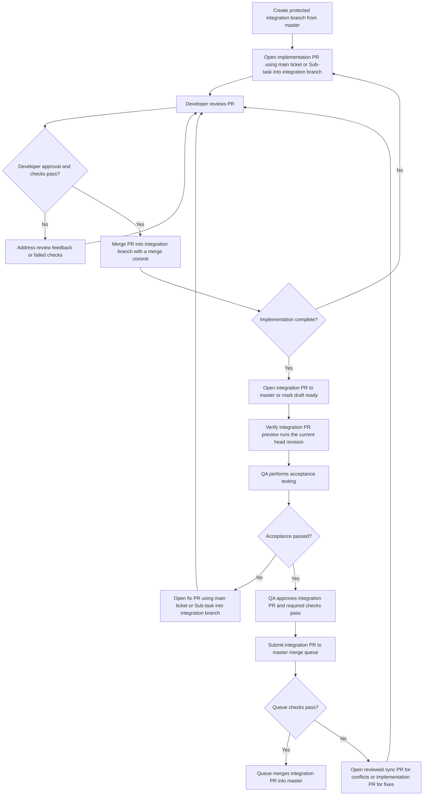

# Development Process

This guide covers pull requests, integration branches, syncs from `master`, required CI checks, and the merge queue. For test and production releases, see the [Deployment Process](deployment.md).

## Pull Requests

Developer pull requests fall into two categories:

| PR destination | Required approval | Required checks | Merge process |
| --- | --- | --- | --- |
| Into an integration branch, including implementation and sync PRs | Developer code review | All required status checks | Create a merge commit for every PR |
| From a completed integration branch into `master` | QA approval | All required status checks, including source-branch validation and merge-queue checks | Submit to the `master` merge queue |

Developer review checks each change before it enters the integration branch. QA approves the completed parent ticket on the integration PR to `master`. These approvals occur at different stages; each PR requires the approval for its destination. All PRs into integration branches use **Create a merge commit**, so implementation and sync PRs follow one merge policy that preserves ancestry. See [Development and QA approvals](pull-request-approvals.md) for the ruleset configuration.

The merge queue coordinates integration branch merges into `master`. After QA approval and passing PR checks, the queue tests the combined result against the latest `master` and earlier queued changes before merging it.

Every PR must pass the required Elixir and TypeScript status checks, including builds, unit tests, and TypeScript lint checks. These checks start automatically when a PR is created. Coveralls and GitGuardian provide additional information; developers and reviewers decide whether their findings block the PR.

PRs targeting `master` must also pass **Validate master source branch**. For developer work, the source must be an integration branch matching `integ-*`, `story/*`, `bug/*`, or `task/*`, case-insensitively. Together with integration branch protections that require developer review and passing checks and block direct or bypass pushes, this ensures developer changes reaching `master` have passed through the integration workflow. QA then approves the integrated result. The source-name check alone does not verify review history or the Jira issue type.

Automated `dependabot/*` updates are an explicit exception to the integration-source requirement. The validator runs when a PR is opened, updated with new commits, reopened, or edited. See [Naming](#naming) for examples and [Rollout requirements](#rollout-requirements) for the protections, CI coverage, and merge-queue support that must be configured to enforce this process.

## Integration Branches

Every Jira Story, Bug, and Task has its own protected integration branch matching `integ-*`, `story/*`, `bug/*`, or `task/*`. Prefer the issue type and key for new branches, such as `story/MER-1000-student-dashboard`; an explicitly chosen `integ-MER-1000-student-dashboard` is also supported. All integration branches ultimately target `master` through a PR and the merge queue.

Developers decide whether to split each Story, Bug, or Task into zero or more child Sub-tasks. Implementation may use the main ticket directly; creating a Sub-task is not a prerequisite. Syncs from `master`, including conflict resolution, use the parent ticket directly and require no separate child Sub-task. Each implementation branch starts from the parent's integration branch, and its PR targets that integration branch. This applies even to a small bug fix, chore, or ticket with only one implementation PR. An Epic may contain multiple parent tickets; it does not receive one shared integration branch.

Integration branch protections must require PRs, developer code review approvals, and status checks. Block direct pushes, including maintainer pushes that bypass review. Once implementation is complete, open the integration PR to `master` for acceptance testing, or mark an existing draft PR ready for review. Acceptance testing and QA approval must pass before the PR enters the merge queue.

### Process Diagram

An integration PR may be opened as a draft during development when a preview deployment of the combined work is useful. Otherwise, open it when implementation is complete. Keep it open throughout acceptance testing and any fixes.



### Naming

Prefer the Jira issue type, issue key, and a short description for new integration branches; explicitly chosen `integ-*` names are also supported:

| Pattern | Purpose | Example |
| --- | --- | --- |
| `story/*` | Story integration branch | `story/MER-1000-student-dashboard` |
| `bug/*` | Bug integration branch | `bug/MER-1002-fix-dashboard-loading` |
| `task/*` | Task integration branch for chores, DevOps, and other work | `task/MER-1003-update-build-tools` |
| `integ-*` | Integration branch with an explicitly chosen name | `integ-MER-1000-student-dashboard` |
| `dependabot/*` | Automated dependency updates allowed into `master` | `dependabot/npm_and_yarn/assets/example-1.2.3` |

Prefix matching is case-insensitive, so `Story/MER-1000-student-dashboard` also passes. Prefer lowercase prefixes for consistency. The workflow no longer imposes the old lowercase, hyphen-separated suffix restriction on `integ-*` branches.

For implementation using the main ticket, `MER-1000-student-dashboard` is a suggested working-branch name. When using a child Sub-task, retain the `sub-task/MER-1001-dashboard-skeleton` convention. Working-branch names are not enforced; keep the working and integration branch refs distinct. Use `sync/<parent-issue-key>-<summary>` for downmerging `master` and resolving conflicts. All implementation and sync PRs target the integration branch and cannot merge directly into `master`. The sync branch copies the parent integration branch's ticket key and summary, replacing only the type prefix with `sync/`, and is reused across syncs. Reference the same parent ticket in the sync PR; no child Sub-task is required for a sync. Dependabot branches remain an automated dependency-update exception to the developer implementation workflow.

### Jira Branch-name Preference

Each teammate can configure the branch name in Jira's suggested Git command from a ticket's **Development → Create branch** dropdown:

1. Open the branch-name format settings beside the Git create-and-checkout command.
2. Set the format to **Issue type / Issue key - Issue summary**.
3. Check the preview and select **Save**.

For a Story, this produces a name such as `story/MER-1000-student-dashboard`. A Task produces `task/*`; a Sub-task produces `sub-task/*`. The preference is [per user](https://support.atlassian.com/jira/kb/how-to-alter-the-branch-name-format-in-the-create-branch-option-in-development-panel/), so each teammate must save it.

This preference applies only to the suggested Git command. **Create branch in GitHub** does not use it and can still prefill the unprefixed `MER-...` name; Atlassian tracks this limitation in [JRACLOUD-86016](https://jira.atlassian.com/browse/JRACLOUD-86016). For an integration branch in that dialog, add the appropriate issue-type prefix or use an explicitly chosen `integ-*` name. For a working branch using the main ticket, the unprefixed `MER-...` name is suitable; remove the integration prefix if copying the suggested command. For a sync branch, replace the parent integration branch's type prefix with `sync/`, preserving its ticket key and summary. Reuse that branch when it already exists. Alternatively, run the suggested command locally and push the branch. Check that the source is `master` for a new integration branch, or the parent integration branch for a new implementation or sync branch.

### Creating an Integration Branch

Create the integration branch from `master` using the main ticket's type and key, or an explicitly chosen `integ-*` name. The ruleset must protect it from subsequent direct pushes as soon as it exists. Creating the branch establishes its starting point; implementation changes arrive through PRs referencing the main ticket or a chosen Sub-task, and syncs from `master` arrive through sync PRs referencing the parent ticket.

```
git fetch origin
git switch -c story/MER-1000-student-dashboard origin/master
git push -u origin story/MER-1000-student-dashboard
```

The same steps apply to `bug/*` and `task/*`. Implementation PRs provide previews of their own head branches. If a preview deployment of the integration branch is desired while development is ongoing, open a **draft PR to `master`** from that branch. Once implementation is complete, open the integration PR or mark the existing draft ready for review, then follow [QA Acceptance Testing](#qa-acceptance-testing).

### Using the Integration Branch Workflow Skill

Use `integration_branch_workflow` from `.agents/skills/integration_branch_workflow` in an oli-torus checkout or worktree to prepare integration, working, and sync branches. Invoke it explicitly with `$integration_branch_workflow`, or use a request like these:

| Goal | Example request |
| --- | --- |
| Start a parent ticket | "Set up branches for MER-1000" or "Create an integration branch for MER-1000" |
| Work directly on the main ticket | "Set up branches for MER-1000 without subtasks" |
| Work on a specific child Sub-task | "Set up branches for MER-1000 and use Sub-task MER-1001" |
| Sync with master | "Sync MER-1000 integration branch" or "Pull the latest from master into my integration branch" |

For setup, the skill creates or reuses the integration branch, defaulting new branches to `origin/master`. It then creates or reuses a working branch based on that integration branch and checks it out. With no Sub-tasks, or an explicit choice to work directly on the main ticket, it uses the main ticket key without offering or requiring a Sub-task. For example, you can request `integ-MER-1000-student-dashboard` and `MER-1000-student-dashboard`. When Sub-tasks exist and you have not chosen to use the main ticket, it retains the existing selection behavior: honor a selected child, use a single active child, or choose the first unstarted child by ticket number when several exist. Creating a new Sub-task requires an explicit request and approval of its draft. Setup prepares local branches; request publication separately.

For syncing, the skill creates or reuses `sync/<parent-issue-key>-<summary>` with the same summary as the parent branch, incorporates the latest integration tip and `master`, and opens or updates a PR targeting the integration branch. It uses the parent ticket directly and requires no sync Sub-task. If conflicts occur, it presents this menu:

1. (a)utomatic
2. (m)anual

Reply with `1` or `a` for automatic resolution, or `2` or `m` to pause while you resolve and stage the conflicts. Reply when ready to resume. The skill verifies the result before publishing the sync PR, which requires developer review, status checks, and a merge commit.

Git is required for branch operations, and authenticated GitHub access through `gh` is needed for sync PRs. An installed, authenticated `jira` CLI enables ticket lookups and approved Jira changes. When it is unavailable, the skill skips those steps, explains any manual Jira actions, and continues with the ticket details available. You may need to supply a ticket type, summary, or child key before the corresponding branch can be created.

### Implementation with or without Sub-tasks

Each implementation branch starts from the integration branch. Without a Sub-task, use the main ticket in the PR title and description:

```sh
git fetch origin
git switch -c MER-1000-student-dashboard origin/story/MER-1000-student-dashboard
# ...commit and push...
gh pr create --base story/MER-1000-student-dashboard --title "[FEATURE] [MER-1000] Student dashboard"
```

When developers choose Sub-tasks, implement each child on a separate branch from the same integration branch and reference that child in its PR:

```
git fetch origin
git switch -c sub-task/MER-1001-dashboard-skeleton origin/story/MER-1000-student-dashboard
# ...commit and push...
gh pr create --base story/MER-1000-student-dashboard --title "[FEATURE] [MER-1001] Dashboard skeleton"
```

Implementation PRs into an integration branch receive developer code review and use **Create a merge commit** after developer approval and required status checks pass. Each PR gets its own preview environment. This same merge method applies to sync PRs.

When a PR depends on another PR that has not merged yet, branch from that PR's branch but still open the PR against the integration branch (its diff includes the other PR's commits until that one merges). The prerequisite's merge commit preserves those commits, so merging it does not require rebasing the dependent branch. If the dependent branch needs newer integration changes, merge the integration branch into it and push normally.

### Keeping an Integration Branch in Sync with `master`

The `master` merge queue validates completed integration PRs against the latest `master` and any earlier queued changes. It does not continually update the integration branch itself. To update an integration branch with the latest `master`, create or reuse its `sync/<parent-issue-key>-<summary>` branch and merge `master` into that sync branch. Create a new sync branch from the integration branch only when it does not already exist locally or remotely. If the integration branch already contains the latest `master`, no sync PR is needed.

In this example, `MER-1000` is the parent integration ticket used in both the reusable branch name and the sync PR title. The summary `student-dashboard` matches the parent branch `story/MER-1000-student-dashboard`. Start the PR description with a link to that parent ticket. For the first sync, when the branch does not yet exist:

```
git fetch origin
git switch -c sync/MER-1000-student-dashboard origin/story/MER-1000-student-dashboard
git merge --no-ff origin/master
# Resolve conflicts, stage the resolved files, and complete the merge commit.
git push -u origin sync/MER-1000-student-dashboard
gh pr create --base story/MER-1000-student-dashboard --head sync/MER-1000-student-dashboard --title "[SYNC] [MER-1000] Sync master into student dashboard"
```

For later syncs, reuse the same branch without resetting or overwriting its history. If it exists only remotely, create a local tracking branch. Incorporate the latest integration tip before merging `master`; after the previous sync PR has merged, this normally fast-forwards:

```sh
git fetch origin
git switch sync/MER-1000-student-dashboard
git merge --ff-only origin/story/MER-1000-student-dashboard
git merge --no-ff origin/master
# Resolve any conflicts, run the required checks, and complete the merge.
git push origin sync/MER-1000-student-dashboard
```

If the sync branch has diverged from the integration branch, inspect the outstanding work and merge the integration tip into the sync branch with `--no-ff` instead of resetting or force-pushing. Reconcile any remote sync branch updates before pushing. Update an existing open sync PR, or create a new PR against the integration branch if the previous one was merged or closed. Inspect any unmerged work from a closed PR before carrying it forward. Keep the sync branch for later updates while the parent ticket remains active. Every sync PR references that same parent ticket and uses the `[SYNC]` change type.

Obtain developer code review approval for the sync PR and run the same required status checks as other PRs targeting the integration branch. Merge it using **Create a merge commit**, preserving the merge from `master`. Squashing or rebasing the sync PR discards that ancestry and can make later syncs repeat conflicts. All PRs into integration branches use merge commits. Repository settings and integration branch rules must permit this method and non-linear history.

After the sync PR merges, repeat acceptance testing on the updated integration preview if QA testing has already begun. Obtain renewed QA approval and passing checks before submitting the integration PR to the `master` merge queue. Never push the resolved changes directly to the integration branch or `master`.

### CI for Integration Branches

All integration branches require PRs, developer code review approvals, and passing status checks, including `Elixir build and test` and `TypeScript build and test`. Direct pushes and force pushes are blocked; deletion remains restricted until the integration PR has merged. Configure the additional prefixes before relying on these protections. These requirements apply to both implementation and sync PRs.

Build, Playwright, and PR-title workflows run for PRs targeting `master`, `integ-*`, `story/*`, `bug/*`, and `task/*`. Build and Playwright also run on pushes to those integration branches. These workflow filters use lowercase prefixes, even though the master source-name validator accepts case variants. The PR checks no longer target `hotfix-*`, `prerelease-*`, or `nextgen-ux`.

| Event | What runs |
| --- | --- |
| PR into `integ-*`, `story/*`, `bug/*`, or `task/*` | Build and tests, PR Playwright suite, PR title validation, Danger, AI review, and a preview environment |
| Push to `integ-*`, `story/*`, `bug/*`, or `task/*` (every merge into it) | Build and tests and the PR Playwright suite, to verify the combined result of the merged PRs |
| Completed integration PR from `integ-*` into `master` | Build and tests, PR Playwright suite, PR title validation, source branch validation, and a preview environment. Danger and AI review are skipped because every change on the branch already went through them in its own PR |

PRs from the new prefixes into `master` receive the normal master PR checks, including **Validate master source branch**. The existing Danger and AI review skip conditions apply only to `integ-*` sources.

Every required check for `master` must also report on the merge queue's `merge_group` event. Build and Playwright already have that trigger. The new source-branch validator currently handles only `pull_request`, so merge-queue support is a rollout prerequisite. Queue refs are generated by GitHub and must not be mistaken for the original PR's source branch. See [GitHub's merge queue CI requirements](https://docs.github.com/en/repositories/configuring-branches-and-merges-in-your-repository/configuring-pull-request-merges/managing-a-merge-queue#configuring-continuous-integration-ci-workflows-for-merge-queues).

### Rollout Requirements

The workflow file alone does not configure GitHub rulesets or personal Jira preferences. Complete the following rollout work tracked in [MER-6050](https://eliterate.atlassian.net/browse/MER-6050):

1. Extend the integration branch ruleset targets to cover `integ-*`, `story/*`, `bug/*`, and `task/*`, including case variants. Require PRs, developer code review approvals, and status checks, and block direct pushes, including bypass pushes. Retain force-push and deletion restrictions. Require merge commits for all PRs into integration branches, including implementation and sync PRs; enable this method in repository settings and do not require linear history on integration branches. See `guides/process/pull-request-approvals.md` for targeting details.
2. Deploy the updated branch filters in `.github/workflows/build.yml`, `.github/workflows/pr-playwright.yml`, and `.github/workflows/validate_pr_title.yml`. Verify PR checks and post-merge checks on integration branches. Add workflow filter coverage for case variants before relying on mixed-case prefixes.
3. Make all required master checks report on `merge_group`, including **Validate master source branch**, and verify a queued integration PR can complete. The validator must still enforce allowed source names on PRs and handle queue events separately. After verification, require QA approval, this check, and the merge queue in the ruleset targeting only `master`. Remove any required check that refers to the deleted integration-name validator.
4. Notify the team that Story, Bug, and Task implementation work uses the main ticket or optional child Sub-tasks in PRs into protected integration branches, followed by a completed integration PR through the master merge queue. Sync PRs reference the parent ticket directly. Explain the sync PR process and Jira preference steps above. The preference is per user and changes only the suggested Git command; check the source and name in the **Create branch in GitHub** dialog for the intended branch role.

### QA Acceptance Testing

Once all implementation PRs have merged, open the integration PR against `master` or mark an existing draft ready for review. Keep it open while QA tests the complete parent Story, Bug, or Task. Even work with only one implementation PR follows this process.

1. In the QA handoff, identify the parent ticket and acceptance criteria, integration PR, integration branch, current head commit SHA, and Plasma preview URL: `https://preview-<integration-pr-number>.plasma.oli.cmu.edu/`. Use the integration PR's preview to test the combined work. An implementation PR's preview runs its working branch; Tokamak runs `master`.
2. Wait for the preview build and deployment of that revision. Confirm the running preview image matches the integration PR's head SHA before testing; its image tag is `preview-<integration-pr-number>-<short-head-sha>`. The **Build Preview Image** workflow records the source SHA and preview URL, but its successful deployment status means the image was published; Argo CD still needs to deploy it. Ask the deployment operator to verify the running image if needed.
3. QA tests the parent ticket's acceptance criteria and records the tested revision and results. If changes are needed, open fix PRs from working branches into the integration branch, using the main ticket or a chosen child Sub-task. Each fix receives developer review and passing checks, then merges with **Create a merge commit**.
4. After fixes or syncs change the integration branch, wait for its updated preview, verify the new revision, and repeat acceptance testing. QA approves the integration PR only after the current revision passes. Changes after acceptance require testing and renewed QA approval before merging.

### Merging an Integration Branch to `master`

When implementation is complete, open the integration PR against `master` for acceptance testing, using the parent ticket in the title and description. If a draft PR already provides the integration preview, mark that PR ready for review instead of creating another:

```
gh pr create --base master --head story/MER-1000-student-dashboard --title "[FEATURE] [MER-1000] Student dashboard"
```

After acceptance testing, QA approval, and the required status checks pass, use GitHub to add the PR to the `master` merge queue. The queue tests the combined result against current `master` and preceding queued PRs, then merges it using the configured queue merge method. This replaces the local maintainer merge-and-push process. If conflicts prevent merging, complete a sync PR into the integration branch. Fix any other implementation failures through implementation PRs using the main ticket or a chosen child Sub-task. Repeat acceptance testing on the updated preview and obtain renewed QA approval and passing checks before requeuing.

After the queue merges the PR, delete the integration branch through the repository's permitted cleanup process.

## Merging a Hotfix Back to master

After a hotfix release, merge the hotfix branch back to `master` so downstream development includes its changes. Create a protected integration branch from the hotfix branch named `bug/MER-XXXX-back-merge-X.Y.Z`, using the parent Jira ticket key. Track implementation changes using the main ticket or optional child Sub-tasks. Downmerge `master` and resolve conflicts through a reusable `sync/*` branch and PR referencing the parent ticket and targeting that integration branch, as described in [Keeping an Integration Branch in Sync with master](#keeping-an-integration-branch-in-sync-with-master). Once complete, open the integration PR against `master` and submit it to the merge queue after QA approval and required status checks pass. The previous `integrate-X.Y.Z` naming convention is not accepted by **Validate master source branch**.
